# Generated plays that worked · run 4

211 times a generated play succeeded in this run (100 different plays), during league training or the final evaluation. A generated play counts as successful when it reached its own success condition or gained at least 0.005 EPV. Below, the best instance of each play (by reward), with what the opponent was running and the play's full definition.

`generated_successes.html` has every clip with the decision inspector; download it and open it in a browser.

| Play | By | Against | Opponent's play | Why it counts | Reward | Stage |
|---|---|---|---|---|---|---|
| [`gen_336193263d`](#gen_336193263d) | main | league_exploiter | `low_block_box_protection` | reached its success condition; gained at least 0.005 EPV | +1.0333 | league (update 2) |
| [`gen_2856465b7a`](#gen_2856465b7a) | main | wing_play | `low_block_box_protection`, `mid_block_compact` | gained at least 0.005 EPV | +0.0305 | evaluation (update 6) |
| [`gen_d39a1932c1`](#gen_d39a1932c1) | main | high_press | `low_block_box_protection` | gained at least 0.005 EPV | +0.0197 | evaluation (update 6) |
| [`gen_263419283b`](#gen_263419283b) | main | library | `low_block_box_protection`, `mid_block_compact` | gained at least 0.005 EPV | +0.0154 | validation (update 6) |
| [`gen_f3a75dcb26`](#gen_f3a75dcb26) | main | main_exploiter | `low_block_box_protection`, `mid_block_compact` | reached its success condition; gained at least 0.005 EPV | +0.0152 | league (update 2) |
| [`gen_c053c815af`](#gen_c053c815af) | main | chaotic | `low_block_box_protection`, `mid_block_compact` | gained at least 0.005 EPV | +0.0145 | validation (update 6) |
| [`gen_0c12016b86`](#gen_0c12016b86) | main | main_exploiter | `low_block_box_protection`, `mid_block_compact` | gained at least 0.005 EPV | +0.0135 | league (update 5) |
| [`gen_d432cb40a7`](#gen_d432cb40a7) | league_exploiter | main | `low_block_box_protection`, `mid_block_compact` | gained at least 0.005 EPV | +0.0119 | league (update 4) |
| [`gen_ba9a71b7cc`](#gen_ba9a71b7cc) | main | direct | `low_block_box_protection` | gained at least 0.005 EPV | +0.0118 | league (update 2) |
| [`gen_3582dfc3a3`](#gen_3582dfc3a3) | main | library | `low_block_box_protection`, `mid_block_compact` | gained at least 0.005 EPV | +0.0117 | validation (update 6) |
| [`gen_ab0b8975ec`](#gen_ab0b8975ec) | main | wing_play | `low_block_box_protection`, `mid_block_compact` | reached its success condition; gained at least 0.005 EPV | +0.0093 | evaluation (update 6) |
| [`gen_0368324921`](#gen_0368324921) | main | mid_block | `mid_block_compact` | gained at least 0.005 EPV | +0.0089 | evaluation (update 6) |

## gen_336193263d

Called by **main** against **league_exploiter** (running `low_block_box_protection`); steps reached: s1 → s2; ended: success; reward +1.0333.

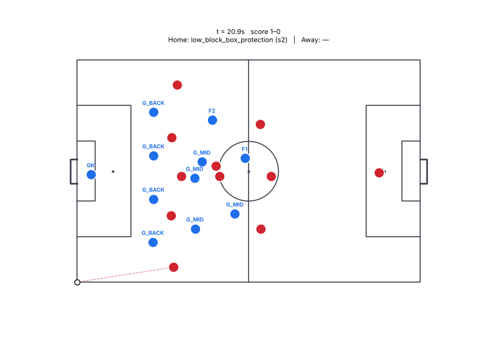

<details><summary>Play definition (YAML)</summary>

```yaml
id: gen_336193263d
name: Generated play
version: 1
phase: in_possession
objective: score
strategy: generated
fallback: false
roles:
- id: R1
  desc: ''
  hints:
  - AM
  - CM
  - ST
  requires:
    finishing: 0.4
  prefers: {}
  starts_with_ball: true
- id: R2
  desc: ''
  hints:
  - ST
  - AM
  - CM
  requires: {}
  prefers: {}
  starts_with_ball: false
triggers:
  all:
  - possession: us
  - has_ball: R1
hard_constraints: []
steps:
- id: s1
  choose:
  - when:
      xg:
        ref: role:R1
        gt: 0.06
    actions:
    - type: shoot
      role: R1
      placement: auto
  - when: always
    actions:
    - type: carry
      role: R1
      to:
        pc_best:
          zone: final_third.center
        score: pc_xt
      speed: fast
    - type: support
      role: R2
      from: R1
      angle: square
      distance: 8.0
  done_when:
    any:
    - event: shot_taken
    - step_elapsed_s:
        gt: 2.0
  timeout_s: 2.5
  on_timeout: abort
- id: s2
  choose:
  - when: always
    actions:
    - type: shoot
      role: R1
      placement: auto
  - when:
      lane_open:
        from: R1
        to:
          role: R2
        min_p: 0.6
    actions:
    - type: pass
      role: R1
      to:
        role: R2
      style: ground
  - when: always
    actions:
    - type: pass
      role: R1
      to:
        best_teammate:
          score: pass_p
      style: ground
  done_when:
    any:
    - event: shot_taken
    - event: pass_completed
    - event: pass_intercepted
  timeout_s: 3.0
  on_timeout: abort
success:
  any:
  - event: shot_taken
  - event: goal
abort:
  any:
  - event: possession_lost
  - event: ball_out
max_duration_s: 7.5
cooldown_s: 0.0
soft_hints:
  risk: 0.3
  chain_depth: 2
  tempo: fast
source: generated
```

</details>

## gen_2856465b7a

Called by **main** against **wing_play** (running `low_block_box_protection`, `mid_block_compact`); steps reached: s1 → s2 → s3; ended: step timeout abort; reward +0.0305.

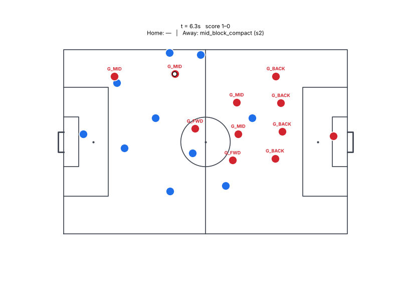

<details><summary>Play definition (YAML)</summary>

```yaml
id: gen_2856465b7a
name: Generated play
version: 1
phase: in_possession
objective: progress_ball
strategy: generated
fallback: false
roles:
- id: R1
  desc: ''
  hints:
  - FB_near
  - CB_near
  - DM
  requires: {}
  prefers: {}
  starts_with_ball: true
- id: R2
  desc: ''
  hints:
  - W_near
  - AM
  requires:
    first_touch: 0.5
  prefers: {}
  starts_with_ball: false
- id: R3
  desc: ''
  hints:
  - CM
  - AM
  - DM
  requires: {}
  prefers: {}
  starts_with_ball: false
triggers:
  all:
  - possession: us
  - has_ball: R1
hard_constraints: []
steps:
- id: s1
  actions:
  - type: check_to_ball
    role: R2
    distance: 8.0
    duration_s: 1.0
  - type: support
    role: R3
    from: R2
    angle: back_inside
    distance: 10.0
  done_when:
    step_elapsed_s:
      gt: 1.0
  timeout_s: 2.0
  on_timeout: abort
- id: s2
  choose:
  - when:
      lane_open:
        from: R1
        to:
          role: R2
        min_p: 0.7
    actions:
    - type: cutback
      role: R1
      to:
        role: R2
  - when: always
    actions:
    - type: pass
      role: R1
      to:
        role: R3
      style: ground
  done_when:
    any:
    - event: pass_completed
    - event: pass_intercepted
  timeout_s: 3.0
  on_timeout: abort
- id: s3
  choose:
  - when:
      all:
      - has_ball: R2
      - pressure_on:
          ref: role:R2
          gt: 3.0
    actions:
    - type: shoot
      actor: ball_holder
      placement: auto
  - when:
      lane_open:
        from: ball_holder
        to:
          role: R3
        min_p: 0.7
    actions:
    - type: shoot
      actor: ball_holder
      placement: auto
  - when: always
    actions:
    - type: pass
      actor: ball_holder
      to:
        space_behind:
          line: opp_last_line
          lane: center
          depth: 6.0
      style: through
  done_when:
    any:
    - event: pass_intercepted
  timeout_s: 3.0
  on_timeout: abort
- id: s4
  choose:
  - when:
      lane_open:
        from: ball_holder
        to:
          role: R3
        min_p: 0.65
    actions:
    - type: pass
      actor: ball_holder
      to:
        role: R3
      style: driven
  - when:
      lane_open:
        from: ball_holder
        to:
          role: R3
        min_p: 0.65
    actions:
    - type: pass
      actor: ball_holder
      to:
        best_teammate:
          score: pass_p
      style: ground
  - when: always
    actions:
    - type: pass
      actor: ball_holder
      to:
        best_teammate:
          score: pass_p
      style: lofted
  done_when:
    any:
    - event: pass_completed
    - event: shot_taken
    - event: pass_completed
  timeout_s: 4.0
  on_timeout: abort
success:
  any:
  - event: pass_intercepted
  - event: shot_taken
  - event: pass_intercepted
abort:
  any:
  - event: ball_out
max_duration_s: 14.0
cooldown_s: 0.0
soft_hints:
  risk: 0.3
  chain_depth: 4
  tempo: medium
source: generated
```

</details>

## gen_d39a1932c1

Called by **main** against **high_press** (running `low_block_box_protection`); steps reached: s1 → s2 → s3; ended: preempted; reward +0.0197.

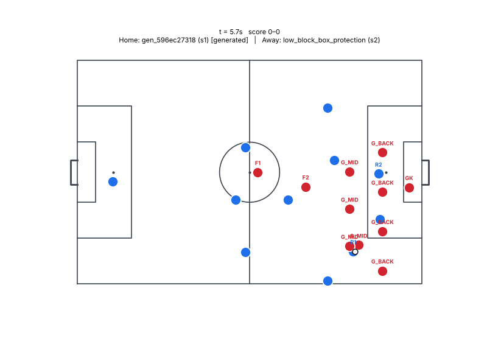

<details><summary>Play definition (YAML)</summary>

```yaml
id: gen_d39a1932c1
name: Generated play
version: 1
phase: in_possession
objective: progress_ball
strategy: generated
fallback: false
roles:
- id: R1
  desc: ''
  hints:
  - CM
  - AM
  - DM
  requires:
    passing: 0.6
    vision: 0.5
  prefers: {}
  starts_with_ball: true
- id: R2
  desc: ''
  hints:
  - ST
  - W_near
  - W_far
  requires:
    first_touch: 0.65
  prefers: {}
  starts_with_ball: false
- id: R3
  desc: ''
  hints:
  - W_far
  - AM
  - ST
  requires: {}
  prefers: {}
  starts_with_ball: false
triggers:
  all:
  - possession: us
  - has_ball: R1
hard_constraints: []
steps:
- id: s1
  actions:
  - type: check_to_ball
    role: R2
    distance: 3.0
    duration_s: 0.8
  - type: decoy_run
    role: R3
    to:
      anchor: line:opp_last_line
      offset:
      - -2.0
      - -12.0
  - type: carry
    role: R1
    to:
      anchor: ball
      offset:
      - 4.0
      - 0.0
    speed: jog
  done_when:
    step_elapsed_s:
      gt: 0.8
  timeout_s: 1.0
  on_timeout: abort
- id: s2
  choose:
  - when:
      xg:
        ref: ball_holder
        gt: 0.06
    actions:
    - type: shoot
      actor: ball_holder
      placement: auto
  - when: always
    actions:
    - type: pass
      actor: ball_holder
      to:
        best_teammate:
          score: xt
          zone: box
      style: ground
  done_when:
    any:
    - event: shot_taken
    - event: pass_completed
  timeout_s: 2.5
  on_timeout: abort
- id: s3
  choose:
  - when:
      lane_open:
        from: R1
        to:
          space_behind:
            line: opp_last_line
            lane: center
            depth: 10.0
        min_p: 0.4
    actions:
    - type: carry
      role: R1
      to:
        anchor: ball
        offset:
        - 4.0
        - -4.0
      speed: jog
  - when:
      lane_open:
        from: R1
        to:
          space_behind:
            line: opp_last_line
            lane: center
            depth: 10.0
        min_p: 0.4
    actions:
    - type: carry
      role: R1
      to:
        pc_best:
          zone: final_third.far_wing
        score: pc_xt
      speed: fast
  - when: always
    actions:
    - type: carry
      role: R1
      to:
        anchor: ball
        offset:
        - 4.0
        - 0.0
      speed: jog
  done_when:
    any:
    - event: pass_completed
  timeout_s: 3.0
  on_timeout: abort
- id: s4
  choose:
  - when:
      xg:
        ref: ball_holder
        gt: 0.06
    actions:
    - type: carry
      role: R1
      to:
        anchor: ball
        offset:
        - 4.0
        - 0.0
      speed: jog
  - when: always
    actions:
    - type: shoot
      actor: ball_holder
      placement: auto
  done_when:
    any:
    - event: shot_taken
    - ball_in_zone: box
  timeout_s: 4.0
  on_timeout: abort
success:
  any:
  - event: shot_taken
  - event: shot_taken
  - event: shot_taken
abort:
  event: ball_out
max_duration_s: 12.5
cooldown_s: 0.0
soft_hints:
  risk: 0.6
  chain_depth: 4
  tempo: fast
source: generated
```

</details>

## gen_263419283b

Called by **main** against **library** (running `low_block_box_protection`, `mid_block_compact`); steps reached: s1; ended: step timeout abort; reward +0.0154.

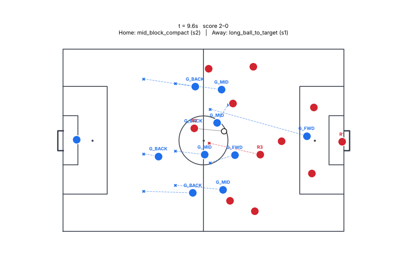

<details><summary>Play definition (YAML)</summary>

```yaml
id: gen_263419283b
name: Generated play
version: 1
phase: in_possession
objective: create_chance
strategy: generated
fallback: false
roles:
- id: R1
  desc: ''
  hints:
  - AM
  - W_near
  - CM
  requires:
    passing: 0.4
  prefers: {}
  starts_with_ball: true
- id: R2
  desc: ''
  hints:
  - ST
  - AM
  - CM
  requires:
    first_touch: 0.5
  prefers: {}
  starts_with_ball: false
triggers:
  all:
  - possession: us
  - has_ball: R1
hard_constraints: []
steps:
- id: s1
  actions:
  - type: pass
    role: R1
    to:
      role: R2
    style: ground
  done_when:
    event: pass_completed
  timeout_s: 2.0
  on_timeout: abort
- id: s2
  actions:
  - type: run_to
    role: R1
    to:
      anchor: role:R1
      offset:
      - 8.0
      - 0.0
    speed: max
  done_when:
    lane_open:
      from: R2
      to:
        role: R1
        lead: 3.0
      min_p: 0.6
  timeout_s: 1.5
  on_timeout: abort
- id: s3
  actions:
  - type: pass
    role: R2
    to:
      role: R1
      lead: 3.0
    style: ground
    one_touch: true
  done_when:
    has_ball: R1
  timeout_s: 2.0
  on_timeout: abort
- id: s4
  choose:
  - when:
      xg:
        ref: role:R1
        gt: 0.08
    actions:
    - type: shoot
      role: R1
      placement: auto
  - when: always
    actions:
    - type: carry
      role: R1
      to:
        pc_best:
          zone: box
        score: pc_xt
      speed: fast
  done_when:
    any:
    - event: shot_taken
    - ball_in_zone: box
  timeout_s: 3.0
  on_timeout: abort
- id: s5
  choose:
  - when:
      xg:
        ref: role:R1
        gt: 0.08
    actions:
    - type: carry
      role: R1
      to:
        anchor: ball
        offset:
        - 8.0
        - 0.0
      speed: jog
    - type: carry
      role: R1
      to:
        anchor: ball
        offset:
        - 12.0
        - 0.0
      speed: jog
  - when: always
    actions:
    - type: pass
      role: R1
      to:
        role: R1
        lead: 3.0
      style: ground
  done_when:
    any:
    - event: pass_completed
    - step_elapsed_s:
        gt: 2.0
  timeout_s: 3.0
  on_timeout: abort
success:
  ball_in_zone: box
abort:
  event: possession_lost
max_duration_s: 13.5
cooldown_s: 0.0
soft_hints:
  risk: 0.3
  chain_depth: 5
  tempo: fast
source: generated
```

</details>

## gen_f3a75dcb26

Called by **main** against **main_exploiter** (running `low_block_box_protection`, `mid_block_compact`); steps reached: s1; ended: success; reward +0.0152.

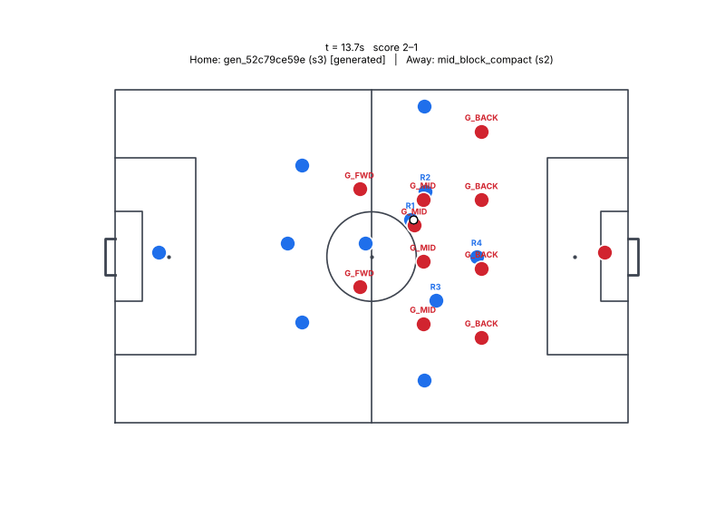

<details><summary>Play definition (YAML)</summary>

```yaml
id: gen_f3a75dcb26
name: Generated play
version: 1
phase: in_possession
objective: create_chance
strategy: generated
fallback: false
roles:
- id: R1
  desc: ''
  hints:
  - AM
  - W_near
  - CM
  requires:
    passing: 0.4
  prefers: {}
  starts_with_ball: true
- id: R2
  desc: ''
  hints:
  - ST
  - AM
  - CM
  requires:
    first_touch: 0.5
  prefers: {}
  starts_with_ball: false
triggers:
  all:
  - possession: us
  - has_ball: R1
hard_constraints: []
steps:
- id: s1
  actions:
  - type: pass
    role: R1
    to:
      role: R2
    style: ground
  done_when:
    event: pass_completed
  timeout_s: 2.0
  on_timeout: abort
- id: s2
  choose:
  - when:
      lane_open:
        from: R1
        to:
          space_behind:
            line: opp_last_line
            lane: center
            depth: 8.0
        min_p: 0.45
    actions:
    - type: run_to
      role: R1
      to:
        anchor: ball
        offset:
        - 2.0
        - 0.0
      speed: jog
    - type: hold_position
      role: R1
      to:
        anchor: role:R1
        offset:
        - 8.0
        - 0.0
    - type: cutback
      role: R1
      to:
        space_behind:
          line: opp_last_line
          lane: center
          depth: 8.0
  - when: always
    actions:
    - type: shoot
      role: R1
      placement: auto
  done_when:
    lane_open:
      from: R1
      to:
        role: R1
        lead: 2.0
      min_p: 0.6
  timeout_s: 1.5
  on_timeout: abort
- id: s3
  choose:
  - when:
      xg:
        ref: role:R1
        gt: 0.08
    actions:
    - type: carry
      role: R1
      to:
        anchor: ball
        offset:
        - 10.0
        - 0.0
      speed: jog
  - when: always
    actions:
    - type: carry
      role: R1
      to:
        anchor: ball
        offset:
        - 12.0
        - 0.0
      speed: jog
  done_when:
    event: pass_completed
  timeout_s: 3.0
  on_timeout: abort
- id: s4
  actions:
  - type: carry
    role: R1
    to:
      anchor: ball
      offset:
      - 10.0
      - 0.0
    speed: jog
  done_when:
    any:
    - event: shot_taken
    - ball_in_zone: box
  timeout_s: 3.0
  on_timeout: abort
success:
  event: pass_completed
abort:
  event: possession_lost
max_duration_s: 11.5
cooldown_s: 0.0
soft_hints:
  risk: 0.3
  chain_depth: 4
  tempo: fast
source: generated
```

</details>

## gen_c053c815af

Called by **main** against **chaotic** (running `low_block_box_protection`, `mid_block_compact`); steps reached: s1; ended: step timeout abort; reward +0.0145.

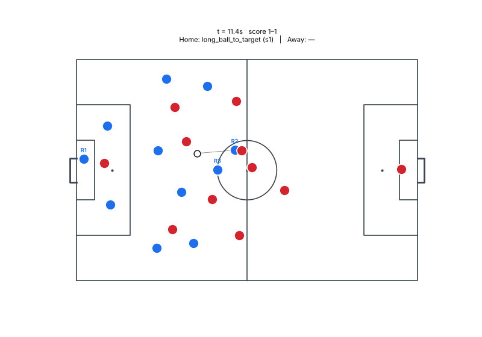

<details><summary>Play definition (YAML)</summary>

```yaml
id: gen_c053c815af
name: Generated play
version: 1
phase: in_possession
objective: create_chance
strategy: generated
fallback: false
roles:
- id: R1
  desc: ''
  hints:
  - AM
  - W_near
  - CM
  requires:
    passing: 0.4
  prefers: {}
  starts_with_ball: true
- id: R2
  desc: ''
  hints:
  - ST
  - AM
  - CM
  requires:
    first_touch: 0.5
  prefers: {}
  starts_with_ball: false
triggers:
  all:
  - possession: us
  - has_ball: R1
hard_constraints: []
steps:
- id: s1
  actions:
  - type: pass
    role: R1
    to:
      role: R2
    style: ground
  done_when:
    event: pass_completed
  timeout_s: 2.0
  on_timeout: abort
- id: s2
  actions:
  - type: run_to
    role: R1
    to:
      anchor: role:R1
      offset:
      - 8.0
      - 0.0
    speed: max
  done_when:
    lane_open:
      from: R2
      to:
        role: R1
        lead: 3.0
      min_p: 0.6
  timeout_s: 1.5
  on_timeout: abort
- id: s3
  actions:
  - type: pass
    role: R2
    to:
      role: R1
      lead: 3.0
    style: ground
    one_touch: true
  done_when:
    has_ball: R1
  timeout_s: 2.0
  on_timeout: abort
- id: s4
  choose:
  - when:
      xg:
        ref: role:R1
        gt: 0.08
    actions:
    - type: shoot
      role: R1
      placement: auto
  - when: always
    actions:
    - type: carry
      role: R1
      to:
        pc_best:
          zone: box
        score: pc_xt
      speed: fast
  done_when:
    any:
    - event: shot_taken
    - ball_in_zone: box
  timeout_s: 3.0
  on_timeout: abort
success:
  event: shot_taken
abort:
  event: possession_lost
max_duration_s: 10.5
cooldown_s: 0.0
soft_hints:
  risk: 0.3
  chain_depth: 4
  tempo: fast
source: generated
```

</details>

## gen_0c12016b86

Called by **main** against **main_exploiter** (running `low_block_box_protection`, `mid_block_compact`); steps reached: s1; ended: step timeout abort; reward +0.0135.

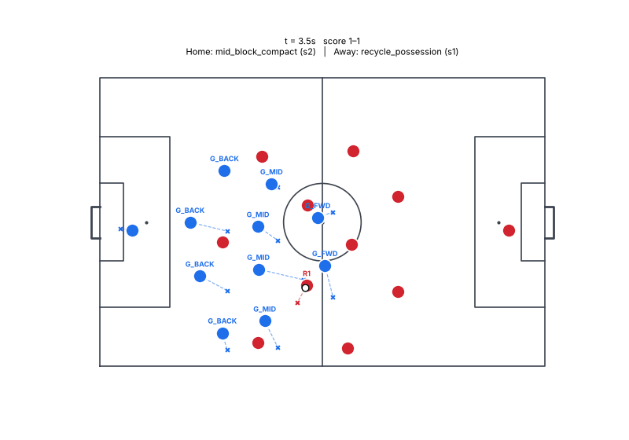

<details><summary>Play definition (YAML)</summary>

```yaml
id: gen_0c12016b86
name: Generated play
version: 1
phase: in_possession
objective: create_chance
strategy: generated
fallback: false
roles:
- id: R1
  desc: ''
  hints:
  - AM
  - W_near
  - CM
  requires:
    passing: 0.4
  prefers: {}
  starts_with_ball: true
- id: R2
  desc: ''
  hints:
  - ST
  - AM
  - CM
  requires:
    first_touch: 0.5
  prefers: {}
  starts_with_ball: false
triggers:
  all:
  - possession: us
  - has_ball: R1
hard_constraints: []
steps:
- id: s1
  actions:
  - type: pass
    role: R1
    to:
      role: R2
    style: ground
  done_when:
    event: pass_completed
  timeout_s: 2.0
  on_timeout: abort
- id: s2
  actions:
  - type: run_to
    role: R1
    to:
      anchor: role:R1
      offset:
      - 8.0
      - 0.0
      freeze: step_start
    speed: max
  done_when:
    lane_open:
      from: R2
      to:
        role: R1
        lead: 3.0
      min_p: 0.6
  timeout_s: 1.5
  on_timeout: abort
- id: s3
  actions:
  - type: pass
    role: R2
    to:
      role: R1
      lead: 3.0
    style: ground
    one_touch: true
  done_when:
    has_ball: R1
  timeout_s: 2.0
  on_timeout: abort
- id: s4
  choose:
  - when:
      xg:
        ref: role:R1
        gt: 0.08
    actions:
    - type: shoot
      role: R1
      placement: auto
  - when: always
    actions:
    - type: carry
      role: R1
      to:
        pc_best:
          zone: box
        score: pc_xt
      speed: fast
  done_when:
    any:
    - event: shot_taken
    - ball_in_zone: box
  timeout_s: 3.0
  on_timeout: abort
success:
  event: shot_taken
abort:
  event: possession_lost
max_duration_s: 10.5
cooldown_s: 0.0
soft_hints:
  risk: 0.3
  chain_depth: 4
  tempo: fast
source: generated
```

</details>

## gen_d432cb40a7

Called by **league_exploiter** against **main** (running `low_block_box_protection`, `mid_block_compact`); steps reached: s1; ended: step timeout abort; reward +0.0119.

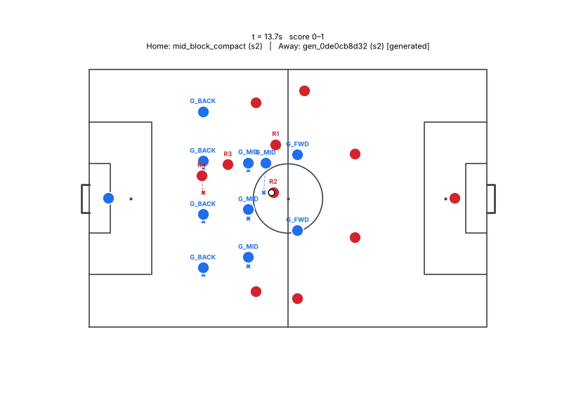

<details><summary>Play definition (YAML)</summary>

```yaml
id: gen_d432cb40a7
name: Generated play
version: 1
phase: in_possession
objective: create_chance
strategy: generated
fallback: false
roles:
- id: R1
  desc: ''
  hints:
  - AM
  - W_near
  - CM
  requires:
    passing: 0.4
  prefers: {}
  starts_with_ball: true
- id: R2
  desc: ''
  hints:
  - ST
  - AM
  - CM
  requires:
    first_touch: 0.5
  prefers: {}
  starts_with_ball: false
triggers:
  all:
  - possession: us
  - has_ball: R1
hard_constraints: []
steps:
- id: s1
  actions:
  - type: pass
    role: R1
    to:
      role: R2
    style: ground
  done_when:
    event: pass_completed
  timeout_s: 2.0
  on_timeout: abort
- id: s2
  actions:
  - type: pass
    actor: ball_holder
    to:
      role: R1
      lead: 3.0
    style: ground
    one_touch: true
  done_when:
    has_ball: R1
  timeout_s: 2.0
  on_timeout: abort
- id: s3
  choose:
  - when:
      xg:
        ref: ball_holder
        gt: 0.1
    actions:
    - type: pass
      actor: ball_holder
      to:
        role: R1
        lead: 2.0
      style: ground
      one_touch: true
  - when: always
    actions:
    - type: shoot
      actor: ball_holder
      placement: auto
  done_when:
    any:
    - event: pass_completed
  timeout_s: 2.5
  on_timeout: abort
- id: s4
  actions:
  - type: shoot
    actor: ball_holder
    placement: auto
  done_when:
    any:
    - event: pass_completed
    - pressure_on:
        ref: role:R2
        lt: 2.0
  timeout_s: 3.0
  on_timeout: abort
success:
  any:
  - event: ball_out
abort:
  any:
  - event: ball_out
max_duration_s: 11.5
cooldown_s: 0.0
soft_hints:
  risk: 0.3
  chain_depth: 4
  tempo: fast
source: generated
```

</details>

## gen_ba9a71b7cc

Called by **main** against **direct** (running `low_block_box_protection`); steps reached: s1; ended: abort; reward +0.0118.

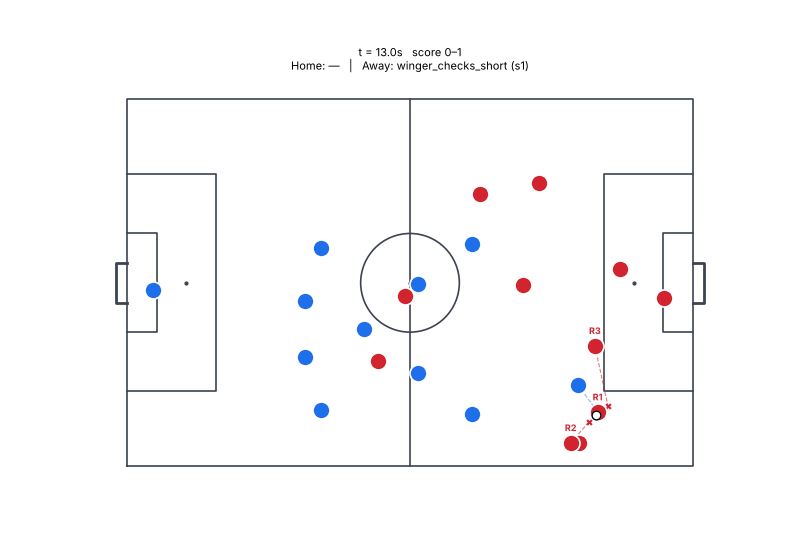

<details><summary>Play definition (YAML)</summary>

```yaml
id: gen_ba9a71b7cc
name: Generated play
version: 1
phase: transition_attack
objective: create_chance
strategy: generated
fallback: false
roles:
- id: R1
  desc: ''
  hints:
  - DM
  - CM
  - CB_near
  requires: {}
  prefers: {}
  starts_with_ball: true
- id: R2
  desc: ''
  hints:
  - ST
  - W_near
  - W_far
  requires:
    pace: 0.6
  prefers: {}
  starts_with_ball: false
- id: R3
  desc: ''
  hints:
  - W_far
  - W_near
  - AM
  requires:
    pace: 0.5
  prefers: {}
  starts_with_ball: false
- id: R4
  desc: ''
  hints:
  - AM
  - CM
  requires: {}
  prefers: {}
  starts_with_ball: false
triggers:
  all:
  - possession: us
  - has_ball: R1
  - event:
      type: possession_won
      within_s: 2.0
hard_constraints: []
steps:
- id: s1
  choose:
  - when:
      lane_open:
        from: ball_holder
        to:
          role: R4
        min_p: 0.65
    actions:
    - type: shoot
      actor: ball_holder
      placement: auto
  - when: always
    actions:
    - type: shoot
      actor: ball_holder
      placement: auto
  done_when:
    step_elapsed_s:
      gt: 2.0
  timeout_s: 3.0
  on_timeout: abort
- id: s2
  choose:
  - when:
      lane_open:
        from: R1
        to:
          space_behind:
            line: opp_last_line
            lane: center
            depth: 8.0
        min_p: 0.45
    actions:
    - type: carry
      role: R1
      to:
        anchor: ball
        offset:
        - 4.0
        - -12.0
      speed: max
    - type: pass
      role: R1
      to:
        space_behind:
          line: opp_last_line
          lane: center
          depth: 8.0
      style: through
  - when:
      lane_open:
        from: R1
        to:
          role: R4
        min_p: 0.75
    actions:
    - type: pass
      role: R1
      to:
        space_behind:
          line: opp_last_line
          lane: center
          depth: 6.0
      style: lofted
  - when: always
    actions:
    - type: pass
      actor: ball_holder
      to:
        space_behind:
          line: opp_last_line
          lane: center
          depth: 8.0
      style: lofted
  done_when:
    any:
    - event: pass_completed
  timeout_s: 3.0
  on_timeout: abort
- id: s3
  choose:
  - when:
      has_ball: R4
    actions:
    - type: shoot
      actor: ball_holder
      placement: auto
  - when: always
    actions:
    - type: shoot
      actor: ball_holder
      placement: auto
  done_when:
    any:
    - event: pass_completed
    - event: pass_completed
    - step_elapsed_s:
        gt: 2.0
  timeout_s: 3.0
  on_timeout: abort
success:
  ball_in_zone: box
abort:
  any:
  - event: shot_taken
  - event: ball_out
max_duration_s: 11.0
cooldown_s: 0.0
soft_hints:
  risk: 0.5
  chain_depth: 3
  tempo: fast
source: generated
```

</details>

## gen_3582dfc3a3

Called by **main** against **library** (running `low_block_box_protection`, `mid_block_compact`); steps reached: s1; ended: step timeout abort; reward +0.0117.

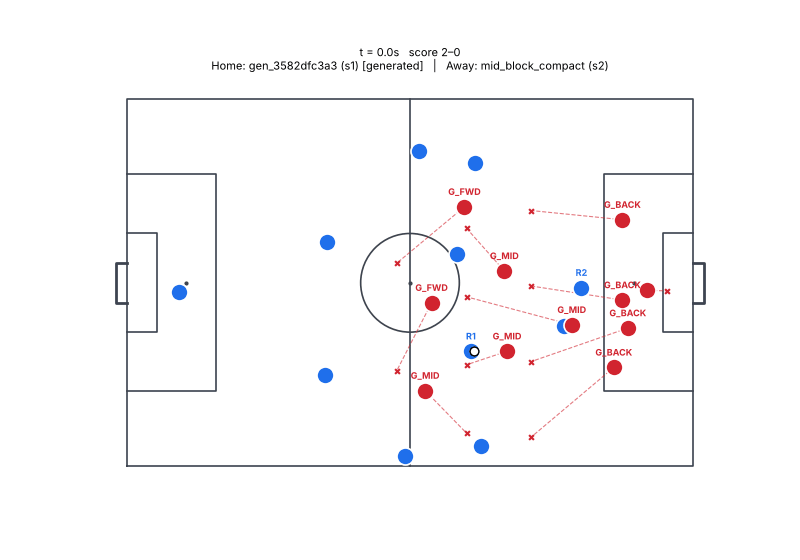

<details><summary>Play definition (YAML)</summary>

```yaml
id: gen_3582dfc3a3
name: Generated play
version: 1
phase: in_possession
objective: create_chance
strategy: generated
fallback: false
roles:
- id: R1
  desc: ''
  hints:
  - AM
  - W_near
  - CM
  requires:
    passing: 0.4
  prefers: {}
  starts_with_ball: true
- id: R2
  desc: ''
  hints:
  - ST
  - AM
  - CM
  requires:
    first_touch: 0.5
  prefers: {}
  starts_with_ball: false
triggers:
  all:
  - possession: us
  - has_ball: R1
hard_constraints: []
steps:
- id: s1
  actions:
  - type: pass
    role: R1
    to:
      role: R2
    style: ground
  done_when:
    event: pass_completed
  timeout_s: 2.0
  on_timeout: abort
- id: s2
  actions:
  - type: run_to
    role: R1
    to:
      anchor: role:R1
      offset:
      - 8.0
      - 0.0
      freeze: step_start
    speed: max
  done_when:
    lane_open:
      from: R2
      to:
        role: R1
        lead: 3.0
      min_p: 0.6
  timeout_s: 2.0
  on_timeout: abort
- id: s3
  actions:
  - type: cutback
    role: R2
    to:
      role: R1
      lead: 3.0
  done_when:
    has_ball: R1
  timeout_s: 2.0
  on_timeout: abort
- id: s4
  choose:
  - when:
      xg:
        ref: role:R1
        gt: 0.08
    actions:
    - type: shoot
      role: R1
      placement: auto
  - when: always
    actions:
    - type: carry
      role: R1
      to:
        pc_best:
          zone: box
        score: pc_xt
      speed: fast
  done_when:
    any:
    - event: shot_taken
    - ball_in_zone: box
  timeout_s: 3.0
  on_timeout: abort
success:
  event: shot_taken
abort:
  any:
  - has_ball: R2
  - dist:
      a: role:R2
      b: anchor:byline_near
      lt: 8.0
  - pressure_on:
      ref: role:R2
      lt: 2.0
max_duration_s: 11.0
cooldown_s: 0.0
soft_hints:
  risk: 0.3
  chain_depth: 4
  tempo: fast
source: generated
```

</details>

## gen_ab0b8975ec

Called by **main** against **wing_play** (running `low_block_box_protection`, `mid_block_compact`); steps reached: s1 → s2; ended: success; reward +0.0093.

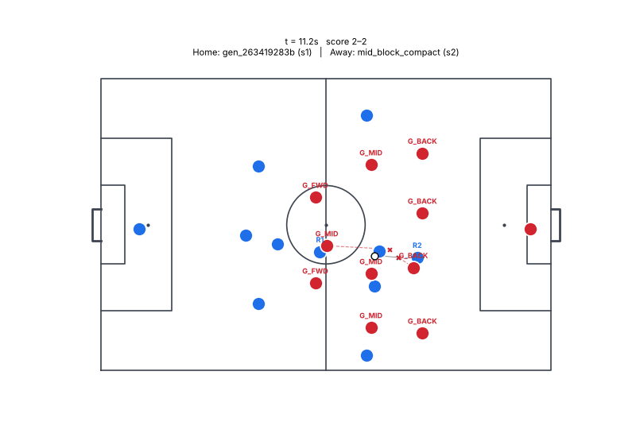

<details><summary>Play definition (YAML)</summary>

```yaml
id: gen_ab0b8975ec
name: Generated play
version: 1
phase: in_possession
objective: score
strategy: generated
fallback: false
roles:
- id: R1
  desc: ''
  hints:
  - AM
  - CM
  - ST
  requires:
    finishing: 0.4
  prefers: {}
  starts_with_ball: true
- id: R2
  desc: ''
  hints:
  - ST
  - AM
  - CM
  requires: {}
  prefers: {}
  starts_with_ball: false
triggers:
  all:
  - possession: us
  - has_ball: R1
hard_constraints: []
steps:
- id: s1
  choose:
  - when:
      xg:
        ref: role:R1
        gt: 0.06
    actions:
    - type: shoot
      role: R1
      placement: auto
  - when: always
    actions:
    - type: carry
      role: R1
      to:
        pc_best:
          zone: final_third.center
        score: pc_xt
      speed: fast
    - type: support
      role: R2
      from: R1
      angle: square
      distance: 8.0
  done_when:
    any:
    - event: shot_taken
    - step_elapsed_s:
        gt: 2.0
  timeout_s: 2.5
  on_timeout: abort
- id: s2
  choose:
  - when: always
    actions:
    - type: shoot
      role: R1
      placement: auto
  - when:
      lane_open:
        from: R1
        to:
          role: R2
        min_p: 0.6
    actions:
    - type: pass
      role: R1
      to:
        role: R2
      style: ground
  - when: always
    actions:
    - type: cutback
      role: R1
      to:
        best_teammate:
          score: pass_p
  done_when:
    any:
    - event: shot_taken
    - event: pass_completed
    - event: pass_intercepted
  timeout_s: 3.0
  on_timeout: abort
success:
  any:
  - event: shot_taken
  - event: goal
abort:
  any:
  - event: possession_lost
  - event: ball_out
max_duration_s: 7.5
cooldown_s: 0.0
soft_hints:
  risk: 0.3
  chain_depth: 2
  tempo: fast
source: generated
```

</details>

## gen_0368324921

Called by **main** against **mid_block** (running `mid_block_compact`); steps reached: s1 → s2; ended: step timeout abort; reward +0.0089.

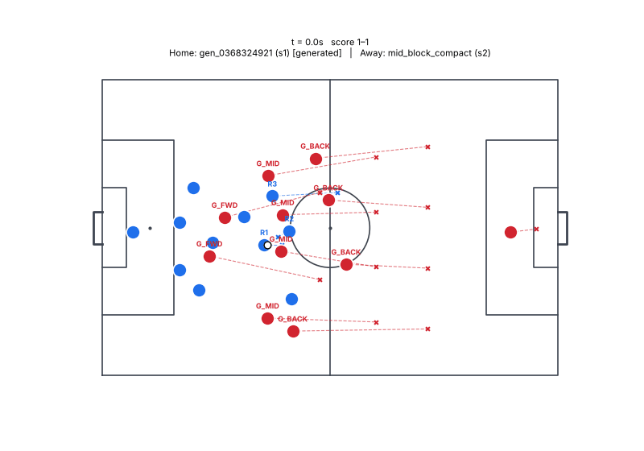

<details><summary>Play definition (YAML)</summary>

```yaml
id: gen_0368324921
name: Generated play
version: 1
phase: in_possession
objective: create_chance
strategy: generated
fallback: false
roles:
- id: R1
  desc: ''
  hints:
  - CM
  - AM
  - DM
  requires:
    passing: 0.6
    vision: 0.5
  prefers: {}
  starts_with_ball: true
- id: R2
  desc: ''
  hints:
  - ST
  - W_near
  - W_far
  requires:
    pace: 0.65
  prefers: {}
  starts_with_ball: false
- id: R3
  desc: ''
  hints:
  - W_far
  - AM
  - ST
  requires: {}
  prefers: {}
  starts_with_ball: false
triggers:
  all:
  - possession: us
  - has_ball: R1
hard_constraints: []
steps:
- id: s1
  actions:
  - type: check_to_ball
    role: R2
    distance: 3.0
    duration_s: 0.8
  - type: decoy_run
    role: R3
    to:
      anchor: line:opp_last_line
      offset:
      - -2.0
      - -12.0
  - type: carry
    role: R1
    to:
      anchor: ball
      offset:
      - 4.0
      - 0.0
    speed: jog
  done_when:
    step_elapsed_s:
      gt: 0.8
  timeout_s: 1.0
  on_timeout: abort
- id: s2
  actions:
  - type: pass
    role: R1
    to:
      space_behind:
        line: opp_last_line
        lane: center
        depth: 10.0
    style: ground
  done_when:
    any:
    - event: pass_intercepted
    - event: pass_intercepted
    - event: ball_out
  timeout_s: 3.0
  on_timeout: abort
- id: s3
  choose:
  - when:
      xg:
        ref: ball_holder
        gt: 0.1
    actions:
    - type: shoot
      actor: ball_holder
      placement: auto
  - when: always
    actions:
    - type: carry
      actor: ball_holder
      to:
        anchor: ball
        offset:
        - 10.0
        - 0.0
      speed: fast
  done_when:
    any:
    - event: shot_taken
    - event: shot_taken
    - event: shot_taken
  timeout_s: 2.5
  on_timeout: abort
- id: s4
  choose:
  - when:
      lane_open:
        from: ball_holder
        to:
          space_behind:
            line: opp_last_line
            lane: center
            depth: 10.0
        min_p: 0.4
    actions:
    - type: carry
      actor: ball_holder
      to:
        anchor: penalty_spot
        offset:
        - 0.0
        - -2.0
      speed: jog
  - when: always
    actions:
    - type: carry
      actor: ball_holder
      to:
        anchor: penalty_spot
        offset:
        - 0.0
        - 0.0
      speed: max
  done_when:
    any:
    - event: shot_taken
    - event: shot_taken
    - event: shot_taken
  timeout_s: 4.0
  on_timeout: abort
success:
  event: shot_taken
abort:
  any:
  - event: possession_lost
  - event: possession_lost
  - event: shot_taken
max_duration_s: 12.5
cooldown_s: 0.0
soft_hints:
  risk: 0.6
  chain_depth: 4
  tempo: fast
source: generated
```

</details>
