# Generated plays that worked · run 5

856 times a generated play succeeded in this run (665 different plays), during league training or the final evaluation. A generated play counts as successful when it reached its own success condition or gained at least 0.005 EPV. Below, the best instance of each play (by reward), with what the opponent was running and the play's full definition.

`generated_successes.html` has every clip with the decision inspector; download it and open it in a browser.

| Play | By | Against | Opponent's play | Why it counts | Reward | Stage |
|---|---|---|---|---|---|---|
| [`gen_5f7fcf6c88`](#gen_5f7fcf6c88) | main_exploiter | main | `low_block_box_protection` | reached its success condition; gained at least 0.005 EPV | +1.0195 | league (update 27) |
| [`gen_8ae196ba13`](#gen_8ae196ba13) | main_exploiter | main | `low_block_box_protection` | gained at least 0.005 EPV | +0.1297 | league (update 10) |
| [`gen_920ef21d3d`](#gen_920ef21d3d) | league_exploiter | low_block_counter | `low_block_box_protection` | gained at least 0.005 EPV | +0.1269 | league (update 1) |
| [`gen_01a5579d8a`](#gen_01a5579d8a) | league_exploiter | low_block_counter | `low_block_box_protection`, `mid_block_compact` | gained at least 0.005 EPV | +0.0759 | league (update 22) |
| [`gen_b8248014c3`](#gen_b8248014c3) | main | main_exploiter | `low_block_box_protection` | reached its success condition; gained at least 0.005 EPV | +0.0710 | league (update 26) |
| [`gen_f95335a9dd`](#gen_f95335a9dd) | main | main_exploiter | `low_block_box_protection`, `mid_block_compact` | gained at least 0.005 EPV | +0.0594 | league (update 6) |
| [`gen_03a714122a`](#gen_03a714122a) | main_exploiter | main | `low_block_box_protection`, `mid_block_compact` | gained at least 0.005 EPV | +0.0437 | league (update 4) |
| [`gen_c83e0dbb29`](#gen_c83e0dbb29) | main_exploiter | main | `low_block_box_protection`, `mid_block_compact` | gained at least 0.005 EPV | +0.0399 | league (update 11) |
| [`gen_336193263d`](#gen_336193263d) | main | main@5 | `low_block_box_protection` | reached its success condition; gained at least 0.005 EPV | +0.0388 | league (update 6) |
| [`gen_5e2af41ce1`](#gen_5e2af41ce1) | league_exploiter | direct | `low_block_box_protection`, `mid_block_compact` | gained at least 0.005 EPV | +0.0383 | league (update 25) |
| [`gen_331d472091`](#gen_331d472091) | main_exploiter | main | `low_block_box_protection`, `mid_block_compact` | gained at least 0.005 EPV | +0.0317 | league (update 3) |
| [`gen_1075a5a01c`](#gen_1075a5a01c) | main | main | `low_block_box_protection`, `mid_block_compact` | reached its success condition; gained at least 0.005 EPV | +0.0316 | league (update 16) |

## gen_5f7fcf6c88

Called by **main_exploiter** against **main** (running `low_block_box_protection`); steps reached: s1 → s2; ended: success; reward +1.0195.

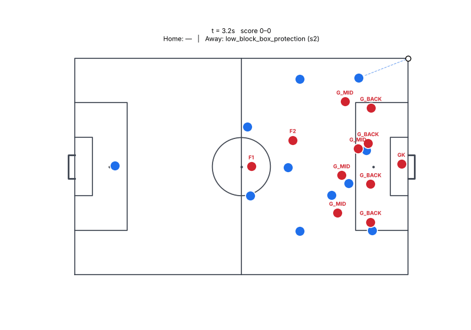

<details><summary>Play definition (YAML)</summary>

```yaml
id: gen_5f7fcf6c88
name: Generated play
version: 1
phase: in_possession
objective: score
strategy: generated
fallback: false
roles:
- id: R1
  desc: ''
  hints:
  - AM
  - CM
  - ST
  requires:
    finishing: 0.4
  prefers: {}
  starts_with_ball: true
- id: R2
  desc: ''
  hints:
  - ST
  - AM
  - CM
  requires: {}
  prefers: {}
  starts_with_ball: false
triggers:
  all:
  - possession: us
  - has_ball: R1
hard_constraints: []
steps:
- id: s1
  choose:
  - when:
      xg:
        ref: role:R1
        gt: 0.06
    actions:
    - type: shoot
      role: R1
      placement: auto
  - when: always
    actions:
    - type: carry
      role: R1
      to:
        pc_best:
          zone: final_third.center
        score: pc_xt
      speed: fast
    - type: support
      role: R2
      from: R1
      angle: square
      distance: 8.0
  done_when:
    any:
    - event: shot_taken
    - step_elapsed_s:
        gt: 2.0
  timeout_s: 2.5
  on_timeout: abort
- id: s2
  choose:
  - when: always
    actions:
    - type: shoot
      role: R1
      placement: auto
  - when:
      lane_open:
        from: R1
        to:
          role: R2
        min_p: 0.6
    actions:
    - type: pass
      role: R1
      to:
        role: R2
      style: driven
  - when: always
    actions:
    - type: pass
      role: R1
      to:
        best_teammate:
          score: pass_p
      style: ground
  done_when:
    any:
    - event: shot_taken
    - event: pass_completed
    - event: pass_intercepted
  timeout_s: 3.0
  on_timeout: abort
- id: s3
  choose:
  - when:
      xg:
        ref: ball_holder
        gt: 0.1
    actions:
    - type: carry
      role: R2
      to:
        pc_best:
          zone: final_third.far_wing
        score: pc_xt
      speed: fast
  - when: always
    actions:
    - type: pass
      role: R1
      to:
        best_teammate:
          score: pass_p
      style: ground
  done_when:
    any:
    - event: shot_taken
    - event: shot_taken
    - ball_in_zone: box
  timeout_s: 3.0
  on_timeout: abort
success:
  any:
  - event: shot_taken
  - event: goal
abort:
  any:
  - event: possession_lost
  - event: ball_out
max_duration_s: 10.5
cooldown_s: 0.0
soft_hints:
  risk: 0.3
  chain_depth: 3
  tempo: fast
source: generated
```

</details>

## gen_8ae196ba13

Called by **main_exploiter** against **main** (running `low_block_box_protection`); steps reached: s1 → s2; ended: step timeout abort; reward +0.1297.

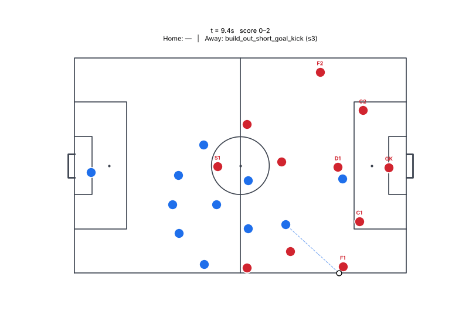

<details><summary>Play definition (YAML)</summary>

```yaml
id: gen_8ae196ba13
name: Generated play
version: 1
phase: transition_attack
objective: create_chance
strategy: generated
fallback: false
roles:
- id: R1
  desc: ''
  hints:
  - DM
  - CM
  - CB_near
  requires: {}
  prefers: {}
  starts_with_ball: true
- id: R2
  desc: ''
  hints:
  - ST
  - W_near
  - W_far
  requires:
    pace: 0.6
  prefers: {}
  starts_with_ball: false
- id: R3
  desc: ''
  hints:
  - W_far
  - W_near
  - AM
  requires:
    pace: 0.5
  prefers: {}
  starts_with_ball: false
- id: R4
  desc: ''
  hints:
  - AM
  - CM
  requires: {}
  prefers: {}
  starts_with_ball: false
triggers:
  all:
  - possession: us
  - has_ball: R1
  - event:
      type: possession_won
      within_s: 2.0
hard_constraints: []
steps:
- id: s1
  actions:
  - type: spin_in_behind
    role: R2
    line: opp_last_line
    lane: center
    depth: 8.0
  - type: run_to
    role: R3
    to:
      anchor: ball
      offset:
      - 24.0
      - -18.0
    speed: max
  - type: run_to
    role: R4
    to:
      anchor: ball
      offset:
      - 12.0
      - 0.0
    speed: fast
  done_when:
    step_elapsed_s:
      gt: 0.3
  timeout_s: 0.5
  on_timeout: abort
- id: s2
  choose:
  - when:
      lane_open:
        from: R1
        to:
          space_behind:
            line: opp_last_line
            lane: center
            depth: 8.0
        min_p: 0.45
    actions:
    - type: pass
      role: R1
      to:
        space_behind:
          line: opp_last_line
          lane: center
          depth: 6.0
      style: through
  - when:
      lane_open:
        from: R1
        to:
          role: R4
        min_p: 0.75
    actions:
    - type: pass
      role: R1
      to:
        space_behind:
          line: opp_last_line
          lane: center
          depth: 6.0
      style: lofted
  - when: always
    actions:
    - type: pass
      actor: ball_holder
      to:
        space_behind:
          line: opp_last_line
          lane: center
          depth: 8.0
      style: lofted
  done_when:
    any:
    - event: pass_intercepted
    - event: ball_out
  timeout_s: 2.5
  on_timeout: abort
- id: s3
  choose:
  - when:
      xg:
        ref: ball_holder
        gt: 0.08
    actions:
    - type: spin_in_behind
      role: R4
      line: opp_last_line
      lane: center
      depth: 6.0
  - when: always
    actions:
    - type: carry
      actor: ball_holder
      to:
        anchor: penalty_spot
        offset:
        - 0.0
        - 0.0
      speed: max
  done_when:
    any:
    - ball_in_zone: box
    - event: pass_completed
    - pressure_on:
        ref: ball_holder
        lt: 2.0
  timeout_s: 5.0
  on_timeout: abort
- id: s4
  choose:
  - when:
      xg:
        ref: ball_holder
        gt: 0.08
    actions:
    - type: shoot
      actor: ball_holder
      placement: auto
  - when: always
    actions:
    - type: pass
      actor: ball_holder
      to:
        best_teammate:
          score: xt
          zone: box
      style: ground
  done_when:
    any:
    - event: shot_taken
    - event: ball_out
  timeout_s: 3.0
  on_timeout: abort
success:
  event: shot_taken
abort:
  event: possession_lost
max_duration_s: 13.0
cooldown_s: 0.0
soft_hints:
  risk: 0.5
  chain_depth: 4
  tempo: fast
source: generated
```

</details>

## gen_920ef21d3d

Called by **league_exploiter** against **low_block_counter** (running `low_block_box_protection`); steps reached: s1 → s2 → s3; ended: possession change; reward +0.1269.

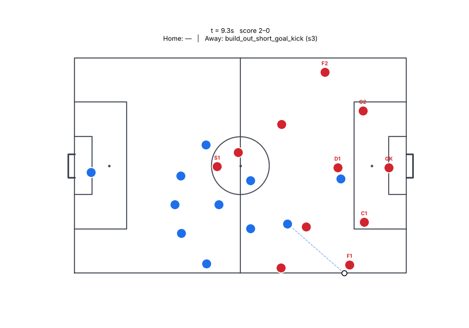

<details><summary>Play definition (YAML)</summary>

```yaml
id: gen_920ef21d3d
name: Generated play
version: 1
phase: in_possession
objective: create_chance
strategy: generated
fallback: false
roles:
- id: R1
  desc: ''
  hints:
  - W_near
  - FB_near
  requires:
    dribbling: 0.4
    passing: 0.4
  prefers: {}
  starts_with_ball: true
- id: R2
  desc: ''
  hints:
  - FB_near
  requires:
    pace: 0.5
    stamina: 0.4
  prefers: {}
  starts_with_ball: false
- id: R3
  desc: ''
  hints:
  - ST
  requires: {}
  prefers: {}
  starts_with_ball: false
- id: R4
  desc: ''
  hints:
  - W_far
  - AM
  requires: {}
  prefers: {}
  starts_with_ball: false
- id: R5
  desc: ''
  hints:
  - AM
  - CM
  requires: {}
  prefers: {}
  starts_with_ball: false
triggers:
  all:
  - possession: us
  - has_ball: R1
hard_constraints: []
steps:
- id: s1
  actions:
  - type: carry
    role: R1
    to:
      anchor: ball
      offset:
      - 4.0
      - -4.0
    speed: jog
  - type: overlap
    role: R2
    around: R1
  - type: run_to
    role: R3
    to:
      zone: near_post_area
    speed: fast
  - type: run_to
    role: R4
    to:
      zone: far_post_area
    speed: fast
  done_when:
    any:
    - ahead_of:
        a: role:R2
        b: role:R1
        by: 3.0
    - step_elapsed_s:
        gt: 2.0
  timeout_s: 3.0
  on_timeout: abort
- id: s2
  choose:
  - when:
      lane_open:
        from: R1
        to:
          role: R2
          lead: 4.0
        min_p: 0.6
    actions:
    - type: pass
      role: R1
      to:
        role: R2
        lead: 4.0
      style: ground
  - when:
      ball_in_zone: final_third.*
    actions:
    - type: cross
      role: R1
      to:
        role: R3
      style: whipped
  - when: always
    actions:
    - type: pass
      role: R1
      to:
        best_teammate:
          score: pc_xt
      style: ground
  done_when:
    any:
    - has_ball: R2
    - event: pass_completed
    - event: pass_intercepted
  timeout_s: 3.0
  on_timeout: abort
- id: s3
  choose:
  - when:
      all:
      - has_ball: R2
      - pc_at:
          target:
            zone: cutback_zone
          gt: 0.6
    actions:
    - type: cutback
      role: R2
      to:
        role: R5
    - type: run_to
      role: R5
      to:
        zone: cutback_zone
      speed: fast
  - when:
      has_ball: R2
    actions:
    - type: cross
      role: R2
      to:
        role: R3
      style: driven_low
  - when: always
    actions:
    - type: pass
      actor: ball_holder
      to:
        best_teammate:
          score: xt
          zone: box
      style: ground
  done_when:
    any:
    - event: pass_completed
    - event: pass_intercepted
    - event: ball_out
  timeout_s: 3.0
  on_timeout: abort
- id: s4
  choose:
  - when:
      xg:
        ref: ball_holder
        gt: 0.08
    actions:
    - type: shoot
      actor: ball_holder
      placement: auto
  - when: always
    actions:
    - type: pass
      actor: ball_holder
      to:
        best_teammate:
          score: xt
          zone: box
      style: ground
  done_when:
    any:
    - event: shot_taken
    - event: pass_completed
  timeout_s: 2.0
  on_timeout: abort
success:
  any:
  - event: shot_taken
  - event: goal
abort:
  any:
  - event: possession_lost
  - event: ball_out
max_duration_s: 13.0
cooldown_s: 0.0
soft_hints:
  risk: 0.4
  chain_depth: 4
  tempo: medium
source: generated
```

</details>

## gen_01a5579d8a

Called by **league_exploiter** against **low_block_counter** (running `low_block_box_protection`, `mid_block_compact`); steps reached: s1; ended: step timeout abort; reward +0.0759.

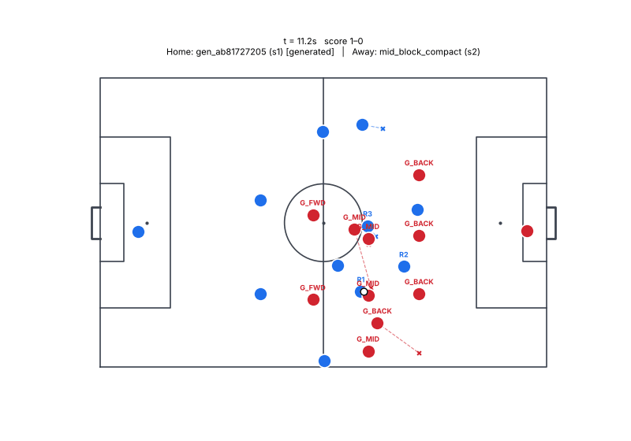

<details><summary>Play definition (YAML)</summary>

```yaml
id: gen_01a5579d8a
name: Generated play
version: 1
phase: in_possession
objective: score
strategy: generated
fallback: false
roles:
- id: R1
  desc: ''
  hints:
  - FB_near
  - W_near
  - CM
  requires: {}
  prefers: {}
  starts_with_ball: true
- id: R2
  desc: ''
  hints:
  - DM
  - CB_near
  - CM
  requires:
    passing: 0.55
  prefers: {}
  starts_with_ball: false
- id: R3
  desc: ''
  hints:
  - W_far
  - FB_far
  requires:
    first_touch: 0.4
  prefers: {}
  starts_with_ball: false
- id: R4
  desc: ''
  hints:
  - FB_far
  - CM
  requires: {}
  prefers: {}
  starts_with_ball: false
triggers:
  all:
  - possession: us
  - has_ball: R1
hard_constraints: []
steps:
- id: s1
  choose:
  - when:
      lane_open:
        from: R1
        to:
          role: R3
          lead: 3.0
        min_p: 0.55
    actions:
    - type: carry
      role: R1
      to:
        pc_best:
          zone: final_third.*
        score: pc_xt
      speed: max
  - when:
      all:
      - has_ball: R3
      - dist:
          a: role:R2
          b: anchor:byline_near
          lt: 8.0
      - pressure_on:
          ref: role:R2
          lt: 3.0
    actions:
    - type: overlap
      role: R4
      around: R1
    - type: pass
      role: R1
      to:
        role: R3
      style: driven
  - when: always
    actions:
    - type: pass
      role: R1
      to:
        zone: near_post_area
      style: ground
  done_when:
    any:
    - has_ball: R3
    - event: pass_completed
    - event: goal
  timeout_s: 3.0
  on_timeout: abort
success:
  all:
  - has_ball: R1
  - has_ball: R3
  - event: pass_intercepted
abort:
  any:
  - has_ball: R3
  - dist:
      a: role:R2
      b: anchor:byline_near
      lt: 8.0
  - pressure_on:
      ref: role:R2
      lt: 2.0
max_duration_s: 5.0
cooldown_s: 0.0
soft_hints:
  risk: 0.3
  chain_depth: 1
  tempo: medium
source: generated
```

</details>

## gen_b8248014c3

Called by **main** against **main_exploiter** (running `low_block_box_protection`); steps reached: s1; ended: success; reward +0.0710.

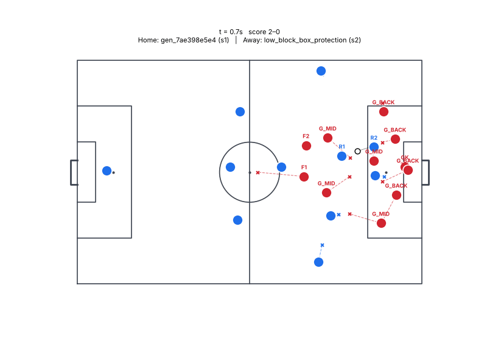

<details><summary>Play definition (YAML)</summary>

```yaml
id: gen_b8248014c3
name: Generated play
version: 1
phase: in_possession
objective: score
strategy: generated
fallback: false
roles:
- id: R1
  desc: ''
  hints:
  - AM
  - CM
  - ST
  requires:
    finishing: 0.4
  prefers: {}
  starts_with_ball: true
- id: R2
  desc: ''
  hints:
  - ST
  - AM
  - CM
  requires: {}
  prefers: {}
  starts_with_ball: false
triggers:
  all:
  - possession: us
  - has_ball: R1
hard_constraints: []
steps:
- id: s1
  choose:
  - when:
      xg:
        ref: role:R1
        gt: 0.06
    actions:
    - type: shoot
      role: R1
      placement: auto
  - when: always
    actions:
    - type: carry
      role: R1
      to:
        pc_best:
          zone: final_third.center
        score: pc_xt
      speed: fast
    - type: support
      role: R2
      from: R1
      angle: square
      distance: 8.0
  done_when:
    any:
    - event: shot_taken
    - step_elapsed_s:
        gt: 2.0
  timeout_s: 2.5
  on_timeout: abort
- id: s2
  choose:
  - when: always
    actions:
    - type: shoot
      role: R1
      placement: auto
  - when:
      lane_open:
        from: R1
        to:
          role: R2
        min_p: 0.6
    actions:
    - type: pass
      role: R1
      to:
        role: R2
      style: ground
  - when: always
    actions:
    - type: pass
      role: R1
      to:
        best_teammate:
          score: pass_p
      style: ground
  done_when:
    any:
    - event: shot_taken
    - event: pass_completed
    - event: pass_intercepted
  timeout_s: 3.0
  on_timeout: abort
success:
  any:
  - event: shot_taken
  - event: pass_intercepted
abort:
  any:
  - event: possession_lost
  - event: ball_out
max_duration_s: 7.5
cooldown_s: 0.0
soft_hints:
  risk: 0.3
  chain_depth: 2
  tempo: fast
source: generated
```

</details>

## gen_f95335a9dd

Called by **main** against **main_exploiter** (running `low_block_box_protection`, `mid_block_compact`); steps reached: s1 → s2 → s3; ended: step timeout abort; reward +0.0594.

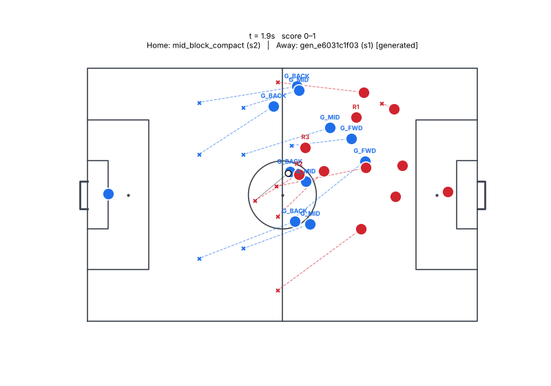

<details><summary>Play definition (YAML)</summary>

```yaml
id: gen_f95335a9dd
name: Generated play
version: 1
phase: transition_attack
objective: create_chance
strategy: generated
fallback: false
roles:
- id: R1
  desc: ''
  hints:
  - W_near
  - FB_near
  requires:
    dribbling: 0.4
    passing: 0.4
  prefers: {}
  starts_with_ball: true
- id: R2
  desc: ''
  hints:
  - FB_near
  requires:
    pace: 0.5
    stamina: 0.4
  prefers: {}
  starts_with_ball: false
- id: R3
  desc: ''
  hints:
  - ST
  requires: {}
  prefers: {}
  starts_with_ball: false
- id: R4
  desc: ''
  hints:
  - W_far
  - AM
  requires: {}
  prefers: {}
  starts_with_ball: false
- id: R5
  desc: ''
  hints:
  - AM
  - CM
  requires: {}
  prefers: {}
  starts_with_ball: false
triggers:
  all:
  - possession: us
  - has_ball: R1
  - event:
      type: possession_won
      within_s: 2.0
hard_constraints: []
steps:
- id: s1
  actions:
  - type: carry
    role: R1
    to:
      anchor: ball
      offset:
      - 4.0
      - -2.0
    speed: jog
  - type: overlap
    role: R2
    around: R1
  - type: run_to
    role: R3
    to:
      zone: final_third.center
    speed: fast
  - type: run_to
    role: R4
    to:
      zone: final_third.far_halfspace
    speed: fast
  done_when:
    all:
    - ahead_of:
        a: role:R2
        b: role:R1
        by: 3.0
    - lane_open:
        from: R1
        to:
          role: R2
          lead: 4.0
        min_p: 0.65
  timeout_s: 5.0
  on_timeout: abort
- id: s2
  actions:
  - type: shoot
    actor: ball_holder
    placement: auto
  done_when:
    all:
    - possession: us
    - ball_beyond_line:
        line: opp_first_line
  timeout_s: 3.0
  on_timeout: abort
- id: s3
  choose:
  - when:
      xg:
        ref: ball_holder
        gt: 0.1
    actions:
    - type: shoot
      actor: ball_holder
      placement: auto
  - when: always
    actions:
    - type: run_to
      role: R3
      to:
        zone: cutback_zone
      speed: fast
    - type: carry
      role: R4
      to:
        anchor: penalty_spot
        offset:
        - 0.0
        - 0.0
      speed: max
    - type: run_to
      role: R4
      to:
        zone: cutback_zone
      speed: fast
  done_when:
    dist:
      a: role:R2
      b: anchor:byline_near
      lt: 8.0
  timeout_s: 1.0
  on_timeout: abort
- id: s4
  actions:
  - type: overlap
    role: R4
    around: R3
  done_when:
    all:
    - ahead_of:
        a: role:R2
        b: ball_holder
        by: 2.0
  timeout_s: 3.0
  on_timeout: abort
- id: s5
  choose:
  - when:
      has_ball: R3
    actions:
    - type: spin_in_behind
      role: R4
      line: opp_last_line
      lane: center
      depth: 8.0
  - when: always
    actions:
    - type: run_to
      role: R3
      to:
        zone: cutback_zone
      speed: fast
  done_when:
    all:
    - has_ball: R4
    - ball_in_zone: final_third.*
    - has_ball: R4
  timeout_s: 4.0
  on_timeout: abort
success:
  all:
  - has_ball: R2
  - dist:
      a: role:R2
      b: ball_holder
      lt: 2.0
abort:
  event: ball_out
max_duration_s: 18.0
cooldown_s: 0.0
soft_hints:
  risk: 0.4
  chain_depth: 5
  tempo: medium
source: generated
```

</details>

## gen_03a714122a

Called by **main_exploiter** against **main** (running `low_block_box_protection`, `mid_block_compact`); steps reached: s1 → s2 → s3; ended: abort; reward +0.0437.

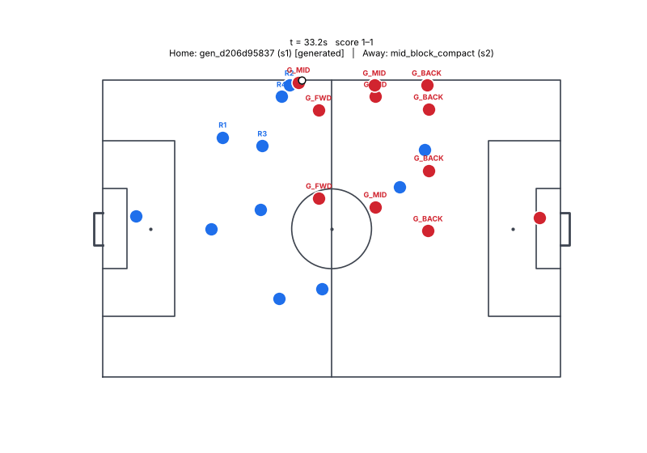

<details><summary>Play definition (YAML)</summary>

```yaml
id: gen_03a714122a
name: Generated play
version: 1
phase: transition_attack
objective: create_chance
strategy: generated
fallback: false
roles:
- id: R1
  desc: ''
  hints:
  - DM
  - CM
  - CB_near
  requires: {}
  prefers: {}
  starts_with_ball: true
- id: R2
  desc: ''
  hints:
  - ST
  - W_near
  - W_far
  requires:
    pace: 0.6
  prefers: {}
  starts_with_ball: false
- id: R3
  desc: ''
  hints:
  - W_far
  - W_near
  - AM
  requires:
    pace: 0.5
  prefers: {}
  starts_with_ball: false
- id: R4
  desc: ''
  hints:
  - AM
  - CM
  requires: {}
  prefers: {}
  starts_with_ball: false
triggers:
  all:
  - possession: us
  - has_ball: R1
  - event:
      type: possession_won
      within_s: 2.0
hard_constraints: []
steps:
- id: s1
  actions:
  - type: spin_in_behind
    role: R2
    line: opp_last_line
    lane: center
    depth: 8.0
  - type: run_to
    role: R3
    to:
      anchor: ball
      offset:
      - 24.0
      - -18.0
    speed: max
  - type: run_to
    role: R4
    to:
      anchor: ball
      offset:
      - 12.0
      - 0.0
    speed: fast
  done_when:
    step_elapsed_s:
      gt: 0.3
  timeout_s: 0.5
  on_timeout: abort
- id: s2
  actions:
  - type: spin_in_behind
    role: R2
    line: opp_last_line
    lane: center
    depth: 8.0
  - type: run_to
    role: R3
    to:
      anchor: ball
      offset:
      - 24.0
      - -18.0
    speed: max
  - type: run_to
    role: R4
    to:
      anchor: ball
      offset:
      - 12.0
      - 0.0
    speed: fast
  done_when:
    step_elapsed_s:
      gt: 0.3
  timeout_s: 0.5
  on_timeout: abort
- id: s3
  choose:
  - when:
      lane_open:
        from: R1
        to:
          space_behind:
            line: opp_last_line
            lane: center
            depth: 8.0
        min_p: 0.45
    actions:
    - type: pass
      role: R1
      to:
        space_behind:
          line: opp_last_line
          lane: center
          depth: 8.0
      style: through
  - when:
      lane_open:
        from: R1
        to:
          role: R4
        min_p: 0.75
    actions:
    - type: pass
      role: R1
      to:
        space_behind:
          line: opp_last_line
          lane: center
          depth: 8.0
      style: through
  - when: always
    actions:
    - type: pass
      role: R1
      to:
        space_behind:
          line: opp_last_line
          lane: center
          depth: 6.0
      style: through
  done_when:
    any:
    - event: pass_completed
    - pressure_on:
        ref: ball_holder
        lt: 2.0
  timeout_s: 5.0
  on_timeout: abort
- id: s4
  actions:
  - type: hold_width
    role: R3
    lane: near_wing
  - type: shoot
    actor: ball_holder
    placement: auto
  done_when:
    any:
    - event: shot_taken
    - event: ball_out
  timeout_s: 3.0
  on_timeout: abort
success:
  any:
  - ball_in_zone: box
abort:
  any:
  - ball_in_zone: box
max_duration_s: 11.0
cooldown_s: 0.0
soft_hints:
  risk: 0.5
  chain_depth: 4
  tempo: fast
source: generated
```

</details>

## gen_c83e0dbb29

Called by **main_exploiter** against **main** (running `low_block_box_protection`, `mid_block_compact`); steps reached: s1; ended: possession change; reward +0.0399.

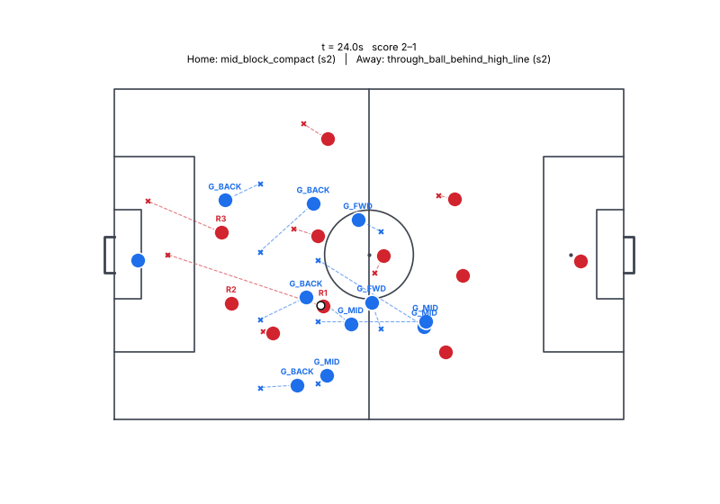

<details><summary>Play definition (YAML)</summary>

```yaml
id: gen_c83e0dbb29
name: Generated play
version: 1
phase: in_possession
objective: create_chance
strategy: generated
fallback: false
roles:
- id: R1
  desc: ''
  hints:
  - CM
  - AM
  - DM
  requires:
    passing: 0.6
    vision: 0.5
  prefers: {}
  starts_with_ball: true
- id: R2
  desc: ''
  hints:
  - ST
  - W_near
  - W_far
  requires:
    pace: 0.65
  prefers: {}
  starts_with_ball: false
- id: R3
  desc: ''
  hints:
  - W_far
  - AM
  - ST
  requires: {}
  prefers: {}
  starts_with_ball: false
triggers:
  all:
  - possession: us
  - has_ball: R1
hard_constraints: []
steps:
- id: s1
  choose:
  - when:
      all:
      - onside: R2
      - lane_open:
          from: R1
          to:
            space_behind:
              line: opp_last_line
              lane: center
              depth: 10.0
          min_p: 0.4
    actions:
    - type: spin_in_behind
      role: R2
      line: opp_last_line
      lane: center
      depth: 10.0
    - type: decoy_run
      role: R3
      to:
        anchor: line:opp_last_line
        offset:
        - -2.0
        - -12.0
    - type: pass
      role: R1
      to:
        space_behind:
          line: opp_last_line
          lane: center
          depth: 10.0
      style: through
  - when:
      xg:
        ref: ball_holder
        gt: 0.12
    actions:
    - type: spin_in_behind
      actor: ball_holder
      line: opp_last_line
      lane: center
      depth: 10.0
  - when: always
    actions:
    - type: shoot
      actor: ball_holder
      placement: auto
  done_when:
    any:
    - event: pass_intercepted
    - event: ball_out
  timeout_s: 3.0
  on_timeout: abort
success:
  any:
  - event: goal
abort:
  any:
  - ball_in_zone: box
max_duration_s: 5.0
cooldown_s: 0.0
soft_hints:
  risk: 0.6
  chain_depth: 1
  tempo: fast
source: generated
```

</details>

## gen_336193263d

Called by **main** against **main@5** (running `low_block_box_protection`); steps reached: s1 → s2; ended: success; reward +0.0388.

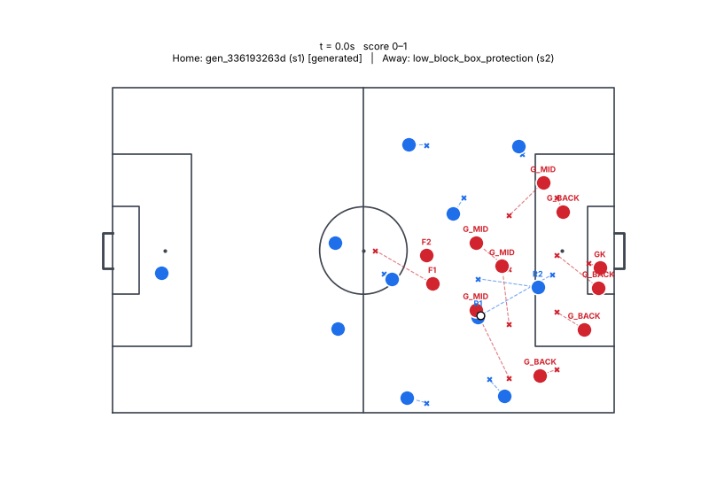

<details><summary>Play definition (YAML)</summary>

```yaml
id: gen_336193263d
name: Generated play
version: 1
phase: in_possession
objective: score
strategy: generated
fallback: false
roles:
- id: R1
  desc: ''
  hints:
  - AM
  - CM
  - ST
  requires:
    finishing: 0.4
  prefers: {}
  starts_with_ball: true
- id: R2
  desc: ''
  hints:
  - ST
  - AM
  - CM
  requires: {}
  prefers: {}
  starts_with_ball: false
triggers:
  all:
  - possession: us
  - has_ball: R1
hard_constraints: []
steps:
- id: s1
  choose:
  - when:
      xg:
        ref: role:R1
        gt: 0.06
    actions:
    - type: shoot
      role: R1
      placement: auto
  - when: always
    actions:
    - type: carry
      role: R1
      to:
        pc_best:
          zone: final_third.center
        score: pc_xt
      speed: fast
    - type: support
      role: R2
      from: R1
      angle: square
      distance: 8.0
  done_when:
    any:
    - event: shot_taken
    - step_elapsed_s:
        gt: 2.0
  timeout_s: 2.5
  on_timeout: abort
- id: s2
  choose:
  - when: always
    actions:
    - type: shoot
      role: R1
      placement: auto
  - when:
      lane_open:
        from: R1
        to:
          role: R2
        min_p: 0.6
    actions:
    - type: pass
      role: R1
      to:
        role: R2
      style: ground
  - when: always
    actions:
    - type: pass
      role: R1
      to:
        best_teammate:
          score: pass_p
      style: ground
  done_when:
    any:
    - event: shot_taken
    - event: pass_completed
    - event: pass_intercepted
  timeout_s: 3.0
  on_timeout: abort
success:
  any:
  - event: shot_taken
  - event: goal
abort:
  any:
  - event: possession_lost
  - event: ball_out
max_duration_s: 7.5
cooldown_s: 0.0
soft_hints:
  risk: 0.3
  chain_depth: 2
  tempo: fast
source: generated
```

</details>

## gen_5e2af41ce1

Called by **league_exploiter** against **direct** (running `low_block_box_protection`, `mid_block_compact`); steps reached: s1; ended: step timeout abort; reward +0.0383.

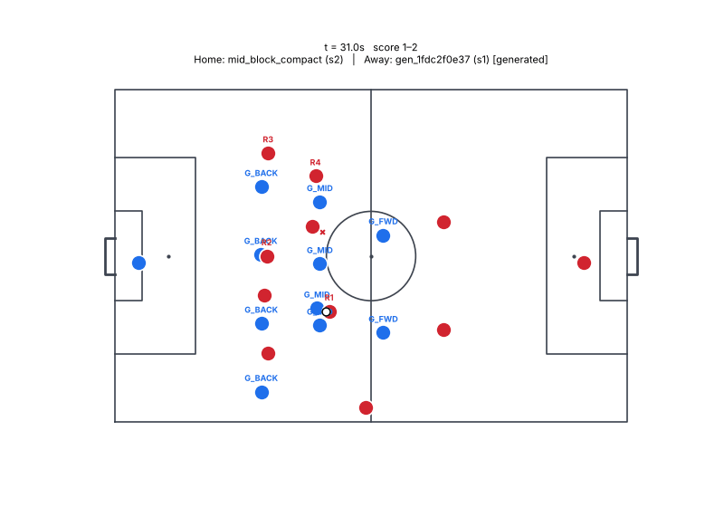

<details><summary>Play definition (YAML)</summary>

```yaml
id: gen_5e2af41ce1
name: Generated play
version: 1
phase: in_possession
objective: score
strategy: generated
fallback: false
roles:
- id: R1
  desc: ''
  hints:
  - AM
  - CM
  - ST
  requires:
    finishing: 0.4
  prefers: {}
  starts_with_ball: true
- id: R2
  desc: ''
  hints:
  - ST
  - AM
  - CM
  requires: {}
  prefers: {}
  starts_with_ball: false
triggers:
  all:
  - possession: us
  - has_ball: R1
hard_constraints: []
steps:
- id: s1
  actions:
  - type: pass
    role: R1
    to:
      zone: near_post_area
    style: through
  done_when:
    any:
    - has_ball: R2
    - has_ball: R2
    - has_ball: R2
  timeout_s: 2.5
  on_timeout: abort
- id: s2
  actions:
  - type: pass
    role: R2
    to:
      role: R2
      lead: 2.0
    style: driven
  done_when:
    any:
    - has_ball: R2
    - has_ball: R2
    - event: goal
  timeout_s: 3.0
  on_timeout: abort
success:
  has_ball: R2
abort:
  any:
  - has_ball: R2
max_duration_s: 7.5
cooldown_s: 0.0
soft_hints:
  risk: 0.3
  chain_depth: 2
  tempo: fast
source: generated
```

</details>

## gen_331d472091

Called by **main_exploiter** against **main** (running `low_block_box_protection`, `mid_block_compact`); steps reached: s1; ended: step timeout abort; reward +0.0317.

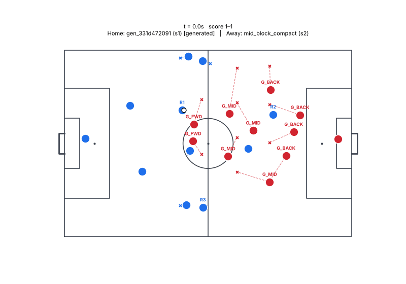

<details><summary>Play definition (YAML)</summary>

```yaml
id: gen_331d472091
name: Generated play
version: 1
phase: in_possession
objective: create_chance
strategy: generated
fallback: false
roles:
- id: R1
  desc: ''
  hints:
  - CM
  - AM
  - DM
  requires:
    passing: 0.6
    vision: 0.5
  prefers: {}
  starts_with_ball: true
- id: R2
  desc: ''
  hints:
  - ST
  - W_near
  - W_far
  requires:
    pace: 0.65
  prefers: {}
  starts_with_ball: false
- id: R3
  desc: ''
  hints:
  - W_far
  - AM
  - ST
  requires: {}
  prefers: {}
  starts_with_ball: false
triggers:
  all:
  - possession: us
  - has_ball: R1
hard_constraints: []
steps:
- id: s1
  choose:
  - when:
      all:
      - onside: R2
      - lane_open:
          from: R1
          to:
            space_behind:
              line: opp_last_line
              lane: center
              depth: 10.0
          min_p: 0.4
    actions:
    - type: spin_in_behind
      role: R2
      line: opp_last_line
      lane: center
      depth: 10.0
    - type: decoy_run
      role: R3
      to:
        anchor: line:opp_last_line
        offset:
        - -2.0
        - -12.0
    - type: pass
      role: R1
      to:
        space_behind:
          line: opp_last_line
          lane: center
          depth: 10.0
      style: through
  - when:
      lane_open:
        from: R1
        to:
          role: R2
        min_p: 0.7
    actions:
    - type: spin_in_behind
      role: R2
      line: opp_last_line
      lane: center
      depth: 10.0
  - when: always
    actions:
    - type: carry
      role: R1
      to:
        pc_best:
          zone: mid_opp.*
        score: pc_xt
      speed: fast
    - type: pass
      role: R1
      to:
        space_behind:
          line: opp_last_line
          lane: center
          depth: 6.0
      style: through
  done_when:
    any:
    - has_ball: R3
    - lane_open:
        from: R3
        to:
          space_behind:
            line: opp_last_line
            lane: center
            depth: 10.0
        min_p: 0.4
  timeout_s: 3.0
  on_timeout: abort
- id: s2
  actions:
  - type: carry
    role: R2
    to:
      anchor: penalty_spot
      offset:
      - 0.0
      - 0.0
    speed: max
  - type: run_to
    role: R3
    to:
      zone: far_post_area
    speed: max
  done_when:
    any:
    - ball_in_zone: box
  timeout_s: 3.0
  on_timeout: abort
- id: s3
  choose:
  - when:
      xg:
        ref: role:R3
        gt: 0.12
    actions:
    - type: spin_in_behind
      role: R2
      line: opp_last_line
      lane: center
      depth: 6.0
    - type: carry
      role: R2
      to:
        anchor: ball
        offset:
        - 0.0
        - -4.0
      speed: jog
  - when: always
    actions:
    - type: run_to
      role: R3
      to:
        zone: far_post_area
      speed: fast
  done_when:
    any:
    - ball_in_zone: box
  timeout_s: 3.0
  on_timeout: abort
- id: s4
  choose:
  - when:
      xg:
        ref: ball_holder
        gt: 0.08
    actions:
    - type: carry
      role: R2
      to:
        pc_best:
          zone: final_third.center
        score: pc_xt
      speed: fast
    - type: pass
      role: R2
      to:
        space_behind:
          line: opp_last_line
          lane: center
          depth: 6.0
      style: through
  - when: always
    actions:
    - type: shoot
      actor: ball_holder
      placement: auto
  done_when:
    any:
    - ball_in_zone: box
  timeout_s: 4.0
  on_timeout: abort
success:
  any:
  - event: shot_taken
  - ball_in_zone: box
abort:
  any:
  - event: possession_lost
  - event: possession_lost
  - event: possession_lost
max_duration_s: 15.0
cooldown_s: 0.0
soft_hints:
  risk: 0.6
  chain_depth: 4
  tempo: fast
source: generated
```

</details>

## gen_1075a5a01c

Called by **main** against **main** (running `low_block_box_protection`, `mid_block_compact`); steps reached: s1 → s2 → s3; ended: success; reward +0.0316.

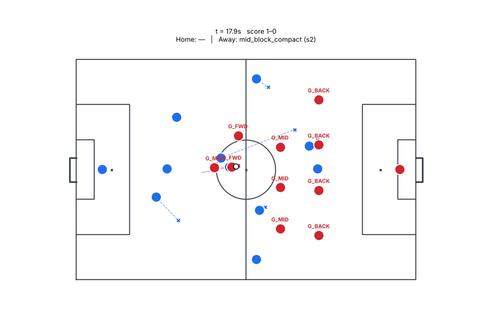

<details><summary>Play definition (YAML)</summary>

```yaml
id: gen_1075a5a01c
name: Generated play
version: 1
phase: in_possession
objective: score
strategy: generated
fallback: false
roles:
- id: R1
  desc: ''
  hints:
  - AM
  - CM
  - ST
  requires:
    finishing: 0.4
  prefers: {}
  starts_with_ball: true
- id: R2
  desc: ''
  hints:
  - ST
  - AM
  - CM
  requires: {}
  prefers: {}
  starts_with_ball: false
triggers:
  all:
  - possession: us
  - has_ball: R1
hard_constraints: []
steps:
- id: s1
  choose:
  - when:
      xg:
        ref: role:R1
        gt: 0.06
    actions:
    - type: shoot
      role: R1
      placement: auto
  - when: always
    actions:
    - type: carry
      role: R1
      to:
        pc_best:
          zone: final_third.center
        score: pc_xt
      speed: fast
    - type: support
      role: R2
      from: R1
      angle: square
      distance: 8.0
  done_when:
    any:
    - event: shot_taken
    - step_elapsed_s:
        gt: 2.0
  timeout_s: 2.5
  on_timeout: abort
- id: s2
  choose:
  - when: always
    actions:
    - type: shoot
      role: R1
      placement: auto
  - when:
      lane_open:
        from: R1
        to:
          role: R2
        min_p: 0.6
    actions:
    - type: pass
      role: R1
      to:
        role: R2
      style: ground
  - when: always
    actions:
    - type: pass
      role: R1
      to:
        best_teammate:
          score: pass_p
      style: ground
  done_when:
    any:
    - event: shot_taken
    - event: pass_completed
    - event: pass_intercepted
  timeout_s: 3.0
  on_timeout: abort
- id: s3
  choose:
  - when:
      has_ball: R2
    actions:
    - type: pass
      role: R2
      to:
        role: R2
      style: ground
  - when: always
    actions:
    - type: pass
      role: R1
      to:
        best_teammate:
          score: xt
          zone: box
      style: through
  done_when:
    any:
    - event: pass_intercepted
  timeout_s: 4.0
  on_timeout: abort
- id: s4
  choose:
  - when:
      all:
      - possession: us
      - ball_beyond_line:
          line: opp_second_line
    actions:
    - type: carry
      role: R2
      to:
        role: R2
      speed: jog
  - when: always
    actions:
    - type: pass
      role: R2
      to:
        role: R2
      style: ground
      one_touch: true
  done_when:
    all:
    - possession: us
    - ball_beyond_line:
        line: opp_first_line
  timeout_s: 4.0
  on_timeout: abort
- id: s5
  choose:
  - when:
      all:
      - possession: us
      - ball_beyond_line:
          line: opp_first_line
    actions:
    - type: pass
      actor: ball_holder
      to:
        best_teammate:
          score: xt
          zone: box
      style: through
  - when: always
    actions:
    - type: carry
      actor: ball_holder
      to:
        zone: mid_opp.*
      speed: fast
    - type: pass
      actor: ball_holder
      to:
        space_behind:
          line: opp_last_line
          lane: center
          depth: 8.0
      style: through
  done_when:
    any:
    - event: pass_completed
  timeout_s: 4.0
  on_timeout: abort
success:
  ball_in_zone: box
abort:
  any:
  - event: possession_lost
  - event: ball_out
max_duration_s: 19.5
cooldown_s: 0.0
soft_hints:
  risk: 0.3
  chain_depth: 5
  tempo: fast
source: generated
```

</details>
