# Generated plays that worked · run 6

156 times a generated play succeeded in this run (74 different plays), during league training or the final evaluation. A generated play counts as successful when it reached its own success condition or gained at least 0.005 EPV. Below, the best instance of each play (by reward), with what the opponent was running and the play's full definition.

`generated_successes.html` has every clip with the decision inspector; download it and open it in a browser.

| Play | By | Against | Opponent's play | Why it counts | Reward | Stage |
|---|---|---|---|---|---|---|
| [`gen_70186fba0d`](#gen_70186fba0d) | main | possession | `low_block_box_protection`, `mid_block_compact` | reached its success condition; gained at least 0.005 EPV | +0.0410 | evaluation (update 6) |
| [`gen_d170126ff5`](#gen_d170126ff5) | main_exploiter | league_exploiter | `low_block_box_protection` | gained at least 0.005 EPV | +0.0391 | league (update 2) |
| [`gen_3001c1ee9e`](#gen_3001c1ee9e) | main | chaotic | `low_block_box_protection`, `mid_block_compact` | reached its success condition; gained at least 0.005 EPV | +0.0381 | validation (update 6) |
| [`gen_28cec26b46`](#gen_28cec26b46) | main | selector | `low_block_box_protection`, `mid_block_compact` | reached its success condition; gained at least 0.005 EPV | +0.0309 | validation (update 6) |
| [`gen_8c5861156f`](#gen_8c5861156f) | main | main | `low_block_box_protection`, `mid_block_compact` | reached its success condition; gained at least 0.005 EPV | +0.0283 | league (update 1) |
| [`gen_b92d43e22f`](#gen_b92d43e22f) | main | direct | `low_block_box_protection`, `mid_block_compact` | reached its success condition; gained at least 0.005 EPV | +0.0275 | evaluation (update 6) |
| [`gen_d727d4f0c0`](#gen_d727d4f0c0) | league_exploiter | main_exploiter | `low_block_box_protection`, `mid_block_compact` | gained at least 0.005 EPV | +0.0261 | league (update 1) |
| [`gen_62cc6133d3`](#gen_62cc6133d3) | main_exploiter | league_exploiter | `low_block_box_protection`, `mid_block_compact` | reached its success condition; gained at least 0.005 EPV | +0.0244 | league (update 2) |
| [`gen_336193263d`](#gen_336193263d) | main | high_press | `low_block_box_protection` | reached its success condition; gained at least 0.005 EPV | +0.0236 | evaluation (update 6) |
| [`gen_923fd7bd32`](#gen_923fd7bd32) | main | high_press | `low_block_box_protection`, `mid_block_compact` | reached its success condition; gained at least 0.005 EPV | +0.0225 | validation (update 6) |
| [`gen_4e442422ff`](#gen_4e442422ff) | main | league_exploiter | `low_block_box_protection`, `mid_block_compact` | reached its success condition; gained at least 0.005 EPV | +0.0210 | league (update 1) |
| [`gen_fad459b893`](#gen_fad459b893) | main | league_exploiter | `low_block_box_protection`, `mid_block_compact` | reached its success condition; gained at least 0.005 EPV | +0.0209 | league (update 1) |

## gen_70186fba0d

Called by **main** against **possession** (running `low_block_box_protection`, `mid_block_compact`); steps reached: s1 → s2 → s3 → s4; ended: success; reward +0.0410.

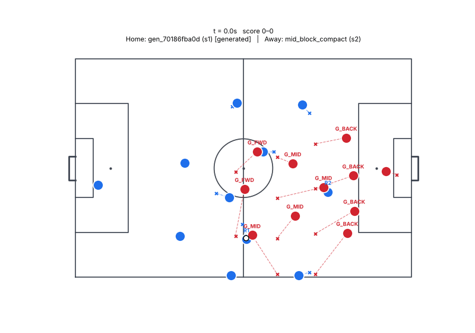

<details><summary>Play definition (YAML)</summary>

```yaml
id: gen_70186fba0d
name: Generated play
version: 1
phase: in_possession
objective: create_chance
strategy: generated
fallback: false
roles:
- id: R1
  desc: ''
  hints:
  - AM
  - W_near
  - CM
  requires:
    passing: 0.4
  prefers: {}
  starts_with_ball: true
- id: R2
  desc: ''
  hints:
  - ST
  - AM
  - CM
  requires:
    first_touch: 0.5
  prefers: {}
  starts_with_ball: false
triggers:
  all:
  - possession: us
  - has_ball: R1
hard_constraints: []
steps:
- id: s1
  choose:
  - when:
      lane_open:
        from: R1
        to:
          role: R2
        min_p: 0.7
    actions:
    - type: pass
      role: R1
      to:
        role: R2
      style: ground
  - when: always
    actions:
    - type: dribble
      role: R1
      to:
        pc_best:
          zone: mid_opp.center
        score: pc_xt
  done_when:
    any:
    - event: pass_completed
    - event: pass_intercepted
    - step_elapsed_s:
        gt: 1.5
  timeout_s: 2.0
  on_timeout: abort
- id: s2
  choose:
  - when:
      has_ball: R2
    actions:
    - type: run_to
      role: R1
      to:
        anchor: role:R1
        offset:
        - 8.0
        - 0.0
        freeze: step_start
      speed: max
    - type: pass
      role: R2
      to:
        role: R1
        lead: 3.0
      style: ground
      one_touch: true
  - when: always
    actions:
    - type: carry
      actor: ball_holder
      to:
        pc_best:
          zone: mid_opp.center
        score: pc_xt
      speed: fast
  done_when:
    any:
    - has_ball: R1
    - event: pass_completed
    - step_elapsed_s:
        gt: 0.3
  timeout_s: 2.5
  on_timeout: abort
- id: s3
  actions:
  - type: pass
    actor: ball_holder
    to:
      role: R1
      lead: 3.0
    style: ground
    one_touch: true
  done_when:
    any:
    - event: pass_completed
    - step_elapsed_s:
        gt: 2.0
  timeout_s: 2.5
  on_timeout: abort
- id: s4
  choose:
  - when:
      xg:
        ref: ball_holder
        gt: 0.06
    actions:
    - type: pass
      actor: ball_holder
      to:
        best_teammate:
          score: xt
          zone: box
      style: through
  - when: always
    actions:
    - type: shoot
      actor: ball_holder
      placement: auto
  done_when:
    ball_in_zone: box
  timeout_s: 3.0
  on_timeout: abort
- id: s5
  choose:
  - when:
      xg:
        ref: ball_holder
        gt: 0.1
    actions:
    - type: pass
      role: R1
      to:
        best_teammate:
          score: xt
          zone: box
      style: ground
  - when: always
    actions:
    - type: pass
      actor: ball_holder
      to:
        best_teammate:
          score: xt
          zone: box
      style: ground
  done_when:
    any:
    - event: shot_taken
    - event: pass_intercepted
  timeout_s: 3.0
  on_timeout: abort
success:
  ball_in_zone: box
abort:
  event: ball_out
max_duration_s: 15.0
cooldown_s: 0.0
soft_hints:
  risk: 0.3
  chain_depth: 5
  tempo: fast
source: generated
```

</details>

## gen_d170126ff5

Called by **main_exploiter** against **league_exploiter** (running `low_block_box_protection`); steps reached: s1; ended: abort; reward +0.0391.

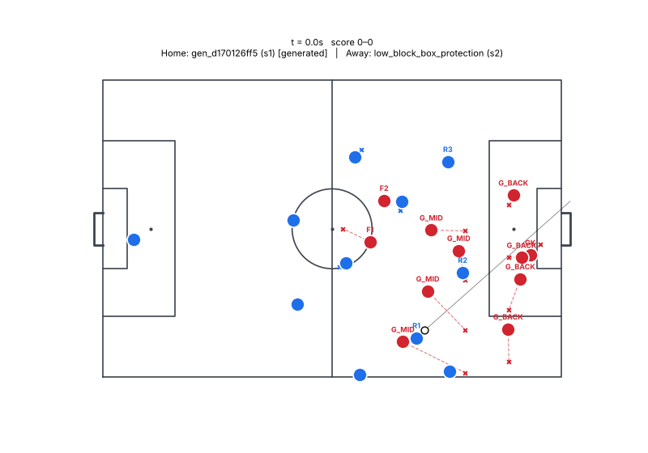

<details><summary>Play definition (YAML)</summary>

```yaml
id: gen_d170126ff5
name: Generated play
version: 1
phase: in_possession
objective: create_chance
strategy: generated
fallback: false
roles:
- id: R1
  desc: ''
  hints:
  - CM
  - AM
  - DM
  requires:
    passing: 0.6
    vision: 0.5
  prefers: {}
  starts_with_ball: true
- id: R2
  desc: ''
  hints:
  - ST
  - W_near
  - W_far
  requires:
    pace: 0.65
  prefers: {}
  starts_with_ball: false
- id: R3
  desc: ''
  hints:
  - W_far
  - AM
  - ST
  requires: {}
  prefers: {}
  starts_with_ball: false
triggers:
  all:
  - possession: us
  - has_ball: R1
hard_constraints: []
steps:
- id: s1
  choose:
  - when:
      all:
      - onside: R2
      - lane_open:
          from: R1
          to:
            space_behind:
              line: opp_last_line
              lane: center
              depth: 10.0
          min_p: 0.4
    actions:
    - type: spin_in_behind
      role: R2
      line: opp_last_line
      lane: center
      depth: 10.0
    - type: decoy_run
      role: R3
      to:
        anchor: line:opp_last_line
        offset:
        - -2.0
        - -12.0
    - type: pass
      role: R1
      to:
        space_behind:
          line: opp_last_line
          lane: center
          depth: 10.0
      style: through
  - when:
      xg:
        ref: ball_holder
        gt: 0.12
    actions:
    - type: spin_in_behind
      actor: ball_holder
      line: opp_last_line
      lane: center
      depth: 10.0
  - when: always
    actions:
    - type: shoot
      actor: ball_holder
      placement: auto
  done_when:
    any:
    - event: pass_intercepted
    - event: ball_out
  timeout_s: 3.0
  on_timeout: abort
success:
  event: goal
abort:
  ball_in_zone: box
max_duration_s: 5.0
cooldown_s: 0.0
soft_hints:
  risk: 0.6
  chain_depth: 1
  tempo: fast
source: generated
```

</details>

## gen_3001c1ee9e

Called by **main** against **chaotic** (running `low_block_box_protection`, `mid_block_compact`); steps reached: s1 → s2 → s3 → s4; ended: success; reward +0.0381.

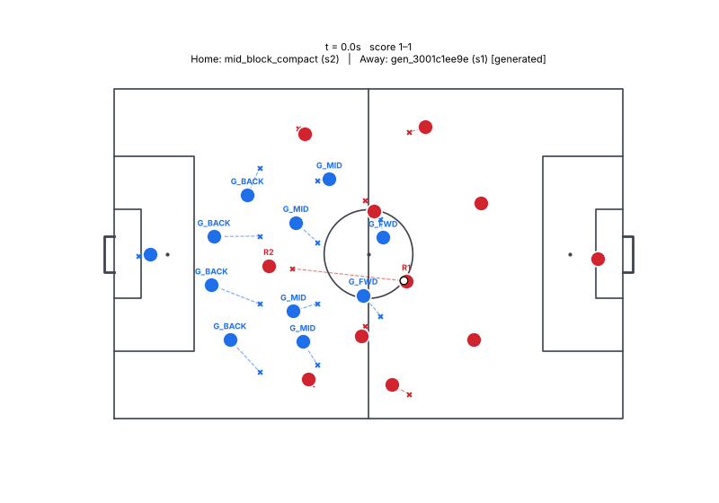

<details><summary>Play definition (YAML)</summary>

```yaml
id: gen_3001c1ee9e
name: Generated play
version: 1
phase: in_possession
objective: create_chance
strategy: generated
fallback: false
roles:
- id: R1
  desc: ''
  hints:
  - DM
  - FB_far
  - W_far
  requires:
    passing: 0.4
  prefers: {}
  starts_with_ball: true
- id: R2
  desc: ''
  hints:
  - ST
  - AM
  - CM
  requires:
    first_touch: 0.5
  prefers: {}
  starts_with_ball: false
triggers:
  all:
  - possession: us
  - has_ball: R1
hard_constraints: []
steps:
- id: s1
  choose:
  - when:
      lane_open:
        from: R1
        to:
          role: R2
        min_p: 0.7
    actions:
    - type: pass
      role: R1
      to:
        role: R2
      style: ground
  - when: always
    actions:
    - type: dribble
      role: R1
      to:
        pc_best:
          zone: mid_opp.center
        score: pc_xt
  done_when:
    any:
    - event: pass_completed
    - event: pass_intercepted
    - step_elapsed_s:
        gt: 1.5
  timeout_s: 2.0
  on_timeout: abort
- id: s2
  choose:
  - when:
      has_ball: R2
    actions:
    - type: run_to
      role: R1
      to:
        anchor: role:R1
        offset:
        - 8.0
        - 0.0
        freeze: step_start
      speed: max
    - type: pass
      role: R2
      to:
        role: R1
        lead: 3.0
      style: ground
      one_touch: true
  - when: always
    actions:
    - type: carry
      actor: ball_holder
      to:
        pc_best:
          zone: mid_opp.center
        score: pc_xt
      speed: fast
  done_when:
    any:
    - has_ball: R1
    - event: pass_completed
    - step_elapsed_s:
        gt: 0.3
  timeout_s: 2.5
  on_timeout: abort
- id: s3
  actions:
  - type: pass
    actor: ball_holder
    to:
      role: R1
      lead: 3.0
    style: ground
    one_touch: true
  done_when:
    any:
    - has_ball: R1
    - event: pass_completed
    - step_elapsed_s:
        gt: 1.5
  timeout_s: 2.5
  on_timeout: abort
- id: s4
  choose:
  - when:
      xg:
        ref: ball_holder
        gt: 0.06
    actions:
    - type: pass
      actor: ball_holder
      to:
        best_teammate:
          score: xt
          zone: box
      style: ground
  - when: always
    actions:
    - type: shoot
      actor: ball_holder
      placement: auto
  done_when:
    any:
    - ball_in_zone: box
  timeout_s: 2.5
  on_timeout: abort
success:
  ball_in_zone: box
abort:
  event: possession_lost
max_duration_s: 11.5
cooldown_s: 0.0
soft_hints:
  risk: 0.3
  chain_depth: 4
  tempo: fast
source: generated
```

</details>

## gen_28cec26b46

Called by **main** against **selector** (running `low_block_box_protection`, `mid_block_compact`); steps reached: s1 → s2 → s3 → s4; ended: success; reward +0.0309.

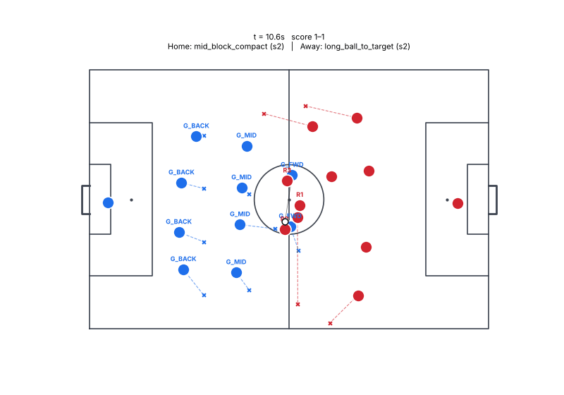

<details><summary>Play definition (YAML)</summary>

```yaml
id: gen_28cec26b46
name: Generated play
version: 1
phase: in_possession
objective: create_chance
strategy: generated
fallback: false
roles:
- id: R1
  desc: ''
  hints:
  - AM
  - W_near
  - CM
  requires:
    passing: 0.4
  prefers: {}
  starts_with_ball: true
- id: R2
  desc: ''
  hints:
  - ST
  - AM
  - CM
  requires:
    first_touch: 0.5
  prefers: {}
  starts_with_ball: false
triggers:
  all:
  - possession: us
  - has_ball: R1
hard_constraints: []
steps:
- id: s1
  choose:
  - when:
      lane_open:
        from: R1
        to:
          role: R2
        min_p: 0.7
    actions:
    - type: pass
      role: R1
      to:
        role: R2
      style: ground
  - when: always
    actions:
    - type: dribble
      role: R1
      to:
        pc_best:
          zone: mid_opp.center
        score: pc_xt
  done_when:
    any:
    - event: pass_completed
    - event: pass_intercepted
    - step_elapsed_s:
        gt: 1.5
  timeout_s: 2.0
  on_timeout: abort
- id: s2
  choose:
  - when:
      has_ball: R2
    actions:
    - type: run_to
      role: R1
      to:
        anchor: role:R1
        offset:
        - 8.0
        - 0.0
        freeze: step_start
      speed: max
    - type: pass
      role: R2
      to:
        role: R1
        lead: 3.0
      style: ground
      one_touch: true
  - when: always
    actions:
    - type: carry
      actor: ball_holder
      to:
        pc_best:
          zone: final_third.*
        score: pc_xt
      speed: fast
  done_when:
    any:
    - has_ball: R1
    - event: pass_completed
    - step_elapsed_s:
        gt: 0.3
  timeout_s: 2.5
  on_timeout: abort
- id: s3
  actions:
  - type: pass
    actor: ball_holder
    to:
      role: R1
      lead: 3.0
    style: ground
    one_touch: true
  done_when:
    any:
    - event: pass_completed
    - step_elapsed_s:
        gt: 2.0
  timeout_s: 2.5
  on_timeout: abort
- id: s4
  choose:
  - when:
      xg:
        ref: ball_holder
        gt: 0.06
    actions:
    - type: pass
      actor: ball_holder
      to:
        best_teammate:
          score: xt
          zone: box
      style: through
  - when: always
    actions:
    - type: shoot
      actor: ball_holder
      placement: auto
  done_when:
    ball_in_zone: box
  timeout_s: 3.0
  on_timeout: abort
- id: s5
  choose:
  - when:
      xg:
        ref: ball_holder
        gt: 0.06
    actions:
    - type: pass
      role: R1
      to:
        best_teammate:
          score: xt
          zone: box
      style: ground
  - when: always
    actions:
    - type: pass
      actor: ball_holder
      to:
        best_teammate:
          score: xt
          zone: box
      style: ground
  done_when:
    any:
    - event: shot_taken
    - event: pass_intercepted
  timeout_s: 3.0
  on_timeout: abort
success:
  ball_in_zone: box
abort:
  event: ball_out
max_duration_s: 15.0
cooldown_s: 0.0
soft_hints:
  risk: 0.3
  chain_depth: 5
  tempo: fast
source: generated
```

</details>

## gen_8c5861156f

Called by **main** against **main** (running `low_block_box_protection`, `mid_block_compact`); steps reached: s1 → s2 → s3 → s4 → s5; ended: success; reward +0.0283.

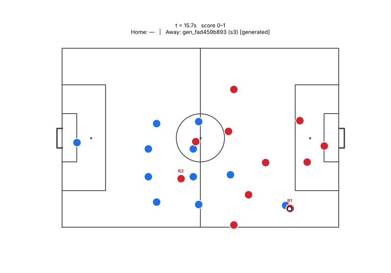

<details><summary>Play definition (YAML)</summary>

```yaml
id: gen_8c5861156f
name: Generated play
version: 1
phase: in_possession
objective: create_chance
strategy: generated
fallback: false
roles:
- id: R1
  desc: ''
  hints:
  - DM
  - FB_far
  - W_far
  requires:
    passing: 0.4
  prefers: {}
  starts_with_ball: true
- id: R2
  desc: ''
  hints:
  - ST
  - AM
  - CM
  requires:
    first_touch: 0.5
  prefers: {}
  starts_with_ball: false
triggers:
  all:
  - possession: us
  - has_ball: R1
hard_constraints: []
steps:
- id: s1
  choose:
  - when:
      lane_open:
        from: R1
        to:
          role: R2
        min_p: 0.7
    actions:
    - type: pass
      role: R1
      to:
        role: R2
      style: ground
  - when: always
    actions:
    - type: dribble
      role: R1
      to:
        pc_best:
          zone: mid_opp.center
        score: pc_xt
  done_when:
    any:
    - event: pass_completed
    - event: pass_intercepted
    - step_elapsed_s:
        gt: 1.5
  timeout_s: 2.0
  on_timeout: abort
- id: s2
  choose:
  - when:
      has_ball: R2
    actions:
    - type: run_to
      role: R1
      to:
        anchor: role:R1
        offset:
        - 8.0
        - 0.0
        freeze: step_start
      speed: max
    - type: pass
      role: R2
      to:
        role: R1
        lead: 3.0
      style: ground
      one_touch: true
  - when: always
    actions:
    - type: carry
      actor: ball_holder
      to:
        pc_best:
          zone: final_third.*
        score: pc_xt
      speed: fast
  done_when:
    any:
    - has_ball: R1
    - event: pass_completed
    - step_elapsed_s:
        gt: 0.3
  timeout_s: 2.5
  on_timeout: abort
- id: s3
  actions:
  - type: pass
    actor: ball_holder
    to:
      role: R1
      lead: 3.0
    style: ground
    one_touch: true
  done_when:
    any:
    - has_ball: R1
    - event: pass_completed
    - step_elapsed_s:
        gt: 1.5
  timeout_s: 2.5
  on_timeout: abort
- id: s4
  choose:
  - when:
      xg:
        ref: ball_holder
        gt: 0.06
    actions:
    - type: pass
      actor: ball_holder
      to:
        best_teammate:
          score: xt
          zone: box
      style: ground
  - when: always
    actions:
    - type: shoot
      actor: ball_holder
      placement: auto
  done_when:
    any:
    - event: shot_taken
    - event: pass_completed
    - step_elapsed_s:
        gt: 2.0
  timeout_s: 2.5
  on_timeout: abort
- id: s5
  choose:
  - when:
      xg:
        ref: ball_holder
        gt: 0.04
    actions:
    - type: pass
      actor: ball_holder
      to:
        best_teammate:
          score: xt
          zone: box
      style: ground
  - when: always
    actions:
    - type: carry
      actor: ball_holder
      to:
        anchor: penalty_spot
        offset:
        - 0.0
        - 10.0
        freeze: step_start
      speed: max
    - type: pass
      role: R1
      to:
        best_teammate:
          score: xt
          zone: box
      style: ground
  done_when:
    ball_in_zone: box
  timeout_s: 3.0
  on_timeout: abort
success:
  ball_in_zone: box
abort:
  event: possession_lost
max_duration_s: 14.5
cooldown_s: 0.0
soft_hints:
  risk: 0.3
  chain_depth: 5
  tempo: fast
source: generated
```

</details>

## gen_b92d43e22f

Called by **main** against **direct** (running `low_block_box_protection`, `mid_block_compact`); steps reached: s1 → s2 → s3 → s4; ended: success; reward +0.0275.

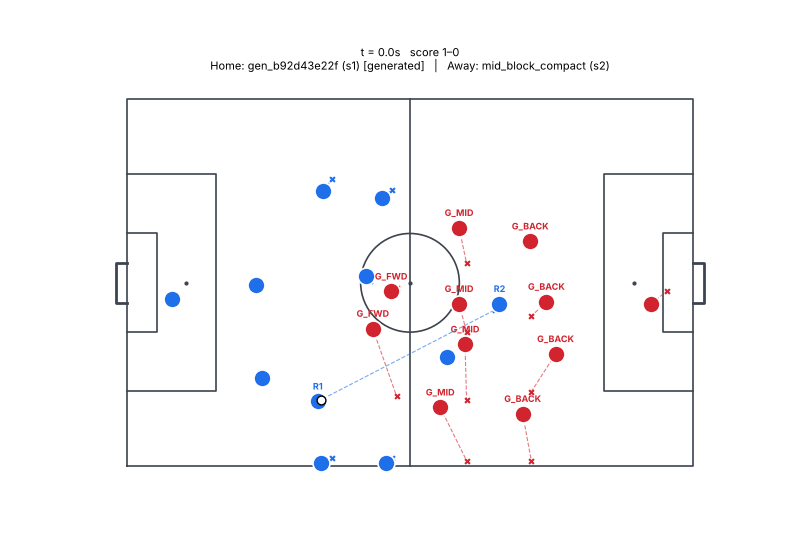

<details><summary>Play definition (YAML)</summary>

```yaml
id: gen_b92d43e22f
name: Generated play
version: 1
phase: in_possession
objective: create_chance
strategy: generated
fallback: false
roles:
- id: R1
  desc: ''
  hints:
  - DM
  - FB_far
  - W_far
  requires:
    passing: 0.4
  prefers: {}
  starts_with_ball: true
- id: R2
  desc: ''
  hints:
  - ST
  - AM
  - CM
  requires:
    first_touch: 0.5
  prefers: {}
  starts_with_ball: false
triggers:
  all:
  - possession: us
  - has_ball: R1
hard_constraints: []
steps:
- id: s1
  choose:
  - when:
      lane_open:
        from: R1
        to:
          role: R2
        min_p: 0.7
    actions:
    - type: pass
      role: R1
      to:
        role: R2
      style: ground
  - when: always
    actions:
    - type: dribble
      role: R1
      to:
        pc_best:
          zone: mid_opp.center
        score: pc_xt
  done_when:
    any:
    - event: pass_completed
    - step_elapsed_s:
        gt: 0.8
    - ball_beyond_line:
        line: opp_first_line
  timeout_s: 2.0
  on_timeout: abort
- id: s2
  choose:
  - when:
      has_ball: R2
    actions:
    - type: run_to
      role: R1
      to:
        anchor: role:R1
        offset:
        - 8.0
        - 0.0
        freeze: step_start
      speed: max
    - type: pass
      role: R2
      to:
        role: R1
        lead: 3.0
      style: ground
      one_touch: true
  - when: always
    actions:
    - type: carry
      actor: ball_holder
      to:
        pc_best:
          zone: mid_opp.center
        score: pc_xt
      speed: fast
  done_when:
    any:
    - has_ball: R1
    - event: pass_completed
    - step_elapsed_s:
        gt: 0.3
  timeout_s: 2.5
  on_timeout: abort
- id: s3
  actions:
  - type: pass
    actor: ball_holder
    to:
      role: R1
      lead: 3.0
    style: ground
    one_touch: true
  done_when:
    any:
    - has_ball: R1
    - event: pass_completed
    - step_elapsed_s:
        gt: 1.5
  timeout_s: 2.5
  on_timeout: abort
- id: s4
  choose:
  - when:
      xg:
        ref: ball_holder
        gt: 0.06
    actions:
    - type: pass
      actor: ball_holder
      to:
        best_teammate:
          score: xt
          zone: box
      style: ground
  - when: always
    actions:
    - type: shoot
      actor: ball_holder
      placement: auto
  done_when:
    any:
    - ball_in_zone: box
  timeout_s: 2.5
  on_timeout: abort
success:
  ball_in_zone: box
abort:
  event: possession_lost
max_duration_s: 11.5
cooldown_s: 0.0
soft_hints:
  risk: 0.3
  chain_depth: 4
  tempo: fast
source: generated
```

</details>

## gen_d727d4f0c0

Called by **league_exploiter** against **main_exploiter** (running `low_block_box_protection`, `mid_block_compact`); steps reached: s1 → s2; ended: step timeout abort; reward +0.0261.

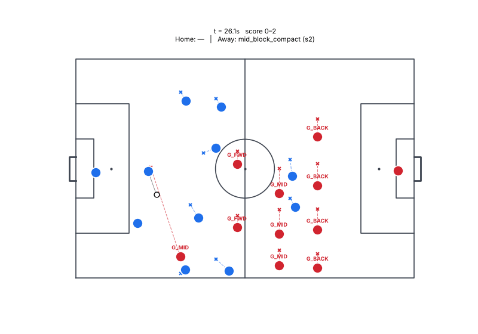

<details><summary>Play definition (YAML)</summary>

```yaml
id: gen_d727d4f0c0
name: Generated play
version: 1
phase: in_possession
objective: score
strategy: generated
fallback: false
roles:
- id: R1
  desc: ''
  hints:
  - FB_near
  - W_near
  - CM
  requires: {}
  prefers: {}
  starts_with_ball: true
- id: R2
  desc: ''
  hints:
  - DM
  - CB_near
  - CM
  requires:
    passing: 0.55
  prefers: {}
  starts_with_ball: false
- id: R3
  desc: ''
  hints:
  - FB_far
  - CM
  requires:
    first_touch: 0.4
  prefers: {}
  starts_with_ball: false
- id: R4
  desc: ''
  hints:
  - CB_near
  - CM
  requires: {}
  prefers: {}
  starts_with_ball: false
triggers:
  all:
  - possession: us
  - has_ball: R1
hard_constraints: []
steps:
- id: s1
  choose:
  - when:
      has_ball: R3
    actions:
    - type: overlap
      role: R4
      around: R1
    - type: carry
      role: R1
      to:
        pc_best:
          zone: final_third.*
        score: pc_xt
      speed: fast
  - when: always
    actions:
    - type: pass
      role: R1
      to:
        pc_best:
          zone: final_third.*
        score: pc_xt
      style: ground
  done_when:
    any:
    - has_ball: R4
    - onside: R2
    - lane_open:
        from: R2
        to:
          role: R2
        min_p: 0.7
  timeout_s: 3.0
  on_timeout: abort
- id: s2
  actions:
  - type: pass
    role: R1
    to:
      zone: near_post_area
    style: driven
  done_when:
    any:
    - has_ball: R4
    - dist:
        a: role:R2
        b: role:R4
        lt: 2.0
  timeout_s: 3.0
  on_timeout: abort
- id: s3
  start_when:
    has_ball: R4
  actions:
  - type: pass
    role: R2
    to:
      pc_best:
        zone: mid_own.far_wing
      score: pc_xt
    style: ground
  done_when:
    any:
    - has_ball: R4
    - has_ball: R4
    - has_ball: R4
  timeout_s: 3.0
  on_timeout: abort
- id: s4
  actions:
  - type: pass
    role: R2
    to:
      role: R4
    style: ground
  done_when:
    any:
    - has_ball: R4
    - has_ball: R4
    - has_ball: R4
  timeout_s: 3.0
  on_timeout: abort
success:
  has_ball: R4
abort:
  any:
  - event: possession_lost
  - event: ball_out
max_duration_s: 14.0
cooldown_s: 0.0
soft_hints:
  risk: 0.3
  chain_depth: 4
  tempo: medium
source: generated
```

</details>

## gen_62cc6133d3

Called by **main_exploiter** against **league_exploiter** (running `low_block_box_protection`, `mid_block_compact`); steps reached: s1 → s2 → s3 → s4; ended: success; reward +0.0244.

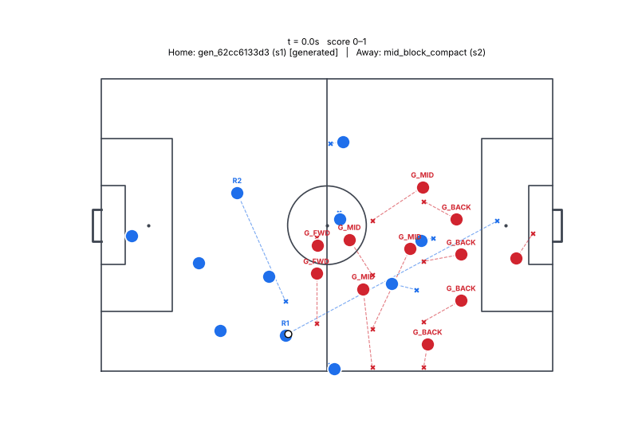

<details><summary>Play definition (YAML)</summary>

```yaml
id: gen_62cc6133d3
name: Generated play
version: 1
phase: in_possession
objective: score
strategy: generated
fallback: false
roles:
- id: R1
  desc: ''
  hints:
  - AM
  - CM
  - ST
  requires:
    finishing: 0.4
  prefers: {}
  starts_with_ball: true
- id: R2
  desc: ''
  hints:
  - CB_far
  requires: {}
  prefers: {}
  starts_with_ball: false
triggers:
  all:
  - possession: us
  - has_ball: R1
hard_constraints: []
steps:
- id: s1
  choose:
  - when:
      xg:
        ref: role:R1
        gt: 0.06
    actions:
    - type: shoot
      role: R1
      placement: auto
  - when: always
    actions:
    - type: carry
      role: R1
      to:
        pc_best:
          zone: final_third.center
        score: pc_xt
      speed: fast
    - type: support
      role: R2
      from: R1
      angle: square
      distance: 8.0
  done_when:
    any:
    - event: shot_taken
    - step_elapsed_s:
        gt: 2.0
  timeout_s: 2.5
  on_timeout: abort
- id: s2
  choose:
  - when:
      lane_open:
        from: R1
        to:
          role: R2
        min_p: 0.6
    actions:
    - type: pass
      role: R1
      to:
        best_teammate:
          score: pass_p
      style: ground
  - when: always
    actions:
    - type: shoot
      role: R1
      placement: auto
  done_when:
    any:
    - event: shot_taken
    - event: pass_completed
    - event: pass_intercepted
  timeout_s: 3.0
  on_timeout: abort
- id: s3
  choose:
  - when:
      has_ball: R2
    actions:
    - type: pass
      role: R2
      to:
        role: R2
      style: ground
  - when: always
    actions:
    - type: carry
      actor: ball_holder
      to:
        pc_best:
          zone: mid_opp.*
        score: pc_xt
      speed: fast
    - type: pass
      role: R1
      to:
        space_behind:
          line: opp_last_line
          lane: center
          depth: 6.0
      style: through
  done_when:
    all:
    - possession: us
    - ball_beyond_line:
        line: opp_first_line
  timeout_s: 4.0
  on_timeout: abort
- id: s4
  choose:
  - when:
      all:
      - possession: us
      - ball_beyond_line:
          line: opp_first_line
    actions:
    - type: carry
      role: R2
      to:
        anchor: penalty_spot
        offset:
        - 0.0
        - 0.0
      speed: jog
  - when: always
    actions:
    - type: shoot
      actor: ball_holder
      placement: auto
  done_when:
    any:
    - event: pass_completed
    - ball_in_zone: box
    - pressure_on:
        ref: role:R2
        lt: 4.0
  timeout_s: 3.0
  on_timeout: abort
success:
  ball_in_zone: box
abort:
  any:
  - event: possession_lost
  - event: ball_out
max_duration_s: 14.5
cooldown_s: 0.0
soft_hints:
  risk: 0.3
  chain_depth: 4
  tempo: fast
source: generated
```

</details>

## gen_336193263d

Called by **main** against **high_press** (running `low_block_box_protection`); steps reached: s1 → s2; ended: success; reward +0.0236.

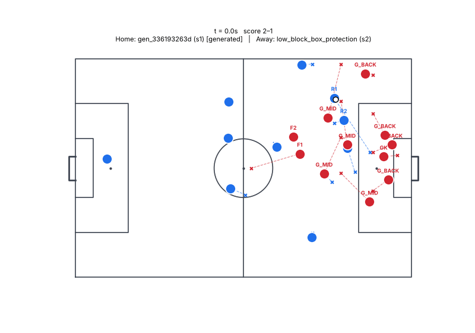

<details><summary>Play definition (YAML)</summary>

```yaml
id: gen_336193263d
name: Generated play
version: 1
phase: in_possession
objective: score
strategy: generated
fallback: false
roles:
- id: R1
  desc: ''
  hints:
  - AM
  - CM
  - ST
  requires:
    finishing: 0.4
  prefers: {}
  starts_with_ball: true
- id: R2
  desc: ''
  hints:
  - ST
  - AM
  - CM
  requires: {}
  prefers: {}
  starts_with_ball: false
triggers:
  all:
  - possession: us
  - has_ball: R1
hard_constraints: []
steps:
- id: s1
  choose:
  - when:
      xg:
        ref: role:R1
        gt: 0.06
    actions:
    - type: shoot
      role: R1
      placement: auto
  - when: always
    actions:
    - type: carry
      role: R1
      to:
        pc_best:
          zone: final_third.center
        score: pc_xt
      speed: fast
    - type: support
      role: R2
      from: R1
      angle: square
      distance: 8.0
  done_when:
    any:
    - event: shot_taken
    - step_elapsed_s:
        gt: 2.0
  timeout_s: 2.5
  on_timeout: abort
- id: s2
  choose:
  - when: always
    actions:
    - type: shoot
      role: R1
      placement: auto
  - when:
      lane_open:
        from: R1
        to:
          role: R2
        min_p: 0.6
    actions:
    - type: pass
      role: R1
      to:
        role: R2
      style: ground
  - when: always
    actions:
    - type: pass
      role: R1
      to:
        best_teammate:
          score: pass_p
      style: ground
  done_when:
    any:
    - event: shot_taken
    - event: pass_completed
    - event: pass_intercepted
  timeout_s: 3.0
  on_timeout: abort
success:
  any:
  - event: shot_taken
  - event: goal
abort:
  any:
  - event: possession_lost
  - event: ball_out
max_duration_s: 7.5
cooldown_s: 0.0
soft_hints:
  risk: 0.3
  chain_depth: 2
  tempo: fast
source: generated
```

</details>

## gen_923fd7bd32

Called by **main** against **high_press** (running `low_block_box_protection`, `mid_block_compact`); steps reached: s1 → s2 → s3 → s4; ended: success; reward +0.0225.

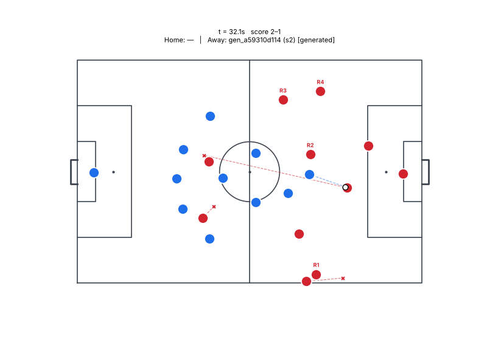

<details><summary>Play definition (YAML)</summary>

```yaml
id: gen_923fd7bd32
name: Generated play
version: 1
phase: in_possession
objective: create_chance
strategy: generated
fallback: false
roles:
- id: R1
  desc: ''
  hints:
  - AM
  - W_near
  - CM
  requires:
    passing: 0.4
  prefers: {}
  starts_with_ball: true
- id: R2
  desc: ''
  hints:
  - ST
  - AM
  - CM
  requires:
    first_touch: 0.5
  prefers: {}
  starts_with_ball: false
triggers:
  all:
  - possession: us
  - has_ball: R1
hard_constraints: []
steps:
- id: s1
  choose:
  - when:
      lane_open:
        from: R1
        to:
          role: R2
        min_p: 0.7
    actions:
    - type: pass
      role: R1
      to:
        role: R2
      style: ground
  - when: always
    actions:
    - type: dribble
      role: R1
      to:
        pc_best:
          zone: mid_opp.center
        score: pc_xt
  done_when:
    any:
    - event: pass_completed
    - event: pass_intercepted
    - step_elapsed_s:
        gt: 1.5
  timeout_s: 2.0
  on_timeout: abort
- id: s2
  choose:
  - when:
      has_ball: R2
    actions:
    - type: run_to
      role: R1
      to:
        anchor: role:R1
        offset:
        - 8.0
        - 0.0
        freeze: step_start
      speed: max
    - type: pass
      role: R2
      to:
        role: R1
        lead: 3.0
      style: ground
      one_touch: true
  - when: always
    actions:
    - type: carry
      actor: ball_holder
      to:
        pc_best:
          zone: mid_opp.center
        score: pc_xt
      speed: fast
  done_when:
    any:
    - has_ball: R1
    - event: pass_completed
    - step_elapsed_s:
        gt: 0.3
  timeout_s: 2.5
  on_timeout: abort
- id: s3
  actions:
  - type: pass
    actor: ball_holder
    to:
      role: R1
      lead: 3.0
    style: ground
    one_touch: true
  done_when:
    any:
    - event: pass_completed
    - step_elapsed_s:
        gt: 2.0
  timeout_s: 2.5
  on_timeout: abort
- id: s4
  choose:
  - when:
      xg:
        ref: ball_holder
        gt: 0.06
    actions:
    - type: pass
      actor: ball_holder
      to:
        best_teammate:
          score: xt
          zone: box
      style: through
  - when: always
    actions:
    - type: shoot
      actor: ball_holder
      placement: auto
  done_when:
    ball_in_zone: box
  timeout_s: 3.0
  on_timeout: abort
- id: s5
  choose:
  - when:
      xg:
        ref: ball_holder
        gt: 0.1
    actions:
    - type: pass
      role: R1
      to:
        best_teammate:
          score: xt
          zone: box
      style: ground
  - when: always
    actions:
    - type: pass
      actor: ball_holder
      to:
        best_teammate:
          score: xt
          zone: box
      style: ground
  done_when:
    any:
    - ball_in_zone: box
    - event: pass_intercepted
  timeout_s: 3.0
  on_timeout: abort
success:
  ball_in_zone: box
abort:
  event: ball_out
max_duration_s: 15.0
cooldown_s: 0.0
soft_hints:
  risk: 0.3
  chain_depth: 5
  tempo: fast
source: generated
```

</details>

## gen_4e442422ff

Called by **main** against **league_exploiter** (running `low_block_box_protection`, `mid_block_compact`); steps reached: s1 → s2 → s3 → s4 → s5; ended: success; reward +0.0210.

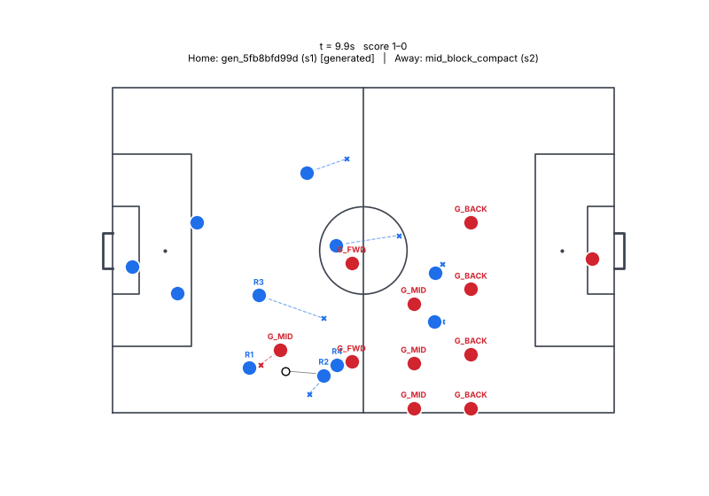

<details><summary>Play definition (YAML)</summary>

```yaml
id: gen_4e442422ff
name: Generated play
version: 1
phase: in_possession
objective: create_chance
strategy: generated
fallback: false
roles:
- id: R1
  desc: ''
  hints:
  - DM
  - FB_far
  - W_far
  requires:
    passing: 0.4
  prefers: {}
  starts_with_ball: true
- id: R2
  desc: ''
  hints:
  - ST
  - AM
  - CM
  requires:
    first_touch: 0.5
  prefers: {}
  starts_with_ball: false
triggers:
  all:
  - possession: us
  - has_ball: R1
hard_constraints: []
steps:
- id: s1
  choose:
  - when:
      lane_open:
        from: R1
        to:
          role: R2
        min_p: 0.7
    actions:
    - type: pass
      role: R1
      to:
        role: R2
      style: ground
  - when: always
    actions:
    - type: dribble
      role: R1
      to:
        pc_best:
          zone: mid_opp.center
        score: pc_xt
  done_when:
    any:
    - event: pass_completed
    - event: pass_intercepted
    - step_elapsed_s:
        gt: 1.5
  timeout_s: 2.0
  on_timeout: abort
- id: s2
  choose:
  - when:
      has_ball: R2
    actions:
    - type: run_to
      role: R1
      to:
        anchor: role:R1
        offset:
        - 8.0
        - 0.0
        freeze: step_start
      speed: max
    - type: pass
      role: R2
      to:
        role: R1
        lead: 3.0
      style: ground
      one_touch: true
  - when: always
    actions:
    - type: carry
      actor: ball_holder
      to:
        pc_best:
          zone: final_third.*
        score: pc_xt
      speed: fast
  done_when:
    any:
    - has_ball: R1
    - event: pass_completed
    - step_elapsed_s:
        gt: 0.3
  timeout_s: 2.5
  on_timeout: abort
- id: s3
  actions:
  - type: pass
    actor: ball_holder
    to:
      role: R1
      lead: 3.0
    style: ground
    one_touch: true
  done_when:
    any:
    - has_ball: R1
    - event: pass_completed
    - step_elapsed_s:
        gt: 3.0
  timeout_s: 2.5
  on_timeout: abort
- id: s4
  choose:
  - when:
      xg:
        ref: role:R2
        gt: 0.12
    actions:
    - type: pass
      actor: ball_holder
      to:
        best_teammate:
          score: pc_xt
      style: ground
  - when: always
    actions:
    - type: shoot
      actor: ball_holder
      placement: auto
  done_when:
    any:
    - event: shot_taken
    - event: pass_completed
    - step_elapsed_s:
        gt: 2.0
  timeout_s: 2.5
  on_timeout: abort
- id: s5
  choose:
  - when:
      xg:
        ref: ball_holder
        gt: 0.06
    actions:
    - type: shoot
      actor: ball_holder
      placement: auto
  - when: always
    actions:
    - type: pass
      actor: ball_holder
      to:
        best_teammate:
          score: xt
          zone: box
      style: through
  done_when:
    any:
    - event: pass_intercepted
  timeout_s: 3.0
  on_timeout: abort
success:
  ball_in_zone: box
abort:
  event: possession_lost
max_duration_s: 14.5
cooldown_s: 0.0
soft_hints:
  risk: 0.3
  chain_depth: 5
  tempo: fast
source: generated
```

</details>

## gen_fad459b893

Called by **main** against **league_exploiter** (running `low_block_box_protection`, `mid_block_compact`); steps reached: s1 → s2 → s3 → s4; ended: success; reward +0.0209.

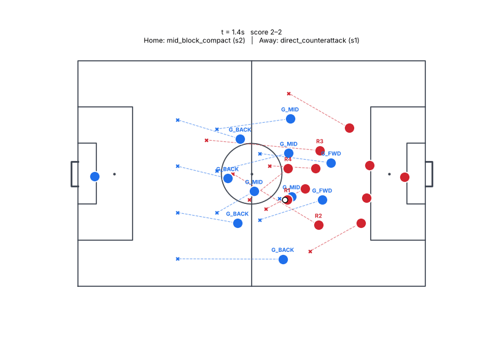

<details><summary>Play definition (YAML)</summary>

```yaml
id: gen_fad459b893
name: Generated play
version: 1
phase: in_possession
objective: create_chance
strategy: generated
fallback: false
roles:
- id: R1
  desc: ''
  hints:
  - AM
  - W_near
  - CM
  requires:
    passing: 0.4
  prefers: {}
  starts_with_ball: true
- id: R2
  desc: ''
  hints:
  - ST
  - AM
  - CM
  requires:
    first_touch: 0.5
  prefers: {}
  starts_with_ball: false
triggers:
  all:
  - possession: us
  - has_ball: R1
hard_constraints: []
steps:
- id: s1
  choose:
  - when:
      lane_open:
        from: R1
        to:
          role: R2
        min_p: 0.7
    actions:
    - type: pass
      role: R1
      to:
        role: R2
      style: ground
  - when: always
    actions:
    - type: dribble
      role: R1
      to:
        pc_best:
          zone: mid_opp.center
        score: pc_xt
  done_when:
    any:
    - event: pass_completed
    - event: pass_intercepted
    - step_elapsed_s:
        gt: 1.5
  timeout_s: 2.0
  on_timeout: abort
- id: s2
  choose:
  - when:
      has_ball: R2
    actions:
    - type: run_to
      role: R1
      to:
        anchor: role:R1
        offset:
        - 8.0
        - 0.0
        freeze: step_start
      speed: max
    - type: pass
      role: R2
      to:
        role: R1
        lead: 3.0
      style: ground
      one_touch: true
  - when: always
    actions:
    - type: carry
      actor: ball_holder
      to:
        pc_best:
          zone: final_third.*
        score: pc_xt
      speed: fast
  done_when:
    any:
    - has_ball: R1
    - event: pass_completed
    - step_elapsed_s:
        gt: 0.3
  timeout_s: 2.5
  on_timeout: abort
- id: s3
  actions:
  - type: pass
    actor: ball_holder
    to:
      role: R1
      lead: 3.0
    style: ground
    one_touch: true
  done_when:
    any:
    - event: pass_completed
    - step_elapsed_s:
        gt: 2.0
  timeout_s: 2.5
  on_timeout: abort
- id: s4
  choose:
  - when:
      xg:
        ref: ball_holder
        gt: 0.06
    actions:
    - type: pass
      actor: ball_holder
      to:
        best_teammate:
          score: xt
          zone: box
      style: through
  - when: always
    actions:
    - type: shoot
      actor: ball_holder
      placement: auto
  done_when:
    ball_in_zone: box
  timeout_s: 3.0
  on_timeout: abort
- id: s5
  choose:
  - when:
      xg:
        ref: ball_holder
        gt: 0.1
    actions:
    - type: pass
      role: R1
      to:
        best_teammate:
          score: xt
          zone: box
      style: ground
  - when: always
    actions:
    - type: pass
      actor: ball_holder
      to:
        best_teammate:
          score: xt
          zone: box
      style: ground
  done_when:
    any:
    - event: shot_taken
    - event: pass_intercepted
  timeout_s: 3.0
  on_timeout: abort
success:
  ball_in_zone: box
abort:
  event: ball_out
max_duration_s: 15.0
cooldown_s: 0.0
soft_hints:
  risk: 0.3
  chain_depth: 5
  tempo: fast
source: generated
```

</details>
