# Generated plays that worked · run 7

164 times a generated play succeeded in this run (63 different plays), during league training or the final evaluation. A generated play counts as successful when it reached its own success condition or gained at least 0.005 EPV. Below, the best instance of each play (by reward), with what the opponent was running and the play's full definition.

`generated_successes.html` has every clip with the decision inspector; download it and open it in a browser.

| Play | By | Against | Opponent's play | Why it counts | Reward | Stage |
|---|---|---|---|---|---|---|
| [`gen_9f93f75d8f`](#gen_9f93f75d8f) | main_exploiter | main | `low_block_box_protection`, `mid_block_compact` | gained at least 0.005 EPV | +0.0840 | league (update 0) |
| [`gen_c58b55ee8c`](#gen_c58b55ee8c) | main | chaotic | `low_block_box_protection`, `mid_block_compact` | gained at least 0.005 EPV | +0.0811 | evaluation (update 6) |
| [`gen_d10071f675`](#gen_d10071f675) | league_exploiter | high_press | `low_block_box_protection`, `mid_block_compact` | gained at least 0.005 EPV | +0.0371 | league (update 1) |
| [`gen_f4303c1417`](#gen_f4303c1417) | main | selector | `low_block_box_protection` | reached its success condition; gained at least 0.005 EPV | +0.0284 | validation (update 6) |
| [`gen_8706264fbc`](#gen_8706264fbc) | main | library | `low_block_box_protection` | reached its success condition; gained at least 0.005 EPV | +0.0201 | validation (update 6) |
| [`gen_da83d64dd5`](#gen_da83d64dd5) | main | main | `low_block_box_protection` | reached its success condition; gained at least 0.005 EPV | +0.0195 | league (update 4) |
| [`gen_f87007193a`](#gen_f87007193a) | league_exploiter | direct | `low_block_box_protection` | gained at least 0.005 EPV | +0.0156 | league (update 4) |
| [`gen_5616f4776b`](#gen_5616f4776b) | main | direct | `low_block_box_protection` | reached its success condition; gained at least 0.005 EPV | +0.0155 | validation (update 6) |
| [`gen_336193263d`](#gen_336193263d) | main | main_exploiter | `low_block_box_protection` | reached its success condition; gained at least 0.005 EPV | +0.0150 | league (update 3) |
| [`gen_fb4d7b0b85`](#gen_fb4d7b0b85) | league_exploiter | high_press | `low_block_box_protection`, `mid_block_compact` | gained at least 0.005 EPV | +0.0141 | league (update 1) |
| [`gen_e24d144e3c`](#gen_e24d144e3c) | main | league_exploiter | `low_block_box_protection`, `mid_block_compact` | gained at least 0.005 EPV | +0.0114 | league (update 0) |
| [`gen_8f16a3b689`](#gen_8f16a3b689) | main | high_press | `low_block_box_protection`, `mid_block_compact` | gained at least 0.005 EPV | +0.0114 | league (update 1) |

## gen_9f93f75d8f

Called by **main_exploiter** against **main** (running `low_block_box_protection`, `mid_block_compact`); steps reached: s1 → s2; ended: step timeout abort; reward +0.0840.

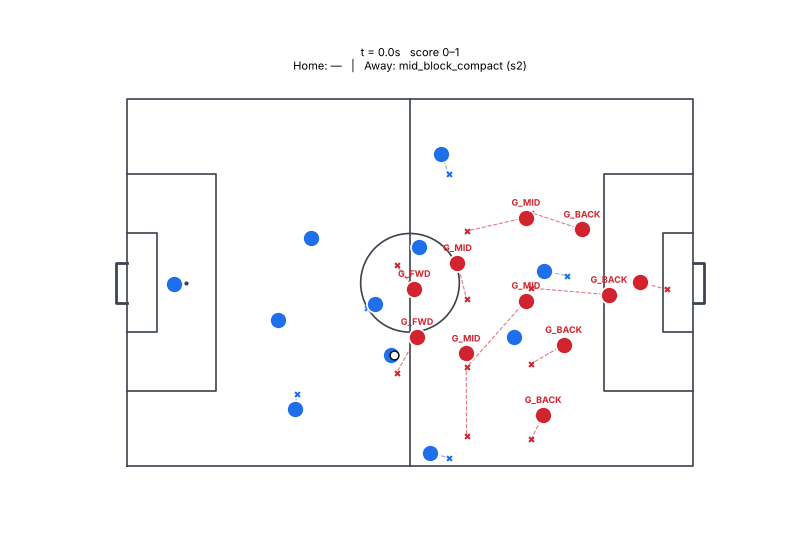

<details><summary>Play definition (YAML)</summary>

```yaml
id: gen_9f93f75d8f
name: Generated play
version: 1
phase: in_possession
objective: score
strategy: generated
fallback: false
roles:
- id: R1
  desc: ''
  hints:
  - FB_near
  - W_near
  - CM
  requires: {}
  prefers: {}
  starts_with_ball: true
- id: R2
  desc: ''
  hints:
  - DM
  - CB_near
  - CM
  requires:
    passing: 0.55
  prefers: {}
  starts_with_ball: false
- id: R3
  desc: ''
  hints:
  - FB_far
  - CM
  requires:
    first_touch: 0.4
  prefers: {}
  starts_with_ball: false
- id: R4
  desc: ''
  hints:
  - CB_near
  - CM
  requires: {}
  prefers: {}
  starts_with_ball: false
triggers:
  all:
  - possession: us
  - has_ball: R1
hard_constraints: []
steps:
- id: s1
  choose:
  - when:
      has_ball: R3
    actions:
    - type: overlap
      role: R4
      around: R1
    - type: carry
      role: R1
      to:
        pc_best:
          zone: final_third.*
        score: pc_xt
      speed: fast
  - when: always
    actions:
    - type: pass
      role: R1
      to:
        pc_best:
          zone: final_third.*
        score: pc_xt
      style: ground
  done_when:
    any:
    - has_ball: R4
    - onside: R2
    - lane_open:
        from: R2
        to:
          role: R2
        min_p: 0.7
  timeout_s: 3.0
  on_timeout: abort
- id: s2
  actions:
  - type: pass
    role: R1
    to:
      zone: near_post_area
    style: driven
  done_when:
    any:
    - has_ball: R4
    - dist:
        a: role:R2
        b: role:R4
        lt: 2.0
  timeout_s: 3.0
  on_timeout: abort
- id: s3
  start_when:
    has_ball: R4
  actions:
  - type: pass
    role: R2
    to:
      pc_best:
        zone: mid_own.far_wing
      score: pc_xt
    style: ground
  done_when:
    any:
    - has_ball: R4
    - has_ball: R4
    - has_ball: R4
  timeout_s: 3.0
  on_timeout: abort
success:
  has_ball: R4
abort:
  any:
  - event: possession_lost
  - event: possession_lost
  - event: ball_out
max_duration_s: 11.0
cooldown_s: 0.0
soft_hints:
  risk: 0.3
  chain_depth: 3
  tempo: medium
source: generated
```

</details>

## gen_c58b55ee8c

Called by **main** against **chaotic** (running `low_block_box_protection`, `mid_block_compact`); steps reached: s1 → s2; ended: step timeout abort; reward +0.0811.

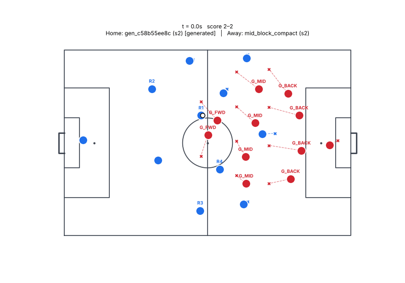

<details><summary>Play definition (YAML)</summary>

```yaml
id: gen_c58b55ee8c
name: Generated play
version: 1
phase: in_possession
objective: score
strategy: generated
fallback: false
roles:
- id: R1
  desc: ''
  hints:
  - FB_near
  - W_near
  - CM
  requires: {}
  prefers: {}
  starts_with_ball: true
- id: R2
  desc: ''
  hints:
  - DM
  - CB_near
  - CM
  requires:
    passing: 0.55
  prefers: {}
  starts_with_ball: false
- id: R3
  desc: ''
  hints:
  - FB_far
  - CM
  requires:
    first_touch: 0.4
  prefers: {}
  starts_with_ball: false
- id: R4
  desc: ''
  hints:
  - FB_far
  - CM
  requires: {}
  prefers: {}
  starts_with_ball: false
triggers:
  all:
  - possession: us
  - has_ball: R1
hard_constraints: []
steps:
- id: s1
  choose:
  - when:
      has_ball: R3
    actions:
    - type: overlap
      role: R4
      around: R1
    - type: carry
      role: R1
      to:
        pc_best:
          zone: final_third.*
        score: pc_xt
      speed: fast
  - when: always
    actions:
    - type: pass
      role: R1
      to:
        pc_best:
          zone: final_third.*
        score: pc_xt
      style: ground
  done_when:
    any:
    - has_ball: R4
    - onside: R2
    - lane_open:
        from: R2
        to:
          role: R2
        min_p: 0.7
  timeout_s: 3.0
  on_timeout: abort
- id: s2
  actions:
  - type: pass
    role: R1
    to:
      zone: near_post_area
    style: driven
  done_when:
    any:
    - has_ball: R4
    - dist:
        a: role:R2
        b: role:R4
        lt: 2.0
  timeout_s: 3.0
  on_timeout: abort
- id: s3
  start_when:
    has_ball: R4
  actions:
  - type: pass
    role: R2
    to:
      pc_best:
        zone: mid_own.far_wing
      score: pc_xt
    style: ground
  done_when:
    has_ball: R4
  timeout_s: 3.0
  on_timeout: abort
- id: s4
  choose:
  - when:
      has_ball: R4
    actions:
    - type: hold_position
      role: R4
      to:
        zone: near_post_area
  - when: always
    actions:
    - type: overlap
      role: R4
      around: R4
    - type: pass
      role: R2
      to:
        role: R4
      style: ground
  done_when:
    any:
    - has_ball: R4
    - has_ball: R4
    - has_ball: R4
  timeout_s: 3.0
  on_timeout: abort
success:
  has_ball: R4
abort:
  any:
  - event: pass_completed
  - event: possession_lost
  - event: possession_lost
max_duration_s: 14.0
cooldown_s: 0.0
soft_hints:
  risk: 0.3
  chain_depth: 4
  tempo: medium
source: generated
```

</details>

## gen_d10071f675

Called by **league_exploiter** against **high_press** (running `low_block_box_protection`, `mid_block_compact`); steps reached: s1 → s2; ended: step timeout abort; reward +0.0371.

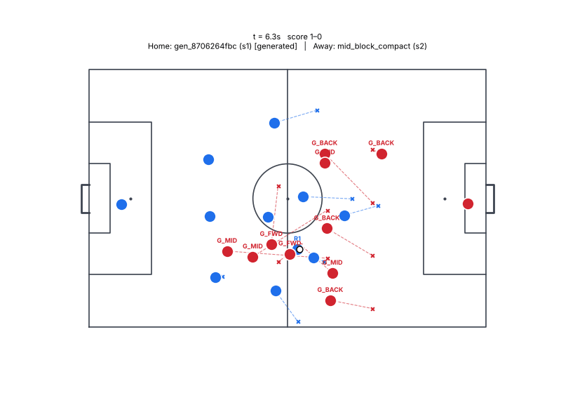

<details><summary>Play definition (YAML)</summary>

```yaml
id: gen_d10071f675
name: Generated play
version: 1
phase: in_possession
objective: score
strategy: generated
fallback: false
roles:
- id: R1
  desc: ''
  hints:
  - FB_near
  - W_near
  - CM
  requires: {}
  prefers: {}
  starts_with_ball: true
- id: R2
  desc: ''
  hints:
  - DM
  - CB_near
  - CM
  requires:
    passing: 0.55
  prefers: {}
  starts_with_ball: false
- id: R3
  desc: ''
  hints:
  - FB_far
  - CM
  requires:
    first_touch: 0.4
  prefers: {}
  starts_with_ball: false
- id: R4
  desc: ''
  hints:
  - FB_far
  - CM
  requires: {}
  prefers: {}
  starts_with_ball: false
triggers:
  all:
  - possession: us
  - has_ball: R1
hard_constraints: []
steps:
- id: s1
  choose:
  - when:
      has_ball: R3
    actions:
    - type: overlap
      role: R4
      around: R1
    - type: carry
      role: R1
      to:
        pc_best:
          zone: final_third.*
        score: pc_xt
      speed: fast
  - when: always
    actions:
    - type: pass
      role: R1
      to:
        pc_best:
          zone: final_third.*
        score: pc_xt
      style: ground
  done_when:
    any:
    - has_ball: R4
    - onside: R2
    - lane_open:
        from: R2
        to:
          role: R2
        min_p: 0.7
  timeout_s: 3.0
  on_timeout: abort
- id: s2
  actions:
  - type: pass
    role: R1
    to:
      zone: near_post_area
    style: driven
  done_when:
    any:
    - has_ball: R4
    - dist:
        a: role:R2
        b: role:R4
        lt: 2.0
  timeout_s: 3.0
  on_timeout: abort
- id: s3
  start_when:
    has_ball: R4
  actions:
  - type: pass
    role: R2
    to:
      zone: near_post_area
    style: ground
  done_when:
    any:
    - has_ball: R4
    - has_ball: R4
    - has_ball: R4
  timeout_s: 3.0
  on_timeout: abort
success:
  has_ball: R4
abort:
  any:
  - event: possession_lost
  - event: ball_out
max_duration_s: 11.0
cooldown_s: 0.0
soft_hints:
  risk: 0.3
  chain_depth: 3
  tempo: medium
source: generated
```

</details>

## gen_f4303c1417

Called by **main** against **selector** (running `low_block_box_protection`); steps reached: s1 → s2; ended: success; reward +0.0284.

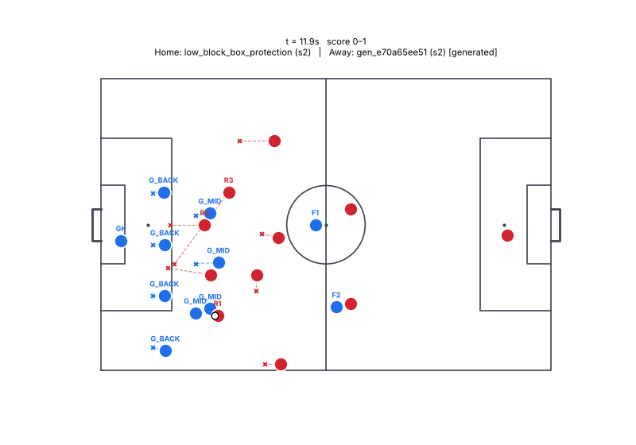

<details><summary>Play definition (YAML)</summary>

```yaml
id: gen_f4303c1417
name: Generated play
version: 1
phase: in_possession
objective: score
strategy: generated
fallback: false
roles:
- id: R1
  desc: ''
  hints:
  - AM
  - CM
  - ST
  requires:
    finishing: 0.4
  prefers: {}
  starts_with_ball: true
- id: R2
  desc: ''
  hints:
  - ST
  - AM
  - CM
  requires: {}
  prefers: {}
  starts_with_ball: false
triggers:
  all:
  - possession: us
  - has_ball: R1
hard_constraints: []
steps:
- id: s1
  choose:
  - when:
      xg:
        ref: role:R1
        gt: 0.06
    actions:
    - type: shoot
      role: R1
      placement: auto
  - when: always
    actions:
    - type: carry
      role: R1
      to:
        pc_best:
          zone: final_third.center
        score: pc_xt
      speed: fast
    - type: support
      role: R2
      from: R1
      angle: square
      distance: 8.0
  done_when:
    any:
    - event: shot_taken
    - step_elapsed_s:
        gt: 2.0
  timeout_s: 2.5
  on_timeout: abort
- id: s2
  choose:
  - when: always
    actions:
    - type: shoot
      role: R1
      placement: auto
  - when:
      lane_open:
        from: R1
        to:
          role: R2
        min_p: 0.6
    actions:
    - type: pass
      role: R1
      to:
        role: R2
      style: ground
  - when: always
    actions:
    - type: pass
      role: R1
      to:
        best_teammate:
          score: pass_p
      style: ground
  done_when:
    any:
    - event: pass_completed
    - event: goal
    - event: pass_intercepted
  timeout_s: 3.0
  on_timeout: abort
success:
  any:
  - event: shot_taken
  - event: goal
abort:
  any:
  - event: possession_lost
  - event: possession_lost
  - event: possession_lost
max_duration_s: 7.5
cooldown_s: 0.0
soft_hints:
  risk: 0.3
  chain_depth: 2
  tempo: fast
source: generated
```

</details>

## gen_8706264fbc

Called by **main** against **library** (running `low_block_box_protection`); steps reached: s1; ended: success; reward +0.0201.

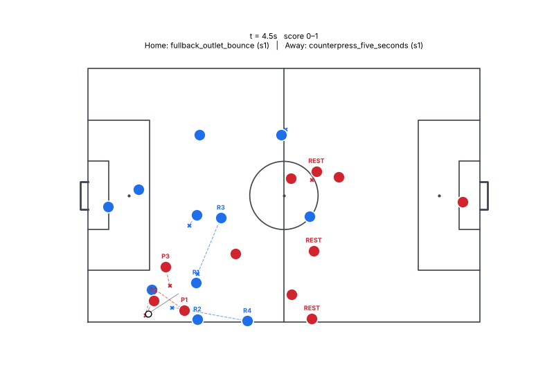

<details><summary>Play definition (YAML)</summary>

```yaml
id: gen_8706264fbc
name: Generated play
version: 1
phase: in_possession
objective: retain_possession
strategy: generated
fallback: false
roles:
- id: R1
  desc: ''
  hints:
  - CB_near
  - CB_far
  - DM
  requires: {}
  prefers: {}
  starts_with_ball: true
triggers:
  all:
  - possession: us
  - has_ball: R1
hard_constraints: []
steps:
- id: s1
  choose:
  - when:
      pressure_on:
        ref: role:R1
        gt: 4.0
    actions:
    - type: carry
      role: R1
      to:
        anchor: ball
        offset:
        - 2.0
        - 0.0
      speed: jog
  - when: always
    actions:
    - type: pass
      role: R1
      to:
        best_teammate:
          score: pass_p
      style: ground
  done_when:
    any:
    - event: pass_completed
    - step_elapsed_s:
        gt: 2.0
  timeout_s: 3.0
  on_timeout: abort
success:
  event: pass_completed
abort:
  event: possession_lost
max_duration_s: 5.0
cooldown_s: 0.0
soft_hints:
  risk: 0.1
  chain_depth: 1
  tempo: slow
source: generated
```

</details>

## gen_da83d64dd5

Called by **main** against **main** (running `low_block_box_protection`); steps reached: s1 → s2; ended: success; reward +0.0195.

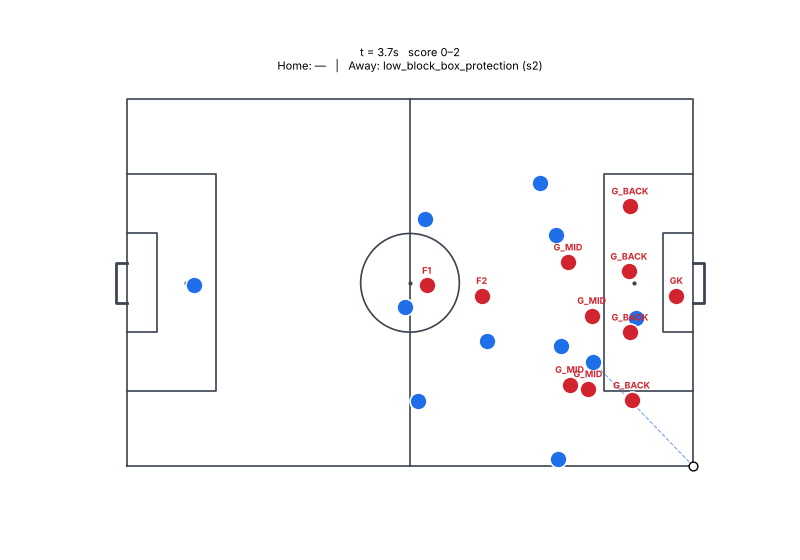

<details><summary>Play definition (YAML)</summary>

```yaml
id: gen_da83d64dd5
name: Generated play
version: 1
phase: in_possession
objective: score
strategy: generated
fallback: false
roles:
- id: R1
  desc: ''
  hints:
  - AM
  - CM
  - ST
  requires:
    finishing: 0.4
  prefers: {}
  starts_with_ball: true
- id: R2
  desc: ''
  hints:
  - ST
  - AM
  - CM
  requires: {}
  prefers: {}
  starts_with_ball: false
triggers:
  all:
  - possession: us
  - has_ball: R1
hard_constraints: []
steps:
- id: s1
  choose:
  - when:
      xg:
        ref: role:R1
        gt: 0.06
    actions:
    - type: shoot
      role: R1
      placement: auto
  - when: always
    actions:
    - type: carry
      role: R1
      to:
        pc_best:
          zone: final_third.center
        score: pc_xt
      speed: fast
    - type: support
      role: R2
      from: R1
      angle: square
      distance: 8.0
  done_when:
    any:
    - event: shot_taken
    - step_elapsed_s:
        gt: 2.0
  timeout_s: 2.5
  on_timeout: abort
- id: s2
  choose:
  - when: always
    actions:
    - type: shoot
      role: R1
      placement: auto
  - when:
      lane_open:
        from: R1
        to:
          role: R2
        min_p: 0.6
    actions:
    - type: pass
      role: R1
      to:
        role: R2
      style: ground
  - when: always
    actions:
    - type: pass
      role: R1
      to:
        best_teammate:
          score: pass_p
      style: ground
  done_when:
    any:
    - event: pass_completed
    - event: goal
    - event: pass_intercepted
  timeout_s: 3.0
  on_timeout: abort
success:
  any:
  - event: shot_taken
  - event: goal
abort:
  any:
  - event: possession_lost
  - event: ball_out
max_duration_s: 7.5
cooldown_s: 0.0
soft_hints:
  risk: 0.3
  chain_depth: 2
  tempo: fast
source: generated
```

</details>

## gen_f87007193a

Called by **league_exploiter** against **direct** (running `low_block_box_protection`); steps reached: s1 → s2; ended: completed; reward +0.0156.

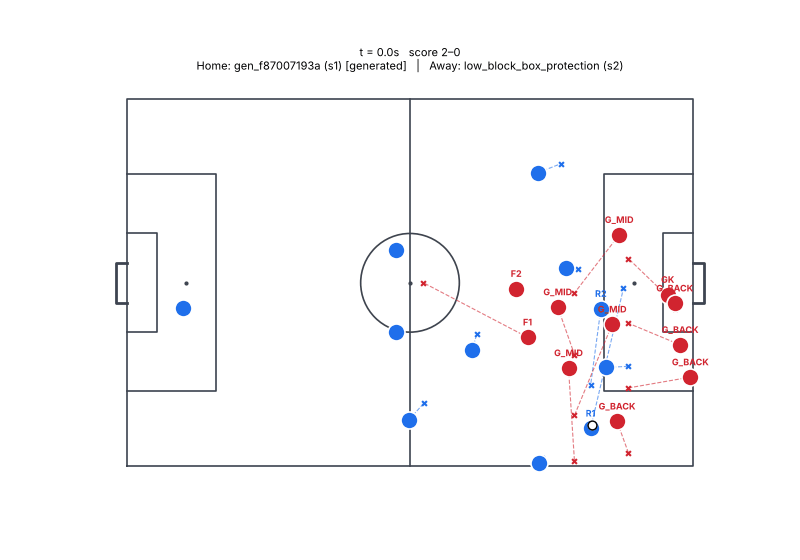

<details><summary>Play definition (YAML)</summary>

```yaml
id: gen_f87007193a
name: Generated play
version: 1
phase: in_possession
objective: score
strategy: generated
fallback: false
roles:
- id: R1
  desc: ''
  hints:
  - AM
  - CM
  - ST
  requires:
    finishing: 0.4
  prefers: {}
  starts_with_ball: true
- id: R2
  desc: ''
  hints:
  - ST
  - AM
  - CM
  requires: {}
  prefers: {}
  starts_with_ball: false
triggers:
  all:
  - possession: us
  - has_ball: R1
hard_constraints: []
steps:
- id: s1
  choose:
  - when:
      xg:
        ref: role:R1
        gt: 0.06
    actions:
    - type: shoot
      role: R1
      placement: auto
  - when: always
    actions:
    - type: carry
      role: R1
      to:
        pc_best:
          zone: final_third.center
        score: pc_xt
      speed: fast
    - type: support
      role: R2
      from: R1
      angle: square
      distance: 8.0
  done_when:
    any:
    - event: shot_taken
    - step_elapsed_s:
        gt: 2.0
  timeout_s: 2.5
  on_timeout: abort
- id: s2
  choose:
  - when:
      lane_open:
        from: R1
        to:
          role: R2
        min_p: 0.6
    actions:
    - type: pass
      role: R1
      to:
        role: R2
      style: driven
  - when: always
    actions:
    - type: shoot
      role: R1
      placement: auto
  done_when:
    any:
    - event: shot_taken
    - event: pass_completed
    - event: pass_intercepted
  timeout_s: 3.0
  on_timeout: abort
success:
  any:
  - event: shot_taken
  - event: goal
abort:
  any:
  - event: possession_lost
  - event: ball_out
max_duration_s: 7.5
cooldown_s: 0.0
soft_hints:
  risk: 0.3
  chain_depth: 2
  tempo: fast
source: generated
```

</details>

## gen_5616f4776b

Called by **main** against **direct** (running `low_block_box_protection`); steps reached: s1 → s2; ended: success; reward +0.0155.

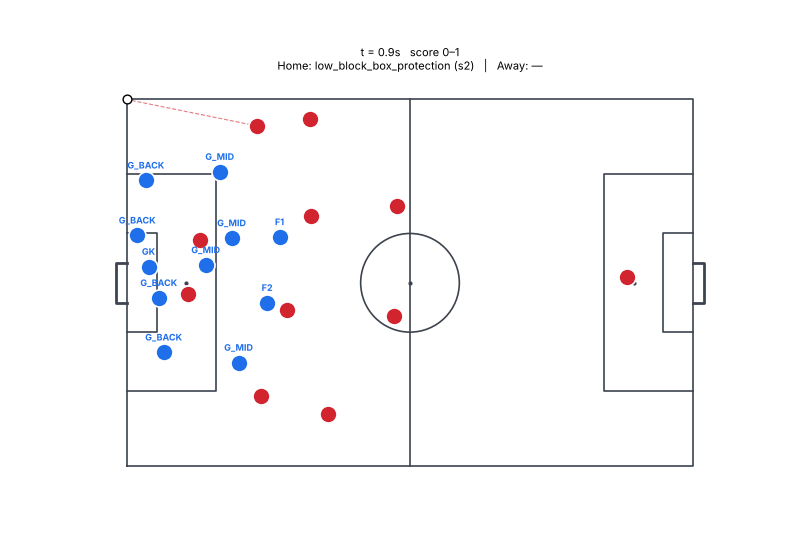

<details><summary>Play definition (YAML)</summary>

```yaml
id: gen_5616f4776b
name: Generated play
version: 1
phase: in_possession
objective: score
strategy: generated
fallback: false
roles:
- id: R1
  desc: ''
  hints:
  - AM
  - CM
  - ST
  requires:
    finishing: 0.4
  prefers: {}
  starts_with_ball: true
- id: R2
  desc: ''
  hints:
  - ST
  - AM
  - CM
  requires: {}
  prefers: {}
  starts_with_ball: false
triggers:
  all:
  - possession: us
  - has_ball: R1
hard_constraints: []
steps:
- id: s1
  choose:
  - when:
      xg:
        ref: role:R1
        gt: 0.06
    actions:
    - type: shoot
      role: R1
      placement: auto
  - when: always
    actions:
    - type: carry
      role: R1
      to:
        pc_best:
          zone: final_third.center
        score: pc_xt
      speed: fast
    - type: support
      role: R2
      from: R1
      angle: square
      distance: 8.0
  done_when:
    any:
    - event: shot_taken
    - step_elapsed_s:
        gt: 2.0
  timeout_s: 2.5
  on_timeout: abort
- id: s2
  choose:
  - when: always
    actions:
    - type: shoot
      role: R1
      placement: auto
  - when:
      lane_open:
        from: R1
        to:
          role: R2
        min_p: 0.6
    actions:
    - type: pass
      role: R1
      to:
        role: R2
      style: ground
  - when: always
    actions:
    - type: pass
      role: R1
      to:
        best_teammate:
          score: pass_p
      style: ground
  done_when:
    any:
    - event: pass_completed
    - event: goal
    - event: pass_completed
  timeout_s: 3.0
  on_timeout: abort
success:
  any:
  - event: shot_taken
  - event: goal
abort:
  any:
  - event: possession_lost
  - event: possession_lost
  - event: possession_lost
max_duration_s: 7.5
cooldown_s: 0.0
soft_hints:
  risk: 0.3
  chain_depth: 2
  tempo: fast
source: generated
```

</details>

## gen_336193263d

Called by **main** against **main_exploiter** (running `low_block_box_protection`); steps reached: s1 → s2; ended: success; reward +0.0150.

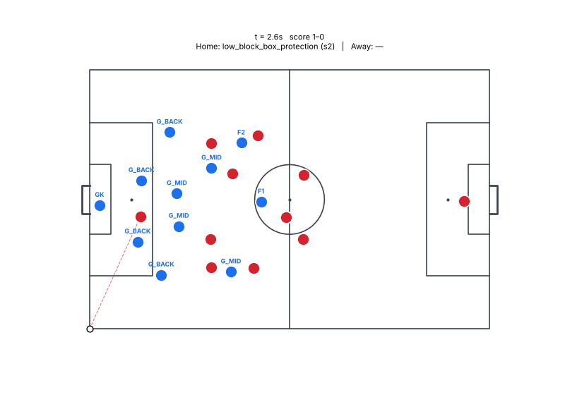

<details><summary>Play definition (YAML)</summary>

```yaml
id: gen_336193263d
name: Generated play
version: 1
phase: in_possession
objective: score
strategy: generated
fallback: false
roles:
- id: R1
  desc: ''
  hints:
  - AM
  - CM
  - ST
  requires:
    finishing: 0.4
  prefers: {}
  starts_with_ball: true
- id: R2
  desc: ''
  hints:
  - ST
  - AM
  - CM
  requires: {}
  prefers: {}
  starts_with_ball: false
triggers:
  all:
  - possession: us
  - has_ball: R1
hard_constraints: []
steps:
- id: s1
  choose:
  - when:
      xg:
        ref: role:R1
        gt: 0.06
    actions:
    - type: shoot
      role: R1
      placement: auto
  - when: always
    actions:
    - type: carry
      role: R1
      to:
        pc_best:
          zone: final_third.center
        score: pc_xt
      speed: fast
    - type: support
      role: R2
      from: R1
      angle: square
      distance: 8.0
  done_when:
    any:
    - event: shot_taken
    - step_elapsed_s:
        gt: 2.0
  timeout_s: 2.5
  on_timeout: abort
- id: s2
  choose:
  - when: always
    actions:
    - type: shoot
      role: R1
      placement: auto
  - when:
      lane_open:
        from: R1
        to:
          role: R2
        min_p: 0.6
    actions:
    - type: pass
      role: R1
      to:
        role: R2
      style: ground
  - when: always
    actions:
    - type: pass
      role: R1
      to:
        best_teammate:
          score: pass_p
      style: ground
  done_when:
    any:
    - event: shot_taken
    - event: pass_completed
    - event: pass_intercepted
  timeout_s: 3.0
  on_timeout: abort
success:
  any:
  - event: shot_taken
  - event: goal
abort:
  any:
  - event: possession_lost
  - event: ball_out
max_duration_s: 7.5
cooldown_s: 0.0
soft_hints:
  risk: 0.3
  chain_depth: 2
  tempo: fast
source: generated
```

</details>

## gen_fb4d7b0b85

Called by **league_exploiter** against **high_press** (running `low_block_box_protection`, `mid_block_compact`); steps reached: s1 → s2 → s3 → s4; ended: step timeout abort; reward +0.0141.

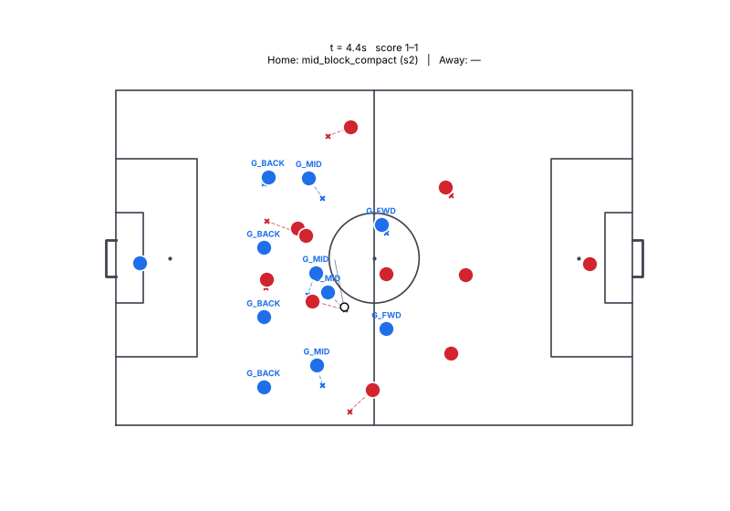

<details><summary>Play definition (YAML)</summary>

```yaml
id: gen_fb4d7b0b85
name: Generated play
version: 1
phase: transition_attack
objective: create_chance
strategy: generated
fallback: false
roles:
- id: R1
  desc: ''
  hints:
  - DM
  - CM
  - CB_near
  requires: {}
  prefers: {}
  starts_with_ball: true
- id: R2
  desc: ''
  hints:
  - ST
  - W_near
  - W_far
  requires:
    pace: 0.6
  prefers: {}
  starts_with_ball: false
- id: R3
  desc: ''
  hints:
  - W_far
  - W_near
  - AM
  requires:
    pace: 0.5
  prefers: {}
  starts_with_ball: false
- id: R4
  desc: ''
  hints:
  - AM
  - CM
  requires: {}
  prefers: {}
  starts_with_ball: false
triggers:
  all:
  - possession: us
  - has_ball: R1
  - event:
      type: possession_won
      within_s: 2.0
hard_constraints: []
steps:
- id: s1
  actions:
  - type: spin_in_behind
    role: R2
    line: opp_last_line
    lane: center
    depth: 8.0
  - type: run_to
    role: R3
    to:
      anchor: ball
      offset:
      - 24.0
      - -18.0
    speed: max
  - type: run_to
    role: R4
    to:
      anchor: ball
      offset:
      - 12.0
      - 0.0
    speed: fast
  done_when:
    step_elapsed_s:
      gt: 0.3
  timeout_s: 0.5
  on_timeout: abort
- id: s2
  choose:
  - when:
      lane_open:
        from: R1
        to:
          space_behind:
            line: opp_last_line
            lane: center
            depth: 8.0
        min_p: 0.45
    actions:
    - type: pass
      role: R1
      to:
        space_behind:
          line: opp_last_line
          lane: center
          depth: 8.0
      style: through
  - when:
      lane_open:
        from: R1
        to:
          role: R4
        min_p: 0.75
    actions:
    - type: pass
      role: R1
      to:
        role: R4
      style: driven
  - when: always
    actions:
    - type: carry
      role: R1
      to:
        anchor: ball
        offset:
        - 10.0
        - 0.0
      speed: fast
  done_when:
    any:
    - event: pass_completed
    - step_elapsed_s:
        gt: 2.0
  timeout_s: 3.0
  on_timeout: abort
- id: s3
  choose:
  - when:
      has_ball: R4
    actions:
    - type: pass
      role: R4
      to:
        best_teammate:
          score: pc_xt
      style: through
  - when: always
    actions:
    - type: carry
      actor: ball_holder
      to:
        anchor: penalty_spot
        offset:
        - 0.0
        - 0.0
      speed: max
  done_when:
    any:
    - ball_in_zone: box
    - event: pass_completed
    - pressure_on:
        ref: ball_holder
        lt: 2.0
  timeout_s: 5.0
  on_timeout: abort
- id: s4
  choose:
  - when:
      xg:
        ref: ball_holder
        gt: 0.08
    actions:
    - type: shoot
      actor: ball_holder
      placement: auto
  - when: always
    actions:
    - type: pass
      actor: ball_holder
      to:
        best_teammate:
          score: xt
          zone: box
      style: ground
  done_when:
    any:
    - event: shot_taken
    - event: pass_completed
  timeout_s: 3.0
  on_timeout: abort
success:
  event: shot_taken
abort:
  event: possession_lost
max_duration_s: 13.5
cooldown_s: 0.0
soft_hints:
  risk: 0.5
  chain_depth: 4
  tempo: fast
source: generated
```

</details>

## gen_e24d144e3c

Called by **main** against **league_exploiter** (running `low_block_box_protection`, `mid_block_compact`); steps reached: s1 → s2; ended: step timeout abort; reward +0.0114.

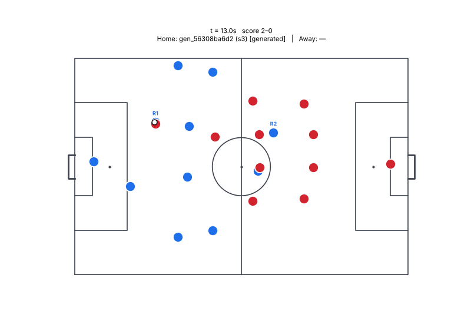

<details><summary>Play definition (YAML)</summary>

```yaml
id: gen_e24d144e3c
name: Generated play
version: 1
phase: in_possession
objective: score
strategy: generated
fallback: false
roles:
- id: R1
  desc: ''
  hints:
  - FB_near
  - W_near
  - CM
  requires: {}
  prefers: {}
  starts_with_ball: true
- id: R2
  desc: ''
  hints:
  - DM
  - CB_near
  - CM
  requires:
    passing: 0.55
  prefers: {}
  starts_with_ball: false
- id: R3
  desc: ''
  hints:
  - FB_far
  - CM
  requires:
    first_touch: 0.4
  prefers: {}
  starts_with_ball: false
- id: R4
  desc: ''
  hints:
  - CB_near
  - CM
  requires: {}
  prefers: {}
  starts_with_ball: false
triggers:
  all:
  - possession: us
  - has_ball: R1
hard_constraints: []
steps:
- id: s1
  choose:
  - when:
      has_ball: R3
    actions:
    - type: overlap
      role: R4
      around: R1
    - type: carry
      role: R1
      to:
        pc_best:
          zone: final_third.*
        score: pc_xt
      speed: fast
  - when: always
    actions:
    - type: pass
      role: R1
      to:
        pc_best:
          zone: final_third.*
        score: pc_xt
      style: ground
  done_when:
    any:
    - has_ball: R4
    - onside: R2
    - lane_open:
        from: R2
        to:
          role: R2
        min_p: 0.7
  timeout_s: 3.0
  on_timeout: abort
- id: s2
  actions:
  - type: pass
    role: R1
    to:
      zone: near_post_area
    style: driven
  done_when:
    any:
    - has_ball: R4
    - dist:
        a: role:R2
        b: role:R4
        lt: 2.0
  timeout_s: 3.0
  on_timeout: abort
- id: s3
  actions:
  - type: pass
    role: R2
    to:
      role: R4
    style: ground
  done_when:
    any:
    - has_ball: R4
    - has_ball: R4
    - has_ball: R4
  timeout_s: 3.0
  on_timeout: abort
success:
  has_ball: R4
abort:
  any:
  - event: possession_lost
  - event: ball_out
max_duration_s: 11.0
cooldown_s: 0.0
soft_hints:
  risk: 0.3
  chain_depth: 3
  tempo: medium
source: generated
```

</details>

## gen_8f16a3b689

Called by **main** against **high_press** (running `low_block_box_protection`, `mid_block_compact`); steps reached: s1; ended: step timeout abort; reward +0.0114.

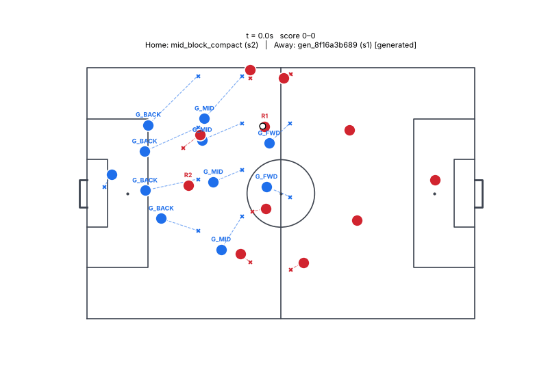

<details><summary>Play definition (YAML)</summary>

```yaml
id: gen_8f16a3b689
name: Generated play
version: 1
phase: in_possession
objective: create_chance
strategy: generated
fallback: false
roles:
- id: R1
  desc: ''
  hints:
  - AM
  - W_near
  - CM
  requires:
    passing: 0.4
  prefers: {}
  starts_with_ball: true
- id: R2
  desc: ''
  hints:
  - ST
  - AM
  - CM
  requires:
    first_touch: 0.5
  prefers: {}
  starts_with_ball: false
triggers:
  all:
  - possession: us
  - has_ball: R1
hard_constraints: []
steps:
- id: s1
  actions:
  - type: pass
    role: R1
    to:
      role: R2
    style: ground
  done_when:
    event: pass_completed
  timeout_s: 2.0
  on_timeout: abort
- id: s2
  actions:
  - type: run_to
    role: R1
    to:
      anchor: role:R1
      offset:
      - 8.0
      - 0.0
      freeze: step_start
    speed: max
  done_when:
    lane_open:
      from: R2
      to:
        role: R1
        lead: 3.0
      min_p: 0.6
  timeout_s: 2.0
  on_timeout: abort
- id: s3
  choose:
  - when:
      xg:
        ref: role:R1
        gt: 0.08
    actions:
    - type: shoot
      role: R1
      placement: auto
  - when: always
    actions:
    - type: carry
      role: R1
      to:
        pc_best:
          zone: box
        score: pc_xt
      speed: fast
  done_when:
    any:
    - event: shot_taken
    - ball_in_zone: box
  timeout_s: 3.0
  on_timeout: abort
success:
  event: shot_taken
abort:
  any:
  - has_ball: R2
  - dist:
      a: role:R2
      b: anchor:byline_near
      lt: 8.0
  - pressure_on:
      ref: role:R2
      lt: 2.0
max_duration_s: 9.0
cooldown_s: 0.0
soft_hints:
  risk: 0.3
  chain_depth: 3
  tempo: fast
source: generated
```

</details>
