# Generated plays that worked · run 8

127 times a generated play succeeded in this run (45 different plays), during league training or the final evaluation. A generated play counts as successful when it reached its own success condition or gained at least 0.005 EPV. Below, the best instance of each play (by reward), with what the opponent was running and the play's full definition.

`generated_successes.html` has every clip with the decision inspector; download it and open it in a browser.

| Play | By | Against | Opponent's play | Why it counts | Reward | Stage |
|---|---|---|---|---|---|---|
| [`gen_73a7bd3462`](#gen_73a7bd3462) | league_exploiter | chaotic | `low_block_box_protection` | gained at least 0.005 EPV | +1.0329 | league (update 4) |
| [`gen_0175cca3f0`](#gen_0175cca3f0) | main | possession | `low_block_box_protection` | reached its success condition; gained at least 0.005 EPV | +0.9845 | validation (update 6) |
| [`gen_0a352d72d3`](#gen_0a352d72d3) | main | mid_block | `low_block_box_protection`, `mid_block_compact` | gained at least 0.005 EPV | +0.0789 | league (update 4) |
| [`gen_02ac9846b3`](#gen_02ac9846b3) | main | main | `low_block_box_protection` | reached its success condition; gained at least 0.005 EPV | +0.0768 | league (update 2) |
| [`gen_336193263d`](#gen_336193263d) | main | direct | `low_block_box_protection` | reached its success condition; gained at least 0.005 EPV | +0.0699 | validation (update 6) |
| [`gen_a59310d114`](#gen_a59310d114) | league_exploiter | main_exploiter | `low_block_box_protection` | reached its success condition; gained at least 0.005 EPV | +0.0559 | league (update 3) |
| [`gen_99ffa4b017`](#gen_99ffa4b017) | league_exploiter | chaotic | `low_block_box_protection` | reached its success condition; gained at least 0.005 EPV | +0.0349 | league (update 4) |
| [`gen_674e48e127`](#gen_674e48e127) | league_exploiter | chaotic | `low_block_box_protection`, `mid_block_compact` | gained at least 0.005 EPV | +0.0253 | league (update 4) |
| [`gen_250c0c44e2`](#gen_250c0c44e2) | main | high_press | `low_block_box_protection`, `mid_block_compact` | gained at least 0.005 EPV | +0.0089 | evaluation (update 6) |
| [`gen_8706264fbc`](#gen_8706264fbc) | main | wing_play | `mid_block_compact` | reached its success condition; gained at least 0.005 EPV | +0.0084 | evaluation (update 6) |
| [`gen_5dcb336c76`](#gen_5dcb336c76) | main | wing_play | `low_block_box_protection` | gained at least 0.005 EPV | +0.0080 | evaluation (update 6) |
| [`gen_aaed078c77`](#gen_aaed078c77) | main | mid_block | `low_block_box_protection` | gained at least 0.005 EPV | +0.0077 | league (update 1) |

## gen_73a7bd3462

Called by **league_exploiter** against **chaotic** (running `low_block_box_protection`); steps reached: s1; ended: step timeout abort; reward +1.0329.

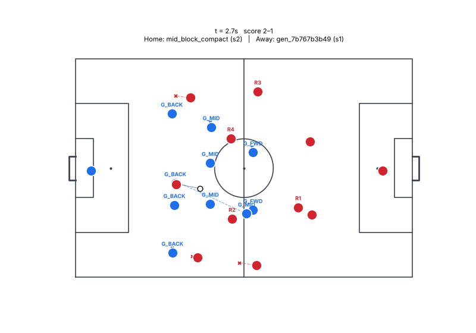

<details><summary>Play definition (YAML)</summary>

```yaml
id: gen_73a7bd3462
name: Generated play
version: 1
phase: in_possession
objective: score
strategy: generated
fallback: false
roles:
- id: R1
  desc: ''
  hints:
  - FB_near
  - W_near
  - CM
  requires: {}
  prefers: {}
  starts_with_ball: true
- id: R2
  desc: ''
  hints:
  - DM
  - CB_near
  - CM
  requires:
    passing: 0.55
  prefers: {}
  starts_with_ball: false
- id: R3
  desc: ''
  hints:
  - FB_far
  - CM
  requires:
    first_touch: 0.4
  prefers: {}
  starts_with_ball: false
- id: R4
  desc: ''
  hints:
  - FB_far
  - CM
  requires: {}
  prefers: {}
  starts_with_ball: false
triggers:
  all:
  - possession: us
  - has_ball: R1
hard_constraints: []
steps:
- id: s1
  choose:
  - when:
      has_ball: R3
    actions:
    - type: overlap
      role: R4
      around: R1
    - type: carry
      role: R1
      to:
        pc_best:
          zone: final_third.*
        score: pc_xt
      speed: fast
  - when: always
    actions:
    - type: pass
      role: R1
      to:
        pc_best:
          zone: final_third.*
        score: pc_xt
      style: ground
  done_when:
    any:
    - has_ball: R4
    - has_ball: R4
    - has_ball: R4
  timeout_s: 3.0
  on_timeout: abort
success:
  has_ball: R4
abort:
  has_ball: R4
max_duration_s: 5.0
cooldown_s: 0.0
soft_hints:
  risk: 0.3
  chain_depth: 1
  tempo: medium
source: generated
```

</details>

## gen_0175cca3f0

Called by **main** against **possession** (running `low_block_box_protection`); steps reached: s1 → s2; ended: success; reward +0.9845.

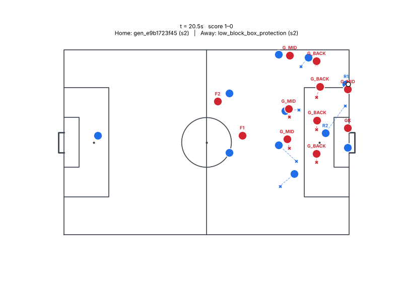

<details><summary>Play definition (YAML)</summary>

```yaml
id: gen_0175cca3f0
name: Generated play
version: 1
phase: in_possession
objective: score
strategy: generated
fallback: false
roles:
- id: R1
  desc: ''
  hints:
  - AM
  - CM
  - ST
  requires:
    finishing: 0.4
  prefers: {}
  starts_with_ball: true
- id: R2
  desc: ''
  hints:
  - FB_far
  - AM
  - CM
  requires: {}
  prefers: {}
  starts_with_ball: false
triggers:
  all:
  - possession: us
  - has_ball: R1
hard_constraints: []
steps:
- id: s1
  choose:
  - when:
      xg:
        ref: role:R1
        gt: 0.06
    actions:
    - type: shoot
      role: R1
      placement: auto
  - when: always
    actions:
    - type: carry
      role: R1
      to:
        pc_best:
          zone: final_third.center
        score: pc_xt
      speed: fast
    - type: support
      role: R2
      from: R1
      angle: square
      distance: 8.0
  done_when:
    any:
    - event: shot_taken
    - step_elapsed_s:
        gt: 2.0
  timeout_s: 2.5
  on_timeout: abort
- id: s2
  choose:
  - when:
      pressure_on:
        ref: role:R2
        gt: 3.0
    actions:
    - type: pass
      role: R2
      to:
        role: R2
      style: ground
  - when:
      lane_open:
        from: R1
        to:
          role: R2
        min_p: 0.65
    actions:
    - type: pass
      role: R1
      to:
        zone: near_post_area
      style: ground
  - when: always
    actions:
    - type: pass
      role: R1
      to:
        role: R2
      style: ground
  done_when:
    any:
    - event: pass_intercepted
  timeout_s: 3.0
  on_timeout: abort
success:
  any:
  - event: ball_out
abort:
  any:
  - event: ball_out
max_duration_s: 7.5
cooldown_s: 0.0
soft_hints:
  risk: 0.3
  chain_depth: 2
  tempo: fast
source: generated
```

</details>

## gen_0a352d72d3

Called by **main** against **mid_block** (running `low_block_box_protection`, `mid_block_compact`); steps reached: s1 → s2; ended: step timeout abort; reward +0.0789.

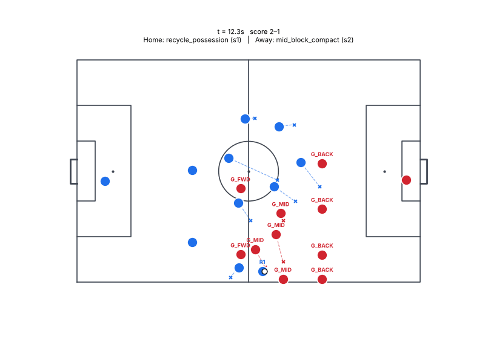

<details><summary>Play definition (YAML)</summary>

```yaml
id: gen_0a352d72d3
name: Generated play
version: 1
phase: in_possession
objective: score
strategy: generated
fallback: false
roles:
- id: R1
  desc: ''
  hints:
  - AM
  - CM
  - ST
  requires:
    finishing: 0.4
  prefers: {}
  starts_with_ball: true
- id: R2
  desc: ''
  hints:
  - W_far
  - FB_far
  requires: {}
  prefers: {}
  starts_with_ball: false
triggers:
  all:
  - possession: us
  - has_ball: R1
hard_constraints: []
steps:
- id: s1
  choose:
  - when:
      xg:
        ref: role:R1
        gt: 0.06
    actions:
    - type: shoot
      role: R1
      placement: auto
  - when: always
    actions:
    - type: carry
      role: R1
      to:
        pc_best:
          zone: final_third.center
        score: pc_xt
      speed: fast
    - type: support
      role: R2
      from: R1
      angle: square
      distance: 8.0
  done_when:
    any:
    - event: shot_taken
    - step_elapsed_s:
        gt: 2.0
  timeout_s: 2.5
  on_timeout: abort
- id: s2
  choose:
  - when:
      pressure_on:
        ref: role:R1
        gt: 3.0
    actions:
    - type: pass
      role: R1
      to:
        role: R1
        lead: 2.0
      style: lofted
  - when: always
    actions:
    - type: carry
      role: R1
      to:
        role: R2
      speed: max
    - type: pass
      role: R1
      to:
        zone: near_post_area
      style: ground
  done_when:
    any:
    - event: pass_completed
    - event: pass_intercepted
  timeout_s: 2.5
  on_timeout: abort
- id: s3
  choose:
  - when:
      xg:
        ref: ball_holder
        gt: 0.06
    actions:
    - type: shoot
      actor: ball_holder
      placement: auto
  - when: always
    actions:
    - type: pass
      actor: ball_holder
      to:
        best_teammate:
          score: xt
          zone: box
      style: ground
  done_when:
    any:
    - event: shot_taken
    - event: pass_completed
  timeout_s: 2.5
  on_timeout: abort
success:
  event: shot_taken
abort:
  event: ball_out
max_duration_s: 9.5
cooldown_s: 0.0
soft_hints:
  risk: 0.3
  chain_depth: 3
  tempo: fast
source: generated
```

</details>

## gen_02ac9846b3

Called by **main** against **main** (running `low_block_box_protection`); steps reached: s1; ended: success; reward +0.0768.

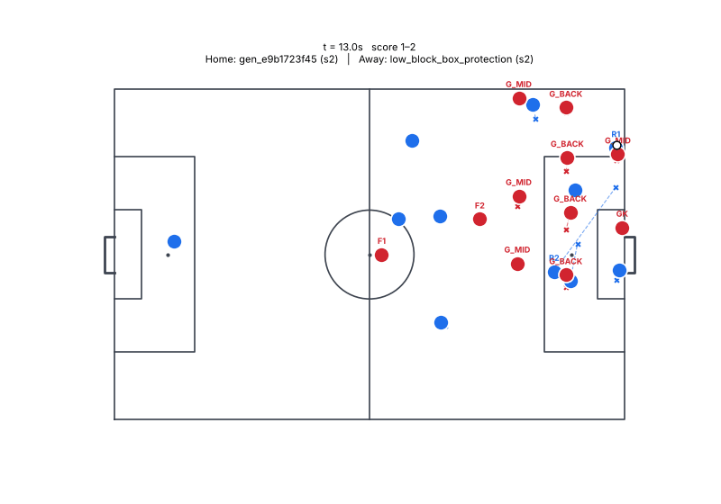

<details><summary>Play definition (YAML)</summary>

```yaml
id: gen_02ac9846b3
name: Generated play
version: 1
phase: in_possession
objective: score
strategy: generated
fallback: false
roles:
- id: R1
  desc: ''
  hints:
  - AM
  - CM
  - ST
  requires:
    finishing: 0.4
  prefers: {}
  starts_with_ball: true
- id: R2
  desc: ''
  hints:
  - FB_far
  - FB_near
  requires: {}
  prefers: {}
  starts_with_ball: false
triggers:
  all:
  - possession: us
  - has_ball: R1
hard_constraints: []
steps:
- id: s1
  choose:
  - when:
      xg:
        ref: role:R1
        gt: 0.06
    actions:
    - type: shoot
      role: R1
      placement: auto
  - when: always
    actions:
    - type: carry
      role: R1
      to:
        pc_best:
          zone: final_third.center
        score: pc_xt
      speed: fast
    - type: support
      role: R2
      from: R1
      angle: square
      distance: 8.0
  done_when:
    any:
    - event: shot_taken
    - step_elapsed_s:
        gt: 2.0
  timeout_s: 2.5
  on_timeout: abort
- id: s2
  choose:
  - when:
      pressure_on:
        ref: role:R1
        gt: 3.0
    actions:
    - type: pass
      role: R1
      to:
        role: R1
        lead: 2.0
      style: lofted
  - when: always
    actions:
    - type: carry
      role: R1
      to:
        role: R2
      speed: max
    - type: pass
      role: R1
      to:
        zone: near_post_area
      style: ground
  done_when:
    any:
    - event: pass_completed
    - event: pass_intercepted
  timeout_s: 2.5
  on_timeout: abort
- id: s3
  choose:
  - when:
      xg:
        ref: ball_holder
        gt: 0.06
    actions:
    - type: shoot
      actor: ball_holder
      placement: auto
  - when: always
    actions:
    - type: pass
      actor: ball_holder
      to:
        best_teammate:
          score: xt
          zone: box
      style: ground
  done_when:
    any:
    - event: shot_taken
    - ball_in_zone: box
  timeout_s: 2.5
  on_timeout: abort
success:
  event: shot_taken
abort:
  event: ball_out
max_duration_s: 9.5
cooldown_s: 0.0
soft_hints:
  risk: 0.3
  chain_depth: 3
  tempo: fast
source: generated
```

</details>

## gen_336193263d

Called by **main** against **direct** (running `low_block_box_protection`); steps reached: s1; ended: success; reward +0.0699.

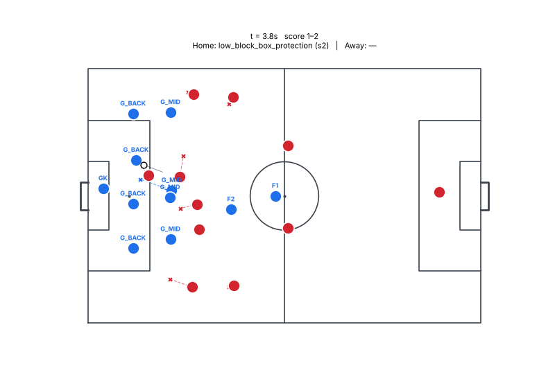

<details><summary>Play definition (YAML)</summary>

```yaml
id: gen_336193263d
name: Generated play
version: 1
phase: in_possession
objective: score
strategy: generated
fallback: false
roles:
- id: R1
  desc: ''
  hints:
  - AM
  - CM
  - ST
  requires:
    finishing: 0.4
  prefers: {}
  starts_with_ball: true
- id: R2
  desc: ''
  hints:
  - ST
  - AM
  - CM
  requires: {}
  prefers: {}
  starts_with_ball: false
triggers:
  all:
  - possession: us
  - has_ball: R1
hard_constraints: []
steps:
- id: s1
  choose:
  - when:
      xg:
        ref: role:R1
        gt: 0.06
    actions:
    - type: shoot
      role: R1
      placement: auto
  - when: always
    actions:
    - type: carry
      role: R1
      to:
        pc_best:
          zone: final_third.center
        score: pc_xt
      speed: fast
    - type: support
      role: R2
      from: R1
      angle: square
      distance: 8.0
  done_when:
    any:
    - event: shot_taken
    - step_elapsed_s:
        gt: 2.0
  timeout_s: 2.5
  on_timeout: abort
- id: s2
  choose:
  - when: always
    actions:
    - type: shoot
      role: R1
      placement: auto
  - when:
      lane_open:
        from: R1
        to:
          role: R2
        min_p: 0.6
    actions:
    - type: pass
      role: R1
      to:
        role: R2
      style: ground
  - when: always
    actions:
    - type: pass
      role: R1
      to:
        best_teammate:
          score: pass_p
      style: ground
  done_when:
    any:
    - event: shot_taken
    - event: pass_completed
    - event: pass_intercepted
  timeout_s: 3.0
  on_timeout: abort
success:
  any:
  - event: shot_taken
  - event: goal
abort:
  any:
  - event: possession_lost
  - event: ball_out
max_duration_s: 7.5
cooldown_s: 0.0
soft_hints:
  risk: 0.3
  chain_depth: 2
  tempo: fast
source: generated
```

</details>

## gen_a59310d114

Called by **league_exploiter** against **main_exploiter** (running `low_block_box_protection`); steps reached: s1; ended: success; reward +0.0559.

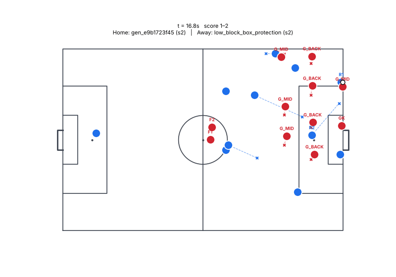

<details><summary>Play definition (YAML)</summary>

```yaml
id: gen_a59310d114
name: Generated play
version: 1
phase: in_possession
objective: progress_ball
strategy: generated
fallback: false
roles:
- id: R1
  desc: ''
  hints:
  - FB_near
  - W_near
  - CM
  requires: {}
  prefers: {}
  starts_with_ball: true
- id: R2
  desc: ''
  hints:
  - DM
  - CB_near
  - CM
  requires:
    passing: 0.55
  prefers: {}
  starts_with_ball: false
- id: R3
  desc: ''
  hints:
  - W_far
  - FB_far
  requires:
    first_touch: 0.4
  prefers: {}
  starts_with_ball: false
- id: R4
  desc: ''
  hints:
  - FB_far
  - CM
  requires: {}
  prefers: {}
  starts_with_ball: false
triggers:
  all:
  - possession: us
  - has_ball: R1
hard_constraints: []
steps:
- id: s1
  choose:
  - when:
      lane_open:
        from: R1
        to:
          role: R3
          lead: 3.0
        min_p: 0.55
    actions:
    - type: hold_width
      role: R3
      lane: far_wing
    - type: pass
      role: R1
      to:
        role: R3
        lead: 3.0
      style: lofted
  - when:
      lane_open:
        from: R1
        to:
          role: R2
        min_p: 0.7
    actions:
    - type: hold_width
      role: R3
      lane: far_wing
    - type: support
      role: R2
      from: R1
      angle: back_inside
      distance: 14.0
    - type: pass
      role: R1
      to:
        role: R2
      style: ground
  - when: always
    actions:
    - type: pass
      role: R1
      to:
        best_teammate:
          score: pass_p
      style: ground
  done_when:
    any:
    - has_ball: R2
    - has_ball: R3
    - event: pass_completed
  timeout_s: 3.0
  on_timeout: abort
- id: s2
  choose:
  - when:
      has_ball: R3
    actions:
    - type: carry
      role: R3
      to:
        pc_best:
          zone: final_third.far_wing
        score: pc_xt
      speed: fast
    - type: overlap
      role: R4
      around: R3
  - when:
      all:
      - has_ball: R2
      - lane_open:
          from: R2
          to:
            role: R3
            lead: 3.0
          min_p: 0.55
    actions:
    - type: pass
      role: R2
      to:
        role: R3
        lead: 3.0
      style: lofted
  - when: always
    actions:
    - type: carry
      actor: ball_holder
      to:
        pc_best:
          zone: mid_opp.*
        score: pc_xt
      speed: fast
  done_when:
    any:
    - ball_in_zone: final_third.*
    - event: pass_completed
    - step_elapsed_s:
        gt: 2.0
  timeout_s: 3.0
  on_timeout: abort
success:
  has_ball: R3
abort:
  any:
  - event: possession_lost
  - event: ball_out
max_duration_s: 8.0
cooldown_s: 0.0
soft_hints:
  risk: 0.3
  chain_depth: 2
  tempo: medium
source: generated
```

</details>

## gen_99ffa4b017

Called by **league_exploiter** against **chaotic** (running `low_block_box_protection`); steps reached: s1; ended: success; reward +0.0349.

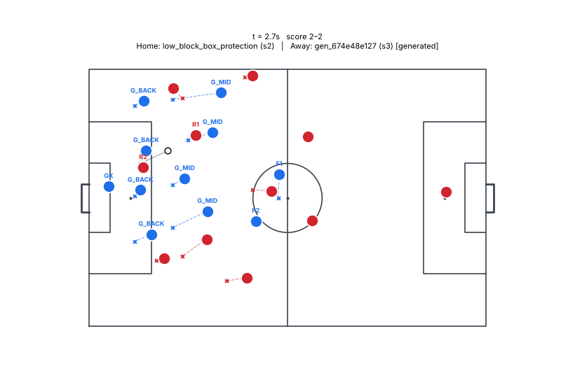

<details><summary>Play definition (YAML)</summary>

```yaml
id: gen_99ffa4b017
name: Generated play
version: 1
phase: in_possession
objective: create_chance
strategy: generated
fallback: false
roles:
- id: R1
  desc: ''
  hints:
  - ST
  - AM
  - DM
  requires:
    finishing: 0.4
  prefers: {}
  starts_with_ball: true
- id: R2
  desc: ''
  hints:
  - ST
  - AM
  - CM
  requires:
    first_touch: 0.4
  prefers: {}
  starts_with_ball: false
triggers:
  all:
  - possession: us
  - has_ball: R1
hard_constraints: []
steps:
- id: s1
  choose:
  - when:
      lane_open:
        from: R1
        to:
          role: R2
        min_p: 0.7
    actions:
    - type: pass
      role: R1
      to:
        role: R2
      style: ground
  - when: always
    actions:
    - type: dribble
      role: R1
      to:
        pc_best:
          zone: final_third.*
        score: pc_xt
  done_when:
    any:
    - event: pass_completed
    - event: pass_intercepted
    - step_elapsed_s:
        gt: 1.5
  timeout_s: 2.0
  on_timeout: abort
- id: s2
  choose:
  - when:
      has_ball: R2
    actions:
    - type: run_to
      role: R1
      to:
        anchor: role:R1
        offset:
        - 14.0
        - 0.0
        freeze: step_start
      speed: max
    - type: pass
      role: R2
      to:
        role: R1
        lead: 3.0
      style: ground
      one_touch: true
  - when: always
    actions:
    - type: carry
      actor: ball_holder
      to:
        pc_best:
          zone: final_third.*
        score: pc_xt
      speed: fast
  done_when:
    any:
    - has_ball: R1
    - event: pass_completed
    - step_elapsed_s:
        gt: 2.0
  timeout_s: 2.5
  on_timeout: abort
- id: s3
  choose:
  - when:
      xg:
        ref: ball_holder
        gt: 0.08
    actions:
    - type: shoot
      actor: ball_holder
      placement: auto
  - when: always
    actions:
    - type: pass
      actor: ball_holder
      to:
        best_teammate:
          score: xt
          zone: box
      style: ground
  done_when:
    any:
    - event: shot_taken
    - event: pass_completed
  timeout_s: 2.0
  on_timeout: abort
success:
  event: shot_taken
abort:
  event: possession_lost
max_duration_s: 8.5
cooldown_s: 0.0
soft_hints:
  risk: 0.4
  chain_depth: 3
  tempo: medium
source: generated
```

</details>

## gen_674e48e127

Called by **league_exploiter** against **chaotic** (running `low_block_box_protection`, `mid_block_compact`); steps reached: s1 → s2 → s3; ended: completed; reward +0.0253.

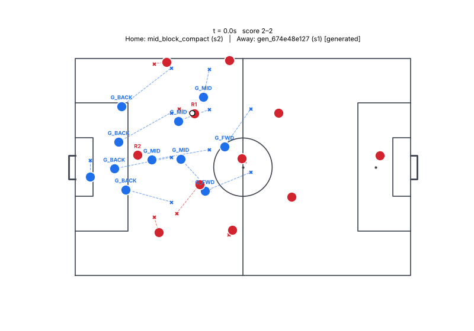

<details><summary>Play definition (YAML)</summary>

```yaml
id: gen_674e48e127
name: Generated play
version: 1
phase: in_possession
objective: create_chance
strategy: generated
fallback: false
roles:
- id: R1
  desc: ''
  hints:
  - AM
  - W_near
  - CM
  requires:
    passing: 0.4
  prefers: {}
  starts_with_ball: true
- id: R2
  desc: ''
  hints:
  - ST
  - AM
  - CM
  requires:
    first_touch: 0.5
  prefers: {}
  starts_with_ball: false
triggers:
  all:
  - possession: us
  - has_ball: R1
hard_constraints: []
steps:
- id: s1
  choose:
  - when:
      lane_open:
        from: R1
        to:
          role: R1
          lead: 3.0
        min_p: 0.7
    actions:
    - type: pass
      role: R1
      to:
        role: R1
        lead: 3.0
      style: ground
  - when: always
    actions:
    - type: dribble
      role: R1
      to:
        pc_best:
          zone: final_third.*
        score: pc_xt
  done_when:
    any:
    - event: pass_completed
    - event: pass_intercepted
    - step_elapsed_s:
        gt: 1.5
  timeout_s: 2.0
  on_timeout: abort
- id: s2
  choose:
  - when:
      has_ball: R2
    actions:
    - type: run_to
      role: R1
      to:
        anchor: role:R1
        offset:
        - 8.0
        - 0.0
        freeze: step_start
      speed: max
    - type: pass
      role: R2
      to:
        role: R1
        lead: 3.0
      style: ground
      one_touch: true
  - when: always
    actions:
    - type: carry
      actor: ball_holder
      to:
        pc_best:
          zone: final_third.*
        score: pc_xt
      speed: fast
  done_when:
    any:
    - has_ball: R1
    - event: pass_completed
    - step_elapsed_s:
        gt: 2.0
  timeout_s: 2.5
  on_timeout: abort
- id: s3
  choose:
  - when:
      xg:
        ref: ball_holder
        gt: 0.08
    actions:
    - type: shoot
      actor: ball_holder
      placement: auto
  - when: always
    actions:
    - type: pass
      actor: ball_holder
      to:
        best_teammate:
          score: xt
          zone: box
      style: ground
  done_when:
    any:
    - event: shot_taken
    - event: pass_completed
  timeout_s: 2.0
  on_timeout: abort
success:
  event: shot_taken
abort:
  event: possession_lost
max_duration_s: 8.5
cooldown_s: 0.0
soft_hints:
  risk: 0.3
  chain_depth: 3
  tempo: fast
source: generated
```

</details>

## gen_250c0c44e2

Called by **main** against **high_press** (running `low_block_box_protection`, `mid_block_compact`); steps reached: s1; ended: possession change; reward +0.0089.

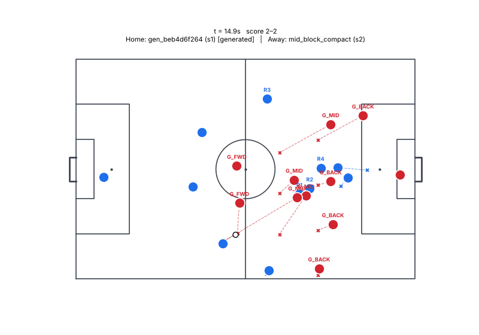

<details><summary>Play definition (YAML)</summary>

```yaml
id: gen_250c0c44e2
name: Generated play
version: 1
phase: in_possession
objective: score
strategy: generated
fallback: false
roles:
- id: R1
  desc: ''
  hints:
  - FB_near
  - W_near
  - CM
  requires: {}
  prefers: {}
  starts_with_ball: true
- id: R2
  desc: ''
  hints:
  - DM
  - CB_near
  - CM
  requires:
    passing: 0.55
  prefers: {}
  starts_with_ball: false
- id: R3
  desc: ''
  hints:
  - FB_far
  - CM
  requires:
    first_touch: 0.4
  prefers: {}
  starts_with_ball: false
- id: R4
  desc: ''
  hints:
  - FB_far
  - CM
  requires: {}
  prefers: {}
  starts_with_ball: false
triggers:
  all:
  - possession: us
  - has_ball: R1
hard_constraints: []
steps:
- id: s1
  choose:
  - when:
      has_ball: R3
    actions:
    - type: overlap
      role: R4
      around: R1
    - type: carry
      role: R1
      to:
        pc_best:
          zone: final_third.*
        score: pc_xt
      speed: fast
  - when: always
    actions:
    - type: pass
      role: R1
      to:
        pc_best:
          zone: final_third.*
        score: pc_xt
      style: ground
  done_when:
    any:
    - has_ball: R4
    - has_ball: R4
    - has_ball: R3
  timeout_s: 3.0
  on_timeout: abort
success:
  has_ball: R4
abort:
  has_ball: R4
max_duration_s: 5.0
cooldown_s: 0.0
soft_hints:
  risk: 0.3
  chain_depth: 1
  tempo: medium
source: generated
```

</details>

## gen_8706264fbc

Called by **main** against **wing_play** (running `mid_block_compact`); steps reached: s1; ended: success; reward +0.0084.

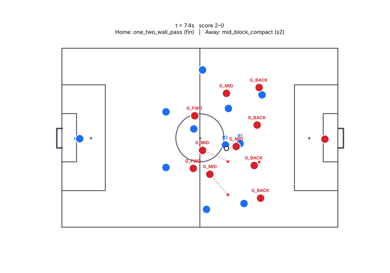

<details><summary>Play definition (YAML)</summary>

```yaml
id: gen_8706264fbc
name: Generated play
version: 1
phase: in_possession
objective: retain_possession
strategy: generated
fallback: false
roles:
- id: R1
  desc: ''
  hints:
  - CB_near
  - CB_far
  - DM
  requires: {}
  prefers: {}
  starts_with_ball: true
triggers:
  all:
  - possession: us
  - has_ball: R1
hard_constraints: []
steps:
- id: s1
  choose:
  - when:
      pressure_on:
        ref: role:R1
        gt: 4.0
    actions:
    - type: carry
      role: R1
      to:
        anchor: ball
        offset:
        - 2.0
        - 0.0
      speed: jog
  - when: always
    actions:
    - type: pass
      role: R1
      to:
        best_teammate:
          score: pass_p
      style: ground
  done_when:
    any:
    - event: pass_completed
    - step_elapsed_s:
        gt: 2.0
  timeout_s: 3.0
  on_timeout: abort
success:
  event: pass_completed
abort:
  event: possession_lost
max_duration_s: 5.0
cooldown_s: 0.0
soft_hints:
  risk: 0.1
  chain_depth: 1
  tempo: slow
source: generated
```

</details>

## gen_5dcb336c76

Called by **main** against **wing_play** (running `low_block_box_protection`); steps reached: s1; ended: possession change; reward +0.0080.

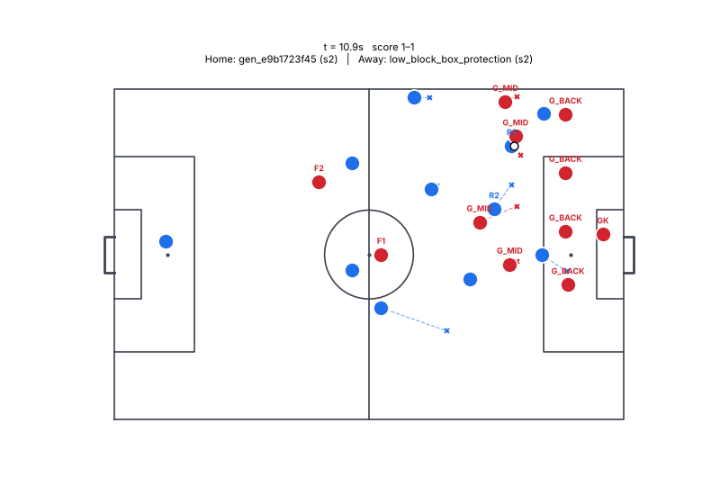

<details><summary>Play definition (YAML)</summary>

```yaml
id: gen_5dcb336c76
name: Generated play
version: 1
phase: in_possession
objective: score
strategy: generated
fallback: false
roles:
- id: R1
  desc: ''
  hints:
  - AM
  - CM
  - ST
  requires:
    finishing: 0.4
  prefers: {}
  starts_with_ball: true
- id: R2
  desc: ''
  hints:
  - FB_far
  - AM
  - CM
  requires: {}
  prefers: {}
  starts_with_ball: false
triggers:
  all:
  - possession: us
  - has_ball: R1
hard_constraints: []
steps:
- id: s1
  choose:
  - when:
      xg:
        ref: role:R1
        gt: 0.06
    actions:
    - type: shoot
      role: R1
      placement: auto
  - when: always
    actions:
    - type: carry
      role: R1
      to:
        pc_best:
          zone: final_third.center
        score: pc_xt
      speed: fast
    - type: support
      role: R2
      from: R1
      angle: square
      distance: 8.0
  done_when:
    any:
    - event: shot_taken
    - step_elapsed_s:
        gt: 2.0
  timeout_s: 2.5
  on_timeout: abort
- id: s2
  choose:
  - when:
      pressure_on:
        ref: role:R2
        gt: 3.0
    actions:
    - type: pass
      role: R2
      to:
        role: R2
      style: ground
  - when:
      xg:
        ref: ball_holder
        gt: 0.12
    actions:
    - type: pass
      actor: ball_holder
      to:
        zone: near_post_area
      style: driven
  - when: always
    actions:
    - type: carry
      actor: ball_holder
      to:
        zone: near_post_area
      speed: fast
    - type: pass
      actor: ball_holder
      to:
        zone: near_post_area
      style: ground
  done_when:
    any:
    - event: pass_intercepted
  timeout_s: 2.5
  on_timeout: abort
- id: s3
  choose:
  - when:
      xg:
        ref: ball_holder
        gt: 0.12
    actions:
    - type: pass
      actor: ball_holder
      to:
        best_teammate:
          score: xt
          zone: box
      style: through
  - when: always
    actions:
    - type: pass
      actor: ball_holder
      to:
        zone: near_post_area
      style: ground
  done_when:
    any:
    - event: shot_taken
    - ball_in_zone: box
  timeout_s: 2.5
  on_timeout: abort
- id: s4
  choose:
  - when:
      xg:
        ref: ball_holder
        gt: 0.1
    actions:
    - type: pass
      actor: ball_holder
      to:
        zone: zone14
      style: lofted
  - when:
      xg:
        ref: ball_holder
        gt: 0.04
    actions:
    - type: carry
      actor: ball_holder
      to:
        zone: zone14
      speed: fast
    - type: pass
      actor: ball_holder
      to:
        best_teammate:
          score: xt
          zone: box
      style: through
  - when: always
    actions:
    - type: pass
      actor: ball_holder
      to:
        best_teammate:
          score: xt
          zone: box
      style: through
  done_when:
    any:
    - event: ball_out
  timeout_s: 2.5
  on_timeout: abort
success:
  event: shot_taken
abort:
  event: ball_out
max_duration_s: 12.0
cooldown_s: 0.0
soft_hints:
  risk: 0.3
  chain_depth: 4
  tempo: fast
source: generated
```

</details>

## gen_aaed078c77

Called by **main** against **mid_block** (running `low_block_box_protection`); steps reached: s1; ended: possession change; reward +0.0077.

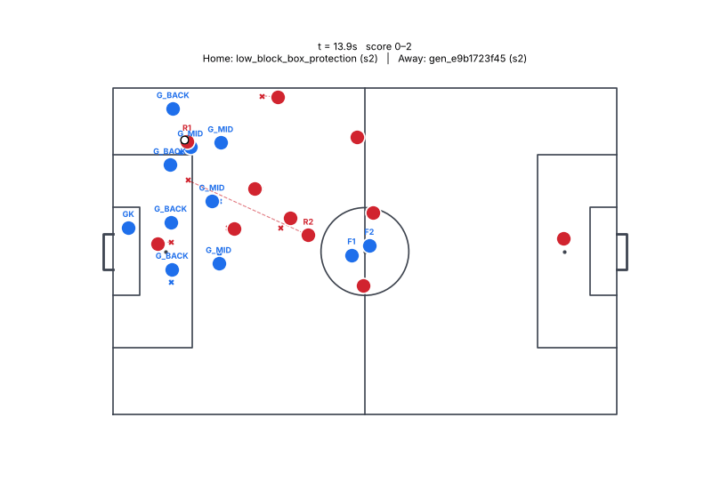

<details><summary>Play definition (YAML)</summary>

```yaml
id: gen_aaed078c77
name: Generated play
version: 1
phase: in_possession
objective: score
strategy: generated
fallback: false
roles:
- id: R1
  desc: ''
  hints:
  - AM
  - CM
  - ST
  requires:
    finishing: 0.4
  prefers: {}
  starts_with_ball: true
- id: R2
  desc: ''
  hints:
  - ST
  - AM
  - CM
  requires: {}
  prefers: {}
  starts_with_ball: false
triggers:
  all:
  - possession: us
  - has_ball: R1
hard_constraints: []
steps:
- id: s1
  choose:
  - when:
      xg:
        ref: role:R1
        gt: 0.06
    actions:
    - type: shoot
      role: R1
      placement: auto
  - when: always
    actions:
    - type: carry
      role: R1
      to:
        pc_best:
          zone: final_third.center
        score: pc_xt
      speed: fast
    - type: support
      role: R2
      from: R1
      angle: square
      distance: 8.0
  done_when:
    any:
    - event: shot_taken
    - step_elapsed_s:
        gt: 2.0
  timeout_s: 2.5
  on_timeout: abort
- id: s2
  choose:
  - when:
      pressure_on:
        ref: role:R1
        gt: 3.0
    actions:
    - type: pass
      role: R1
      to:
        role: R1
        lead: 2.0
      style: lofted
  - when: always
    actions:
    - type: carry
      role: R1
      to:
        pc_best:
          zone: final_third.*
        score: pc_xt
      speed: fast
    - type: pass
      role: R1
      to:
        zone: near_post_area
      style: through
  done_when:
    any:
    - event: pass_completed
    - event: shot_taken
    - ball_in_zone: box
  timeout_s: 2.5
  on_timeout: abort
- id: s3
  choose:
  - when:
      xg:
        ref: ball_holder
        gt: 0.06
    actions:
    - type: pass
      actor: ball_holder
      to:
        best_teammate:
          score: xt
          zone: box
      style: through
  - when: always
    actions:
    - type: pass
      actor: ball_holder
      to:
        best_teammate:
          score: xt
          zone: box
      style: ground
  done_when:
    any:
    - event: shot_taken
    - event: pass_intercepted
  timeout_s: 2.5
  on_timeout: abort
success:
  event: shot_taken
abort:
  event: ball_out
max_duration_s: 9.5
cooldown_s: 0.0
soft_hints:
  risk: 0.3
  chain_depth: 3
  tempo: fast
source: generated
```

</details>
